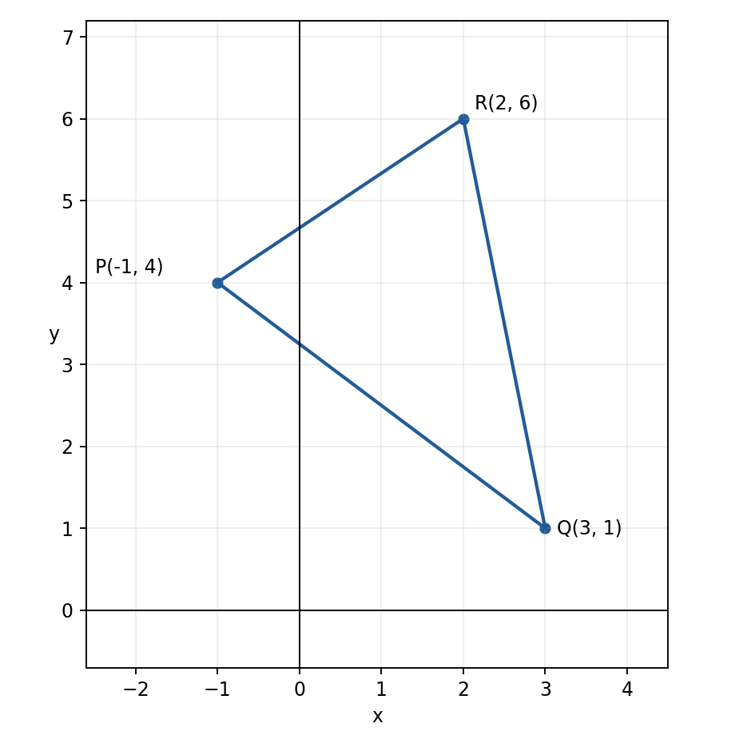

# 7주차 예상문제 — 선형방정식의 해법과 응용

- 작성일: 2026-10-20. **총 11문항(W07-01~W07-11)**이며 관련 소문항을 묶었다.
- [답과 풀이](답과풀이.md)는 별도 파일이다. 풀이를 보낼 때 이 파일의 번호를 사용한다.
- 교수님이 안내한 유형과 별표 내용을 바탕으로 구성한 예상문제다. 실제 시험 문항을 확정한 것은 아니다.
- **실습 5와 C 프로그래밍은 제외한다.** 실습 5 제외는 직접 지정한 예제 4-8·4-10의 LU 수학 문제까지 제외한다는 뜻으로 해석하지 않는다.
- 예제 4-3은 계수·상수항을 바꾼 빈칸형이다. 예제 4-15는 원문의 꼭짓점·넓이 질문을 유지하고 그림을 다시 그렸다.
- 공통 조건: 실수 범위. 수학의 행 번호는 1부터, Python 인덱스는 0부터 시작한다. `Fraction`은 이미 불러왔다고 가정한다.
- 모든 문항은 아직 답변 전이다. “모르겠어”도 오답으로 기록하고 해설 후 재풀이한다.

## 범위와 번호

| 교수님 안내·별표 | 번호 |
| --- | --- |
| 방정식 연산과 첨가행렬 행 연산, 해의 보존 | W07-01 |
| 예제 4-3 숫자 변경·빈칸형 | W07-02 |
| 실습 1 첨가행렬 출력 함수 | W07-03 |
| 실습 2 후진 대입 코드 | W07-04 |
| 예제 4-7 | W07-05 |
| 예제 4-8 | W07-06 |
| 예제 4-10 | W07-07 |
| 산업 간 관계, 표에서 연립방정식·행렬로 표현 | W07-08 |
| 가로 성분 부호 변경과 y축 대칭 | W07-09 |
| 예제 4-13, 정사각형 네 꼭짓점 변환, 실습 6 각도 변환 | W07-10 |
| 예제 4-15 원문 수치 | W07-11 |

## W07-01 · 행 연산과 해의 보존 — T/F

각 명제에 T/F로 답하고 F이면 고치시오.

1. 방정식 두 개의 순서를 바꾸는 것은 첨가행렬의 두 행을 교환하는 것에 대응하며, 연립방정식의 해집합은 변하지 않는다.
2. 한 방정식의 양변을 **0이 아닌 상수**로 곱하거나, 다른 방정식의 배수를 더해 한 방정식을 바꾸면 해집합이 보존된다.
3. 첨가행렬에서 한 행의 계수 부분에만 2를 곱하고 오른쪽 상수항은 그대로 두어도 해집합이 항상 보존된다.
4. 한 방정식에 0을 곱해 0=0으로 바꾸는 것도 언제나 해집합을 보존하는 기본 행 연산이다.

출처: PDF·PPTX 7쪽/슬라이드, 정리 4-1 및 별표 문장.

## W07-02 · 예제 4-3 — 숫자를 바꾼 빈칸 문제

다음 연립방정식을 첨가행렬로 나타내어 푼다.

$$\begin{cases}
-x_2-x_3+x_4=2\\
x_1+x_2+x_3+x_4=5\\
3x_1+4x_2+x_3-2x_4=4\\
2x_1+x_2-2x_3+2x_4=12
\end{cases}$$

초기 첨가행렬은

$$M=\left(\begin{array}{rrrr|r}
0&-1&-1&1&2\\1&1&1&1&5\\3&4&1&-2&4\\2&1&-2&2&12
\end{array}\right).$$

다음 행 연산을 순서대로 적용한다. **빈칸 ①~⑭에 들어갈 수**를 쓰시오. 각 단계의 Rᵢ는 그 단계에 들어올 때의 행이다.

먼저 R₁↔R₂를 시행하면

$$\left(\begin{array}{rrrr|r}
1&1&1&1&5\\0&-1&-1&1&2\\3&4&1&-2&4\\2&1&-2&2&12
\end{array}\right).$$

R₃←R₃−3R₁, R₄←R₄−2R₁:

$$\left(\begin{array}{rrrr|r}
1&1&1&1&5\\0&-1&-1&1&2\\0&\boxed{①}&-2&-5&\boxed{②}\\0&-1&\boxed{③}&0&\boxed{④}
\end{array}\right).$$

R₃←R₃+R₂, R₄←R₄−R₂:

$$\left(\begin{array}{rrrr|r}
1&1&1&1&5\\0&-1&-1&1&2\\0&0&\boxed{⑤}&-4&\boxed{⑥}\\0&0&-3&\boxed{⑦}&\boxed{⑧}
\end{array}\right).$$

R₄←R₄−R₃:

$$\left(\begin{array}{rrrr|r}
1&1&1&1&5\\0&-1&-1&1&2\\0&0&-3&-4&-9\\0&0&0&\boxed{⑨}&\boxed{⑩}
\end{array}\right).$$

이어 R₄←R₄/3, R₃←−(R₃+4R₄)/3, R₂←−(R₂+R₃−R₄), R₁←R₁−R₂−R₃−R₄를 **이 순서대로** 적용하면

$$\left(\begin{array}{rrrr|r}
1&0&0&0&\boxed{⑪}\\0&1&0&0&\boxed{⑫}\\0&0&1&0&\boxed{⑬}\\0&0&0&1&\boxed{⑭}
\end{array}\right).$$

출처: PDF·PPTX 8~10쪽 예제 4-3과 실습 1. 원문의 4미지수 소거 유형을 유지하고 계수·상수항·행 연산 배수를 변경했다.

## W07-03 · 실습 1 — 첨가행렬 출력 코드

각 행의 **마지막 성분은 상수항**, 그 앞의 성분들은 계수다. 아래 함수의 빈칸 ①~③을 채우시오. 출력 문자열은 각 값을 폭 6칸으로 오른쪽 정렬한다.

```python
def print_matrix(M):
    """첨가행렬 출력"""
    for row in M:
        coefficients = " ".join(f"{str(v):>6}" for v in ________)  # ①
        print(f"[{________} | {str(________):>6}]")               # ②, ③
    print()
```

추가로 다음에 답하시오.

1. `join` 앞의 `" "`는 어떤 역할을 하는가?
2. `:>6`과 함수 마지막의 `print()`는 각각 어떤 역할을 하는가?
3. `M = [[1, -2, 1, 0], [0, 1, -4, 4]]`를 출력할 때 `|`의 왼쪽과 오른쪽에 어떤 값들이 놓이는지 두 행으로 쓰시오. 공백 개수는 맞추지 않아도 된다.

출처: PDF·PPTX 11쪽, `01_gauss_jordan_elimination.ipynb`의 사용자 지정 함수. 소거 알고리즘 전체 재작성은 요구하지 않는다.

## W07-04 · 실습 2 — 후진 대입

가우스 소거로 얻은 첨가행렬이 다음과 같이 준비되어 있다. 모든 원소는 `Fraction`이며 대각 성분은 0이 아니다.

```python
M = [
    [Fraction(1), Fraction(-2), Fraction(1), Fraction(0)],
    [Fraction(0), Fraction(1), Fraction(-4), Fraction(4)],
    [Fraction(0), Fraction(0), Fraction(1), Fraction(3)]
]
```

아래 **빈칸 ①~⑥**을 채우시오. 숫자로 해를 직접 넣지 말고 M과 x를 사용한다.

```python
n = 3
x = [________ for _ in range(n)]                         # ①

print("5. 후진 대입")
for i in range(________):                                # ②
    known = sum(M[i][j] * x[j] for j in range(________))  # ③
    x[i] = (________ - known) / ________                 # ④, ⑤
    print(f"x{i + 1} = {x[i]}")

print("\n최종 결과")
for i, value in enumerate(x, ________):                   # ⑥
    print(f"x{i} = {value}")
```

1. 후진 대입 반복문 안에서 출력되는 x₃,x₂,x₁의 값과 순서를 쓰시오.
2. 마지막 `최종 결과` 아래 출력되는 세 줄을 쓰시오.
3. `known`이 뜻하는 값을 설명하시오.

출처: PDF·PPTX 12~14쪽, `02_gaussian_elimination_back_substitution.ipynb`. 원문 소거 결과와 코드 구조를 사용한다.

## W07-05 · 예제 4-7 — 같은 계수행렬의 두 시스템

다음 두 시스템을 **하나의 확대 첨가행렬**로 동시에 푸시오.

$$\text{(1)}\quad\begin{cases}x_1+2x_2=2\\3x_1+7x_2=8\end{cases},\qquad
\text{(2)}\quad\begin{cases}x_1+2x_2=1\\3x_1+7x_2=7\end{cases}.$$

1. 공통 계수행렬의 오른쪽에 두 상수벡터를 순서대로 붙인 [A | b⁽¹⁾ | b⁽²⁾]를 쓰시오.
2. R₂←R₂−3R₁, R₁←R₁−2R₂를 순서대로 적용한 최종 첨가행렬을 구하시오.
3. 시스템 (1), (2)의 해를 각각 쓰시오.

출처: PDF·PPTX 18~19쪽 예제 4-7 및 실습 3. 두 시스템의 우변을 서로 섞지 않는다.

## W07-06 · 예제 4-8 — LU 분해

$$A=\begin{pmatrix}1&2&1\\2&3&3\\-3&-10&2\end{pmatrix}.$$

1. R₂←R₂−2R₁, R₃←R₃+3R₁, R₃←R₃−4R₂를 순서대로 적용하여 상부삼각행렬 U를 구하시오.
2. **주대각선 성분이 모두 1인** 하부삼각행렬 L을 구하여 A=LU로 나타내시오.
3. LU를 직접 곱하여 A와 일치하는지 확인하시오.

출처: PDF·PPTX 20쪽 예제 4-8. 실습 5 코드는 출제하지 않고, 직접 지정된 LU 수학 예제를 다룬다.

## W07-07 · 예제 4-10 — LU로 4미지수 시스템 풀기

다음 시스템을 LU 분해를 이용하여 푸시오.

$$\begin{cases}
6x_1-2x_2-4x_3+4x_4=2\\
3x_1-3x_2-6x_3+x_4=-4\\
-12x_1+8x_2+21x_3-8x_4=8\\
-6x_1-10x_3+7x_4=-43
\end{cases}$$

계수행렬 A의 분해는 다음과 같이 **주어진다**.

$$A=LU,\qquad
L=\begin{pmatrix}2&0&0&0\\1&-1&0&0\\-4&2&1&0\\-2&-1&-2&2\end{pmatrix},\quad
U=\begin{pmatrix}3&-1&-2&2\\0&2&4&1\\0&0&5&-2\\0&0&0&4\end{pmatrix}.$$

1. b를 쓰고, Ux=y로 놓았을 때 먼저 풀어야 하는 y의 방정식을 쓰시오.
2. y₁,y₂,y₃,y₄를 구하시오.
3. 후진 대입으로 x₁,x₂,x₃,x₄를 구하시오. 분수 또는 정확한 유한소수로 답해도 된다.

출처: PDF·PPTX 25쪽 예제 4-10 원문 수치. 이 예제의 L은 주대각선이 모두 1인 형태가 아니므로 주어진 분해를 그대로 사용한다.

## W07-08 · 산업 간 관계 — 표에서 연립방정식과 행렬로

철강의 총생산량을 x₁, 자동차의 총생산량을 x₂라 하자. 각 산업이 생산량 **1단위**를 만드는 데 필요한 투입량은 다음 표와 같다. 투입 비율은 일정하며, 외부 수요는 철강 50, 자동차 70이다.

| 필요한 투입 | 철강 1단위 생산 | 자동차 1단위 생산 |
| --- | ---: | ---: |
| 철강 | 0.2 | 0.3 |
| 자동차 | 0.1 | 0.2 |

1. “총생산 = 산업 내부 수요 + 외부 수요”에 따라 연립방정식 두 개를 쓰시오.
2. x=(x₁,x₂)ᵀ, 외부 수요 d=(50,70)ᵀ로 놓는다. 표를 나타내는 투입계수행렬 T를 쓰고, x=Tx+d를 **Bx=d** 꼴로 정리하여 B를 쓰시오.
3. 필요한 총생산량 x₁,x₂를 구하시오.
4. 자동차 산업에서 필요로 하는 철강의 양은 `0.3x₁`인가, `0.3x₂`인가? 이유를 쓰시오.

출처: PDF·PPTX 28~30쪽의 산업 관계 표와 별표 설명. 행은 투입 자원의 종류, 열은 생산하는 산업을 뜻한다.

## W07-09 · 가로 성분만 부호가 바뀌는 변환

$$S=\begin{pmatrix}-1&0\\0&1\end{pmatrix},\qquad p=\begin{pmatrix}x\\y\end{pmatrix}.$$

1. Sp를 계산하고, 어떤 축에 대한 대칭인지 설명하시오.
2. p=(3,2)ᵀ의 변환 결과를 구하시오.
3. “가로 성분 x의 부호가 바뀌므로 x축 대칭이다.”를 T/F로 판단하고, F이면 고치시오.

출처: PDF·PPTX 31쪽 예제 4-12와 별표 문장. 축의 이름과 부호가 바뀌는 성분을 구별한다.

## W07-10 · 예제 4-13·실습 6 — 정사각형의 시계 방향 회전

다음 행렬은 원점을 중심으로 **시계 방향** θ만큼 회전시킨다.

$$R(\theta)=\begin{pmatrix}\cos\theta&\sin\theta\\-\sin\theta&\cos\theta\end{pmatrix}.$$

정사각형의 꼭짓점은 P₁=(1,1), P₂=(1,2), P₃=(2,2), P₄=(2,1)이다. θ=60°로 놓는다.

1. R(60°)를 쓰시오. 정확한 근호 또는 소수로 답할 수 있다.
2. **네 꼭짓점을 각각 변환**하여 P₁′,P₂′,P₃′,P₄′를 구하시오. 근호식 또는 소수점 아래 네 자리까지 답하시오.
3. `np`와 `theta_deg = 60`이 준비되어 있다. 도 단위 각도를 라디안으로 바꾸는 한 줄을 완성하고, `theta`의 값을 π로 나타내시오.

```python
theta = ____________________
```

4. 꼭짓점을 각 열에 모은 2×4 배열 P에 대해 변환 결과 Q를 구하는 행렬 곱을 쓰고, Q의 크기를 쓰시오. 코드에서 회전행렬 변수는 `R`이다.

출처: PDF·PPTX 32~34쪽 예제 4-13, `06_clockwise_rotation.ipynb`. 그래프 전체 작성 코드는 요구하지 않는다.

## W07-11 · 예제 4-15 — 원문과 같은 문제

세 꼭짓점이 (x₁,y₁), (x₂,y₂), (x₃,y₃)인 삼각형의 넓이는

$$\frac12\left|\det\begin{pmatrix}x_1&y_1&1\\x_2&y_2&1\\x_3&y_3&1\end{pmatrix}\right|$$

이다. 이 식을 이용하여 아래 삼각형의 넓이를 구하시오.

**P=(-1,4), Q=(3,1), R=(2,6)**이며 원문의 꼭짓점과 같다.



그림이 보이지 않으면 [그림 PNG 파일](예상문제_그림/예제4-15_삼각형.png)을 열어 확인할 수 있다. 행렬식 계산 과정을 함께 쓰시오.

출처: PDF·PPTX 36~37쪽 예제 4-15. 꼭짓점·넓이 계산 요구는 유지했고 그래프는 같은 좌표로 다시 그렸다. 넓이는 행렬식의 절댓값의 절반이다.

## 풀이 기록

파일 생성과 답안 제공은 사용자의 풀이 완료가 아니다.

| 번호 | 첫 답변 | 결과 | 재풀이 |
| --- | --- | --- | --- |
| W07-01 | | 답변 전 | |
| W07-02 | | 답변 전 | |
| W07-03 | | 답변 전 | |
| W07-04 | | 답변 전 | |
| W07-05 | | 답변 전 | |
| W07-06 | | 답변 전 | |
| W07-07 | | 답변 전 | |
| W07-08 | | 답변 전 | |
| W07-09 | | 답변 전 | |
| W07-10 | | 답변 전 | |
| W07-11 | | 답변 전 | |
