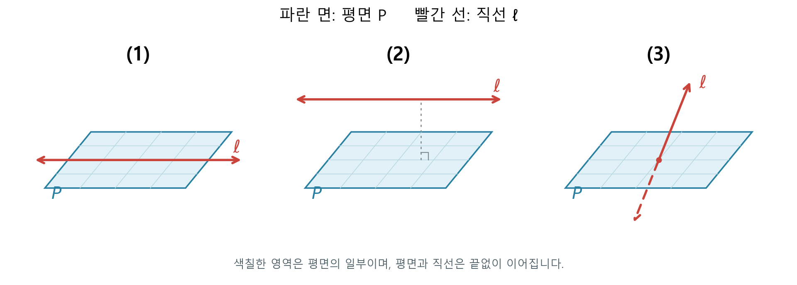

# 선형대수학1 중간고사 문제 기록

출제한 문제와 실제 풀이 시도를 누적한다. 기존 대화형 LA 문제는 서로 다른 80문제를 출제했으며 채점된 최초 풀이 완료는 78문제다. LA-043·LA-078은 해설 제공 후 진행 2문제로 별도 기록하며 정오답에 포함하지 않는다. LA-078은 이해·독립 작성 미확인이다. 최초 정답 54문제 중 LA-007·LA-009·LA-019·LA-020·LA-026·LA-035·LA-046·LA-047·LA-051·LA-052·LA-056·LA-058·LA-060·LA-069·LA-073은 힌트 후 정답이다. LA-021은 풀이 근거 오류, LA-022는 반례 조건 보충, LA-023·LA-024·LA-025는 용어 보충, LA-027은 성분별 증명 보충, LA-041은 행렬 곱 순서에 관한 표현 보충을 기록했다. 최초 오답은 24문제다. 추가 코드 작성 LA-075·LA-076·LA-077·LA-080은 오답 기록을 보존하되 최신 중복 금지 지시에 따라 재풀이 생략. 코드 작성 총 6개로 축소. 4주차 LA-059(힌트 후 오답)·LA-063·LA-064(힌트 후 오답)·LA-065·LA-066·LA-067·LA-068·LA-071·LA-072·LA-074는 새 문제 26개 완료 후 원문제 재풀이를 진행한다(완료 10/10: 정답 LA-059·LA-065(분류 정답·계산 요청 생략)·LA-066·LA-068·LA-071·LA-072·LA-074, 오답 LA-063·LA-064·LA-067; 기존 복습 종료, 추가 코드 작성 LA-075·LA-076·LA-077 오답 완료, LA-078 해설 제공 완료, LA-079 정답·LA-080 오답, 작성 6/6 처리 후 4주차 종료). 2주차 LA-001·LA-002·LA-012·LA-016은 원문제 재풀이에 성공했고, 3주차 LA-032·LA-038·LA-040·LA-045는 재풀이에 성공했고 LA-039는 재풀이 오답(일부 미풀이), LA-044는 사용자 요청으로 재풀이 생략(숙달 미검증)했다. 재풀이 결과는 최초 풀이와 별도로 기록한다. 2주차 1차 학습은 종료했고 3주차는 25/25 학습 진행 완료(채점 24, 해설 확인 1), 오답 재풀이 6/6 처리(정답 4, 오답 1·일부 미풀이, 생략 1) 후 2026-10-20에 1차 학습을 종료했다.

## 현재 파일 문제 상태

7주차 원자료 8개 전체 확인 및 예상문제·답과풀이 파일 저장 완료. W07-01~W07-11 총 11문항, 답변 전 0/11. 6주차 W06-01~W06-12도 아직 답변 전 0/12이며 이전 오답·재풀이 기록은 보존한다. [7주차 문제](../7주차/예상문제.md), [7주차 답과 풀이](../7주차/답과풀이.md).

6주차 원자료 11개 전체 검토 및 예상문제·답과풀이 Markdown 생성 완료. W06-01~W06-12 총 12문항, 사용자 답변 전 0/12. 문제 생성·정답 제공은 풀이 완료로 세지 않는다. 5주차 재풀이 종료와 재오답 이력 보존. [6주차 문제](../6주차/예상문제.md), [6주차 답과 풀이](../6주차/답과풀이.md). 아래 5주차 기록은 보존된 이전 회차다.

2026-10-20 사용자 기준 정정: “모르겠어/모르겠음”도 오답으로 기록하고 정답·풀이 제공 후 재풀이 대상에 포함한다. 단순 무응답과 구별한다. 이전의 미풀이·오답 제외 판정은 당시 기록이며 이 최신 기준이 우선한다.

최신 상태: 5주차 코드 재풀이 두 문항 채점 완료, 둘 다 일부 오답. W05-06(나) 1·3줄 정답, 2줄 거듭제곱 오류. W05-08 4줄 정답, 1·2줄 함수 경로와 3줄 곱 대상·순서 오류. 정답 교정 후 이번 재풀이 종료, 자동 추가 출제 없음.

5주차 최초 제출 8문항 모두 채점. 완전 정답 3개(W05-03·04·05), 설명 오답을 포함한 부분 오답 W05-01, 그 밖의 오답 포함 4개(W05-02·06·07·08)다. W05-01의 T/F 선택 6/6 정답은 유지하며 ③ 설명 오류와 ⑥ 수정 문장 미제출을 별도로 기록한다. “모르겠어”도 오답이다. 재풀이에서는 02②·06(가)·07 계산 정답, 01③ 설명·06(나)·08 코드 재오답. 요청된 재풀이 회차 종료, 자동 재출제 없음. [최초 제출 및 채점](../5주차/채점결과.md), [재풀이 원문](../5주차/재풀이문제.md).

| ID | 유형 | 상태 |
| --- | --- | --- |
| W05-01 | 행렬식 용도·의미 T/F | 최초 T/F 선택 정답·③ 설명 부분 오답, 설명 재풀이도 오답 |
| W05-02 | 소행렬식·여인수·전개 | 최초 일부 오답·② 재풀이 정답 |
| W05-03 | 특이행렬 특징 객관식 | 정답 |
| W05-04 | 정칙행렬 특징 객관식 | 정답 |
| W05-05 | 상부·하부삼각행렬 가역 조건 | 정답 |
| W05-06 | 실습 1의 3×3 손계산·핵심 코드 | 최초 (가)(나) 오답; 재풀이 (가) 정답·(나) 2줄 오답, 종료 |
| W05-07 | 예제 3-12 원문 수치 | 최초 ①②③ 오답→재풀이 모두 정답·④ 최초 정답 |
| W05-08 | 역행렬·근사 검산 코드 | 최초 모르겠어 오답; 재풀이 1·2·3줄 오답·4줄 정답, 종료 |

## 답변을 기다리는 문제

개별 자동 출제 없음. W06-01~W06-12 및 W07-01~W07-11 파일 제공, 두 주차 모두 답변 전. 사용자 제출 시 해당 번호별 채점.


## 7주차 — 파일 기반 학습 준비

2026-10-20 사용자 요청에 따라 [예상문제](../7주차/예상문제.md)와 [답과 풀이](../7주차/답과풀이.md)를 저장했다. 7주차 원자료 8개 전체 확인 및 예상문제·답과풀이 파일 저장 완료. W07-01~W07-11 총 11문항, 답변 전 0/11. 6주차 W06-01~W06-12도 아직 답변 전 0/12이며 이전 오답·재풀이 기록은 보존한다.

PDF 42쪽 전체를 렌더링·시각 확인했다. PPTX 42슬라이드 전체 텍스트·이미지 및 노트 없음 확인. PPTX 미디어 93개 중 PDF 이미지와 RGB 일치 77개, 미일치 16개 별도 시각 검토. 노트북 6개 전부 검토: 각 마크다운 1셀·코드 1셀, 합계 12셀; 저장 출력은 stream 6개와 실습 6 그림 1개, 총 7개 확인. 수치 답안은 Fraction·NumPy 계산 및 대입으로, 코드 3블록은 실행과 출력으로 확인했다.

교수님 시험 안내(사용자 전달):

- 예제 4-3: 숫자를 바꾸어 빈칸에 들어갈 수를 묻는다.
- 실습 1의 함수:

```python
def print_matrix(M):
    """첨가행렬 출력"""
    for row in M:
        coefficients = " ".join(f"{str(v):>6}" for v in row[:-1])
        print(f"[{coefficients} | {str(row[-1]):>6}]")
    print()
```

- 실습 2의 후진 대입:

```python
n = 3
x = [Fraction(0) for _ in range(n)]

print("5. 후진 대입")
for i in range(n - 1, -1, -1):
    known = sum(M[i][j] * x[j] for j in range(i + 1, n))
    x[i] = (M[i][-1] - known) / M[i][i]
    print(f"x{i + 1} = {x[i]}")

print("\n최종 결과")
for i, value in enumerate(x, start=1):
    print(f"x{i} = {value}")
```

- 예제 4-7, 4-8, 4-10, 4-13.
- 예제 4-15: 똑같이 출제. P=(-1,4), Q=(3,1), R=(2,6)의 넓이 원문 유지, PNG 그림 재작성.

별표:

- 방정식 연산은 첨가행렬 행 연산과 대응하며 기본 행 연산 뒤에도 해집합이 변하지 않음.
- 산업 간 관계를 선형방정식으로 표현하기.
- 표에서 연립방정식을 쓰고 행렬로 표현하기.
- 가로 성분만 반대로 바뀌므로 y축 대칭.
- 정사각형 네 꼭짓점을 각각 변환.
- 실습 6 `theta = np.deg2rad(theta_deg)`.

제외 범위: 실습 5 코드 제외, C 프로그래밍 전 주차 제외. 직접 지정한 예제 4-8·4-10의 LU 수학 문제는 포함한다. 다른 미지정 예제·화학방정식 등은 읽었지만 별도 출제하지 않는다. 강의 내부 제목의 ‘6주차’ 표기는 파일명·표지 및 예제 목록에 따라 7주차 자료로 해석한다.

| 번호 | 유형 | 상태 |
| --- | --- | --- |
| W07-01 | 기본 행 연산·해의 보존 T/F | 답변 전 |
| W07-02 | 예제 4-3 계수·우변 변경, 숫자 빈칸 14개 | 답변 전 |
| W07-03 | 실습 1 첨가행렬 출력 함수 | 답변 전 |
| W07-04 | 실습 2 후진 대입 코드·출력 | 답변 전 |
| W07-05 | 예제 4-7 두 시스템 동시 풀이 | 답변 전 |
| W07-06 | 예제 4-8 LU 분해 | 답변 전 |
| W07-07 | 예제 4-10 4×4 LU 시스템 | 답변 전 |
| W07-08 | 산업 투입표→연립방정식→행렬 | 답변 전 |
| W07-09 | 가로 부호 변경·y축 대칭 | 답변 전 |
| W07-10 | 예제 4-13 네 꼭짓점·각도 단위 코드 | 답변 전 |
| W07-11 | 예제 4-15 동일 수치 삼각형 넓이 | 답변 전 |

다음 진행: 사용자가 주차·문제 번호와 답변을 보내면 해당 주차 답과풀이.md로 채점한다. “모르겠어”도 오답으로 기록하여 해설 후 재풀이에 포함한다. 파일 저장만으로 학습 완료·오답을 만들지 않는다. 이번 요청은 생성까지이며 자동 대화 출제나 반복 연습을 시작하지 않는다. W06과 W07 진도는 별도 관리한다.

## 6주차 — 예상문제 파일 생성

2026-10-20 요청에 따라 [예상문제](../6주차/예상문제.md)와 [답과 풀이](../6주차/답과풀이.md)를 저장했다. 6주차 원자료 11개 전체 검토 및 예상문제·답과풀이 Markdown 생성 완료. W06-01~W06-12 총 12문항, 사용자 답변 전 0/12. 문제 생성·정답 제공은 풀이 완료로 세지 않는다. 5주차 재풀이 종료와 재오답 이력 보존.

검토: PDF 59쪽 전체 렌더링·시각 확인, PPTX 59슬라이드 전체 텍스트·이미지 대조 및 발표자 노트 없음 확인. PPTX 이미지 109개 중 PDF와 RGB 일치 89개, 불일치 20개 별도 시각 검토. 노트북 8개 전체 코드 8셀·저장 출력 8개, LinearSystem_guide.py 전체 확인. 5주차 Review 코드 원본도 대조. 소행렬식·여인수·행렬식을 정수 계산으로 검산하고 A adj(A)=det(A)I, 역행렬·코드 출력을 확인했다.

교수님 시험 안내(사용자 전달):

- 5주차 Review: `A_inverse = [row[2:] for row in augmented]`.
- 실습 1: `I = np.eye(3)`, `AI = np.hstack((A, I))`, 검산 안내 print와 `print(A @ A_inverse)`.
- 실습 2: [[1,-3,4],[2,-5,7],[0,-1,1]]을 `np.array(..., dtype=float)`로 생성, I와 AI 구성, `if np.linalg.matrix_rank(A) < A.shape[0]:`.
- 실습 3: `C[i, j] = ((-1) ** (i + j)) * np.linalg.det(minor)`, `det_A = round(np.linalg.det(A))`, `C = cofactor_matrix(A)`, `adj_A = C.T`, `inverse_A = (1 / det_A) * adj_A`, C·adj_A·inverse_A 각각 `np.round(..., 10)`.
- 예제 3-16은 값 변경, 예제 3-20은 3×3 출제(2×2 제외).
- 실습 5: `A1 = [[b[0], A[0][1]], [b[1], A[1][1]]]`, `A2 = [[A[0][0], b[0]], [A[1][0], b[1]]]`; `D = determinant_2x2(A)`, `D1 = determinant_2x2(A1)`, `D2 = determinant_2x2(A2)`.

별표 항목: 수반행렬 정의, 수반행렬과 역행렬 관계 공식, 예제 3-17, 수반행렬로 역행렬 구하기, 크래머의 규칙, 선형결합의 뜻(선형시스템의 뜻과 구별), 영벡터, 평면의 방정식.

제외·해석: 실습 6은 시험 제외이므로 3×3 크래머 코드와 계산을 추가하지 않는다. 예제 3-20은 별도의 3×3 수반행렬·역행렬 유형이므로 포함한다. 실습 5의 2×2 크래머 코드는 직접 지정했으므로 포함한다. C 프로그래밍은 전 주차 제외. 지정하지 않은 실습 4·7·8은 검토했지만 별도 문제로 늘리지 않는다. 이번에 명시한 eye·배열 생성 등은 기존 중복 금지보다 최신 출제 요청을 우선해 포함한다.

| ID | 유형 | 상태 |
| --- | --- | --- |
| W06-01 | Review 오른쪽 블록 슬라이싱 | 답변 전 |
| W06-02 | 실습 1 eye·hstack·곱 검산 | 답변 전 |
| W06-03 | 실습 2 배열 생성·rank 판정 | 답변 전 |
| W06-04 | 수반행렬 정의·공식·T/F | 답변 전 |
| W06-05 | 예제 3-16 숫자 변경 | 답변 전 |
| W06-06 | 예제 3-17 원문 | 답변 전 |
| W06-07 | 예제 3-20(1) 3×3 원문 | 답변 전 |
| W06-08 | 실습 3 핵심 코드 8개 빈칸 | 답변 전 |
| W06-09 | 크래머 공식·2×2 계산 | 답변 전 |
| W06-10 | 실습 5 열 교체·D·D1·D2 코드 | 답변 전 |
| W06-11 | 선형결합·영벡터 | 답변 전 |
| W06-12 | 법선벡터·평면 방정식 | 답변 전 |

다음 진행: 사용자가 번호와 답을 일괄 제출하면 해당 문항을 채점한다. “모르겠어”도 최초 오답에 포함하고 답과 해설을 제공한 뒤 틀린 소문항만 재풀이에 포함한다. 이번 요청은 파일 저장까지이며 자동 대화 출제·재풀이를 시작하지 않는다. 기존 LA·W05 집계와 W06을 분리한다.

## 출제 및 풀이 이력

### LA-001

- 출제일: 2026-10-19
- 주차: 2주차
- 유형: 선형변환의 필수 조건, T/F
- 참고 자료: `2주차/선형대수학1_2주차(선형대수와선형방정식).pdf` 10쪽. 같은 제목의 PPTX 10번 슬라이드도 대조 확인.
- 출제 전 검증: 명제와 반례 검토 완료.
- 상태: 오답
- 시도: 1
- 힌트 제공: 없음

문제:

> 변환 \(T:\mathbb{R}\to\mathbb{R}\)가 \(T(0)=0\)을 만족하면, 그것만으로 \(T\)는 반드시 선형변환이다.
>
> T 또는 F로 답하시오. 가능하면 이유도 한 줄로 설명하시오.

사용자 답변: `T`

채점일: 2026-10-19. 정답: **F**.

해설: 선형변환이면 \(T(0)=0\)이지만, 이 조건만으로 선형변환임을 보장하지는 않는다. 반례 \(T(x)=x^2\)는 \(T(0)=0\)이지만 \(T(1+1)=4\), \(T(1)+T(1)=2\)로 덧셈 보존을 만족하지 않는다. 선형변환은 모든 벡터에 대한 덧셈 보존과 모든 스칼라에 대한 스칼라배 보존을 모두 만족해야 한다.

오류 기록: 충분조건이라고 주장한 명제에 T로 답했다. 풀이 이유를 제시하지 않아 구체적인 오류 원인은 미확인이다. 필요조건과 충분조건의 구분을 복습한다.

#### 재풀이 1차(전체 시도 2)

- 재출제일: 2026-10-19, LA-011 채점 후
- 문제: 위 LA-001 원문제와 동일
- 상태: 정답, 복습 성공
- 힌트 제공: 이번 재출제에서는 없음. 최초 오답 채점 때 해설을 제공한 이력은 보존
- 사용자 답변: `F. 스칼라배와 덧셈 보존 여부도 확인해야해`
- 채점일: 2026-10-19. 정답 F, 이유도 정확함. 원점 보존만으로 충분하지 않으며 두 보존 조건을 확인해야 함을 설명함

최초 오답 기록과 최초 풀이 집계는 재풀이와 별도로 유지한다.

### LA-002

- 출제일: 2026-10-19
- 주차: 2주차
- 유형: 선형과 비선형의 특징과 차이점, T/F
- 참고 자료: `2주차/선형대수학1_2주차(선형대수와선형방정식).pdf` 10~12쪽, 특히 10쪽의 선형변환 예시
- 출제 전 검증: 정의와 원점에서의 함수값으로 검토 완료.
- 상태: 오답
- 시도: 1
- 힌트 제공: 별도 힌트 없음. 직전 LA-001 해설에서 선형변환의 필요조건을 설명함

문제:

> 변환 \(T:\mathbb{R}\to\mathbb{R}\), \(T(x)=3x+2\)는 그래프가 직선이므로 선형변환이다.
>
> T 또는 F로 답하시오. 가능하면 이유도 한 줄로 설명하시오.

사용자 답변: `T`

채점일: 2026-10-19. 정답: **F**.

해설: 선형변환은 반드시 0을 0으로 보내야 한다. 그런데 \(T(0)=3\cdot0+2=2\ne0\)이므로 선형변환이 아니다. \(y=3x+2\)는 일차함수의 직선 그래프이지만, 선형대수에서 말하는 선형변환은 아니다. \(T(0)\ne0\)이면 선형변환이 아니라고 판정할 수 있고, \(T(0)=0\)이면 두 보존 조건을 추가로 확인해야 한다.

오류 기록: 그래프가 직선이라는 이유로 선형변환이라고 주장한 명제에 T로 답했다. 풀이 이유가 없어 구체적인 오류 원인은 미확인이다.

#### 재풀이 1차(전체 시도 2)

- 재출제일: 2026-10-19, LA-001 재풀이 채점 후
- 문제: 위 LA-002 원문제와 동일
- 상태: 정답, 복습 성공
- 힌트 제공: 별도 힌트 없음. 직전 복습에서 원점 보존과 두 보존 조건을 다룸
- 사용자 답변: `F. T(0) = 0이 아니야`
- 채점일: 2026-10-19. 정답 F, 이유도 정확함. T(0)=2이므로 선형변환의 필수 조건을 만족하지 않음

최초 오답 기록과 최초 풀이 집계는 재풀이와 별도로 유지한다.

### LA-003

- 출제일: 2026-10-19
- 주차: 2주차
- 유형: 선형과 비선형의 특징과 차이점, 선형변환 판별, T/F
- 관련 문제: LA-002에서 상수항을 없앤 변형 문제
- 참고 자료: `2주차/선형대수학1_2주차(선형대수와선형방정식).pdf` 10쪽
- 출제 전 검증: 모든 실수에 대한 덧셈 보존과 스칼라배 보존을 전개해 검토 완료.
- 상태: 정답
- 시도: 1
- 힌트 제공: 별도 힌트 없음. 직전 해설에서 원점 보존의 필요조건과 그 한계를 설명함

문제:

> 변환 \(T:\mathbb{R}\to\mathbb{R}\), \(T(x)=3x\)는 선형변환이다.
>
> T 또는 F로 답하시오. 가능하면 이유도 한 줄로 설명하시오.

사용자 답변: `T. 스칼라배 보존되고 T(0) = 0이야`

채점일: 2026-10-19. 정답: **T**.

해설: 모든 실수 \(x,y,c\)에 대해 \(T(x+y)=3(x+y)=3x+3y=T(x)+T(y)\), \(T(cx)=3cx=cT(x)\)이므로 선형변환이다. 사용자가 제시한 스칼라배 보존과 \(T(0)=0\)은 모두 맞다. 덧셈 보존도 해설에서 전개하여 확인했다.

채점 메모: 정답으로 처리하며 오답노트에 추가하지 않는다. 특히 이 문제는 정의역이 1차원 실수 공간이므로 모든 실수 스칼라에 대한 보존이 성립하면 \(T(x)=xT(1)\)을 통해 선형성을 보일 수도 있다. 사용자의 설명을 잘못된 이유로 단정하지 않는다. LA-002의 변형 문제 정답이며 원문제의 복습 상태는 유지한다.

### LA-004

- 출제일: 2026-10-19
- 주차: 2주차
- 유형: 보존 법칙과 선형결합, T/F
- 참고 자료: `2주차/선형대수학1_2주차(선형대수와선형방정식).pdf` 10쪽의 두 보존 조건과 선형결합 보존식
- 출제 전 검증: 덧셈 보존과 스칼라배 보존을 적용하여 명제 검토 완료.
- 상태: 정답
- 시도: 1
- 힌트 제공: 별도 힌트 없음. 직전 해설에서 두 보존 조건을 전개함

문제:

> 실수 벡터공간 사이의 선형변환 \(T\)와 정의역의 임의의 벡터 \(\mathbf{u},\mathbf{v}\)에 대해 다음이 항상 성립한다.
>
> \[T(2\mathbf{u}-3\mathbf{v})=2T(\mathbf{u})-3T(\mathbf{v}).\]
>
> T 또는 F로 답하시오. 가능하면 이유도 한 줄로 설명하시오.

사용자 답변: `T. 스칼라배와 덧셈 보존되기 때문`

채점일: 2026-10-19. 정답: **T**. 이유도 정확함.

해설: 덧셈 보존으로 \(T(2\mathbf{u}+(-3\mathbf{v}))=T(2\mathbf{u})+T(-3\mathbf{v})\), 스칼라배 보존으로 \(T(2\mathbf{u})+T(-3\mathbf{v})=2T(\mathbf{u})-3T(\mathbf{v})\)이다. 음수인 스칼라에도 보존 법칙이 적용된다.

### LA-005

- 출제일: 2026-10-19
- 주차: 2주차
- 유형: 동차 선형시스템의 특징, T/F
- 참고 자료: `2주차/선형대수학1_2주차(선형대수와선형방정식).pdf` 16쪽
- 출제 전 검증: 임의의 실수 계수행렬에 대한 해의 존재를 직접 대입으로 검토 완료.
- 상태: 정답
- 시도: 1
- 힌트 제공: 없음

문제:

> 동차 선형시스템 \(A\mathbf{x}=\mathbf{0}\)은 계수행렬 \(A\)에 따라 해가 하나도 없을 수도 있다.
>
> T 또는 F로 답하시오. 가능하면 이유도 한 줄로 설명하시오.

사용자 답변: `F. x=0인 해가 존재해`

채점일: 2026-10-19. 정답: **F**. 이유도 정확함.

해설: 어떤 계수행렬 \(A\)에 대해서도 \(A\mathbf{0}=\mathbf{0}\)이므로 동차 선형시스템은 항상 \(\mathbf{x}=\mathbf{0}\)이라는 자명해를 갖는다. 따라서 해가 없는 경우는 없다. 여기서 \(\mathbf{x}=\mathbf{0}\)은 모든 미지수가 0이라는 뜻이다.

### LA-006

- 출제일: 2026-10-19
- 주차: 2주차
- 유형: 동차 선형시스템의 특징, 비자명해의 존재, T/F
- 참고 자료: `2주차/선형대수학1_2주차(선형대수와선형방정식).pdf` 16쪽
- 출제 전 검증: 계수행렬의 구체적인 예를 통해 명제와 해집합 검토 완료.
- 상태: 정답
- 시도: 1
- 힌트 제공: 없음. 직전 문제 해설에서 자명해의 뜻을 설명함

문제:

> 동차 선형시스템 \(A\mathbf{x}=\mathbf{0}\)은 자명해 \(\mathbf{x}=\mathbf{0}\) 외에도, 비자명해 \(\mathbf{x}\ne\mathbf{0}\)를 항상 갖는다.
>
> T 또는 F로 답하시오. 가능하면 이유도 한 줄로 설명하시오.

사용자 답변: `F. A=0일 때 비자명해를 가질 수 있는 거지만 모든 A에 대하여 항상 갖는 것은 아니야`

채점일: 2026-10-19. 정답: **F**.

해설: 사용자가 제시한 A=0의 예시는 맞다. 미지수가 하나 이상일 때 영행렬 A에 대해서는 모든 벡터가 해이므로 비자명해도 존재한다. 다만 항상 존재한다는 명제의 반례로는 비자명해가 없는 경우를 제시한다. 예를 들어 A=[1]이면 방정식은 x=0이고 자명해만 존재한다. 또한 영행렬이 아닌 A=[1, -1]에서도 x-y=0은 (1, 1)이라는 비자명해를 갖는다.

채점 메모: 결론과 제시한 예시는 맞으므로 정답 처리한다. 사용자가 A=0일 때만 가능하다고 명시한 것은 아니므로 그러한 오개념을 단정하지 않는다. 항상이라는 주장을 반박하는 반례를 보충하고, A가 영행렬인지 여부만으로 비자명해의 존재를 구분하지 않도록 설명했다. 오답노트에는 추가하지 않는다.

### LA-007

- 출제일: 2026-10-19
- 주차: 2주차
- 유형: 별표 벡터 공간의 정의, 덧셈과 스칼라배에 대한 닫힘성, T/F
- 출제 근거: 사용자가 전달한 별표 항목. PDF 5~7쪽의 벡터 공간 관련 설명과 9쪽의 선형결합 관련 내용을 연결하되, 벡터 공간의 표준 정의를 보충한 문제임
- 출제 전 검증: 벡터 공간에서의 스칼라배와 덧셈 연산의 닫힘성으로 명제 검토 완료.
- 상태: 정답(힌트 후)
- 시도: 1
- 힌트 제공: 개념 힌트 1회. 스칼라배·덧셈에 대한 닫힘성과 문제의 연산 순서를 설명함

문제:

> 실수 벡터공간 V에 속하는 임의의 두 벡터 \(\mathbf{u},\mathbf{v}\)와 임의의 실수 a, b에 대해, \(a\mathbf{u}+b\mathbf{v}\)도 반드시 V에 속한다.
>
> T 또는 F로 답하시오. 가능하면 이유도 한 줄로 설명하시오.

사용자 첫 응답: `모르겠어`

2026-10-19 진행 기록: T/F 답변이 없어 채점을 보류했다. 최초 풀이 완료 수와 정답·오답 수는 변경하지 않았다. 같은 문제를 계속 진행하며, 후속 답변은 힌트 후 풀이로 표시한다.

제공한 개념 힌트:

- 닫혀 있다는 것은 해당 연산을 해도 결과가 그 벡터 공간에 속한다는 뜻이다.
- 실수 벡터공간 V의 벡터에 실수를 곱한 결과는 V에 속한다.
- V에 속하는 두 벡터를 더한 결과도 V에 속한다.
- 문제의 \(a\mathbf{u}+b\mathbf{v}\)는 각 벡터에 실수를 곱한 뒤 더하는 연산이다. 이 두 성질을 차례로 적용해 원래 명제를 다시 판단하도록 안내했다.

힌트 후 사용자 답변: `T야. 스칼라배에 대해 닫혀있기 때문이야`

채점일: 2026-10-19. 정답: **T**, 힌트 후 정답으로 기록.

해설: 스칼라배에 대한 닫힘성으로 \(a\mathbf{u},b\mathbf{v}\in V\)이다. 이어서 덧셈에 대한 닫힘성을 적용해야 \(a\mathbf{u}+b\mathbf{v}\in V\)를 얻는다. 사용자가 제시한 근거는 첫 단계에 해당하며, 합이 V에 속한다는 결론까지 설명하려면 덧셈 닫힘성도 포함해야 한다.

학습 메모: T/F 판정은 정답이므로 오답노트에 추가하지 않는다. 두 닫힘성의 역할을 힌트 없이 구분해 설명할 수 있는지 후속 문제로 재확인한다.

### LA-008

- 출제일: 2026-10-19
- 주차: 2주차
- 유형: 별표 행렬과 벡터 공간의 관계, T/F
- 참고 자료: `2주차/선형대수학1_2주차(선형대수와선형방정식).pdf` 7쪽, 10쪽
- 출제 전 검증: 실수 m×n 행렬의 곱이 실수 n차원 공간에서 m차원 공간으로 정의되고, 분배법칙과 스칼라배 연산을 보존함을 검토 완료.
- 상태: 정답
- 시도: 1
- 힌트 제공: 없음

문제:

> 행렬 A는 \(T(\mathbf{x})=A\mathbf{x}\) 형태로 벡터 공간 사이의 선형변환을 표현하는 도구로 볼 수 있다.
>
> T 또는 F로 답하시오. 가능하면 이유도 한 줄로 설명하시오.

사용자 답변: `T. 스칼라배 보존되고 T(0) = 0이기 때문에 선형 변환이 가능하고 그러므로 A는 그러한 도구로 볼 수 있어`

채점일: 2026-10-19. 정답: **T**. 풀이 근거 보충 필요.

해설: \(T(\mathbf{u}+\mathbf{v})=A(\mathbf{u}+\mathbf{v})=A\mathbf{u}+A\mathbf{v}=T(\mathbf{u})+T(\mathbf{v})\), \(T(c\mathbf{u})=A(c\mathbf{u})=cA\mathbf{u}=cT(\mathbf{u})\)이다. 행렬의 분배법칙과 스칼라배 성질로 두 보존 조건을 만족하므로 선형변환을 표현한다.

풀이 보완: 일반적인 벡터 공간 사이의 변환에서는 스칼라배 보존과 \(T(\mathbf{0})=\mathbf{0}\)만으로 선형성을 보장하지 않는다. \(T(\mathbf{0})=\mathbf{0}\)은 스칼라배 보존에서 이미 따라오는 성질이며, 덧셈 보존을 대신하지 못한다. 사용자가 덧셈 보존을 언급하지 않았으므로 이를 설명에 추가했다. LA-003의 실수 1차원 정의역이라는 특수한 경우와 구분한다.

채점 메모: T/F 판정은 정답으로 기록하고 오답 수는 늘리지 않는다. 후속 복습에서 두 보존 조건을 함께 설명할 수 있는지 재확인한다.

### LA-009

- 출제일: 2026-10-19
- 주차: 2주차
- 유형: 별표 선형대수학에서 말하는 선형의 정의, 보존하는 성질, T/F
- 참고 자료: `2주차/선형대수학1_2주차(선형대수와선형방정식).pdf` 9~11쪽, 특히 10쪽의 정의와 확대·축소 변환 설명
- 출제 전 검증: 실수 좌표 공간의 구체적인 선형변환과 벡터의 통상적인 길이를 계산하여 명제 검토 완료.
- 상태: 정답(힌트 후)
- 시도: 1
- 힌트 제공: 개념 힌트 1회. 스칼라배 보존의 뜻과 3배 선형변환의 전후 길이를 설명함

문제:

> 선형변환은 벡터의 덧셈과 스칼라배 관계를 보존하므로, 모든 벡터의 길이도 변환 전후에 항상 같다.
>
> T 또는 F로 답하시오. 가능하면 이유도 한 줄로 설명하시오.

사용자 첫 응답: `모르겠어`

2026-10-19 진행 기록: T/F 답변이 없어 채점을 보류했다. 최초 풀이 완료 수와 정답·오답 수는 변경하지 않았다. 같은 문제를 계속 진행하며, 후속 답변은 힌트 후 풀이로 표시한다.

제공한 개념 힌트:

- 스칼라배 보존 \(T(c\mathbf{v})=cT(\mathbf{v})\)은 입력에 실수 c를 곱한 뒤 변환한 결과와, 먼저 변환한 뒤 c를 곱한 결과가 같다는 뜻이다.
- \(T(\mathbf{v})=3\mathbf{v}\)는 덧셈과 스칼라배를 보존하는 선형변환이다.
- 입력 벡터 (1, 0)은 출력 벡터 (3, 0)이 된다. 변환 전 길이는 1이고 변환 후 길이는 3이다.
- 이 예를 이용해 원래 명제의 “모든 벡터의 길이가 항상 같다”를 다시 판단하도록 안내했다.

힌트 후 사용자 답변: `F. 계수에 따라 길이가 달라져`

채점일: 2026-10-19. 정답: **F**, 힌트 후 정답으로 기록.

해설: 제시한 3배 변환의 맥락에서 길이가 달라진다는 설명은 맞다. \(T(\mathbf{v})=3\mathbf{v}\)는 선형변환이지만 0이 아닌 벡터의 길이를 3배로 바꾼다. 반면 회전처럼 길이를 유지하는 선형변환도 있다. 따라서 선형변환이 길이를 항상 보존한다는 주장은 거짓이며, 길이가 항상 달라진다는 뜻도 아니다. 선형성이 보존하는 것은 덧셈과 스칼라배의 관계다.

학습 메모: 오답노트에는 추가하지 않는다. 힌트 없이 길이 보존과 선형성의 차이를 설명하는지 후속 확인한다.

### LA-010

- 출제일: 2026-10-19
- 주차: 2주차
- 유형: 별표 선형시스템, 공통해의 의미, T/F
- 참고 자료: `2주차/선형대수학1_2주차(선형대수와선형방정식).pdf` 15쪽의 정의, 17~21쪽의 해의 기하학적 표현
- 출제 전 검증: 두 선형방정식의 개별 해집합과 공통 해집합을 비교하는 구체적인 예로 명제 검토 완료.
- 상태: 정답
- 시도: 1
- 힌트 제공: 없음

문제:

> 선형시스템을 이루는 각 방정식이 각각 해를 가지면, 그 선형시스템 전체도 반드시 해를 가진다.
>
> T 또는 F로 답하시오. 가능하면 이유도 한 줄로 설명하시오.

사용자 답변: `F. 동시에 해를 가지지 않을 수도 있어`

채점일: 2026-10-19. 정답: **F**. 이유도 정확함.

해설: 선형시스템의 해는 모든 방정식을 같은 미지수 값으로 동시에 만족해야 한다. 각 방정식에 해가 있어도 그 해집합들의 교집합은 비어 있을 수 있다. 예를 들어 x+y=1과 x+y=2는 각각 해가 있지만, 두 식을 동시에 만족하는 (x, y)는 없다.

### LA-011

- 출제일: 2026-10-19
- 주차: 2주차
- 유형: 평면과 직선의 그림에서 해가 없는 경우 찾기, 그림 선택
- 출제 근거: 사용자가 전달한 교수님의 출제 유형. PDF 17~21쪽의 공통해와 공간의 기하학적 표현을 참고하여 자체 제작한 연습 그림
- 그림: [LA-011.png](그림/LA-011.png)
- 대화 표시용 그림: `그림/line-plane-question.html` — 같은 선택지 순서와 배치, 색 대신 P·ℓ 표기로도 구분
- 재생성 스크립트: `그림/generate_la011.py`
- 출제 전 검증: 세 배치의 공간 좌표와 평면·직선의 공통점 관계를 확인하고, 생성된 그림의 표시·범례·가독성을 직접 검토함
- 상태: 정답
- 시도: 1
- 힌트 제공: 없음

문제:

> 아래 그림 (1)~(3) 중 평면 P와 직선 ℓ의 공통점이 없어, 해가 없는 경우를 고르시오.
>
> 파란 면은 평면 P, 빨간 선은 직선 ℓ을 나타낸다. 색칠한 영역은 평면의 일부이며, 평면과 직선은 끝없이 이어진다.
>
> 번호와 이유를 답하시오.



사용자 답변: `2번 평면과 직선이 겹치는 부분이 없기 때문이야`

채점일: 2026-10-19. 정답: **2번**. 이유도 정확함.

해설: (1)은 직선이 평면에 포함되어 공통점이 무수히 많고, (2)는 직선이 평면과 평행하게 떨어져 있어 공통점이 없으며, (3)은 한 점에서 만나 공통점이 하나다. 공통점은 두 조건을 동시에 만족하는 해이므로 (2)가 해가 없는 경우다.

표시 문제 기록: 2026-10-19 사용자가 `그림이 안 보여.`라고 알림. 기존 로컬 이미지 링크의 표시 실패로 판단하여 이미지를 직접 재전송하고, 외부 이미지 파일을 불러오지 않는 대화 표시용 도해를 작성했다. 선택지의 번호와 기하학적 관계는 동일하다. 답변·시도·채점·힌트 사용에는 변화가 없으며, 사용자 화면에서의 표시 여부는 아직 확인되지 않았다. 재제시에서는 면을 평면 P, 선을 직선 ℓ로 안내한다.

파일 전달 기록: 2026-10-19 사용자가 `Visualization unavailable on this device.`라는 오류를 보고하고 파일로 보겠다고 요청했다. 기존 `그림/LA-011.png`의 저장 상태를 확인하여 직접 열 수 있는 파일 링크와 상대 경로를 안내했다. 이후 그림 문제는 사용자가 열 수 있는 PNG 파일을 함께 제공한다. 파일 전달 당시에는 답변 대기 상태로 채점과 풀이 수를 유지했으며, 이후 위 사용자 답변을 받아 채점했다.

### LA-012

- 출제일: 2026-10-19
- 주차: 2주차
- 유형: 별표 벡터 공간의 정의, 닫힘성 재확인, T/F
- 관련 문제: LA-007의 두 닫힘성을 새 예에 적용하는 문제
- 출제 근거: PDF 5~7쪽 및 9쪽 관련 개념, 벡터 공간 표준 정의 보충
- 출제 전 검증: 두 좌표축의 합집합에서 스칼라배와 벡터 덧셈의 닫힘성을 각각 검토 완료
- 상태: 오답
- 시도: 1
- 힌트 제공: 없음

문제:

> 평면에서 x축 또는 y축 위에 있는 모든 벡터의 집합
> \[V=\{(x,y)\in\mathbb{R}^2\mid x=0\text{ 또는 }y=0\}\]
> 은 스칼라배에 대해 닫혀 있으므로, 통상적인 벡터 덧셈과 스칼라배에 대해 벡터 공간이다.
>
> T 또는 F와 이유를 답하시오.

사용자 답변: `T. 덧셈과 스칼라배에 닫혀 있어`

채점일: 2026-10-19. 정답: **F**.

해설: 스칼라배에 대해서는 닫혀 있지만 덧셈에 대해서는 닫혀 있지 않다. (1,0)과 (0,1)은 각각 x축과 y축 위에 있어 V에 속한다. 그러나 그 합 (1,1)은 어느 축에도 속하지 않아 V 밖에 있다. 덧셈 닫힘성은 집합 안의 임의의 두 벡터를 더한 결과가 항상 같은 집합에 속한다는 뜻이다. 실패하는 한 쌍만 있어도 닫혀 있지 않다.

오류 기록: 두 닫힘성을 확인해야 한다는 기준은 언급했으나, 두 축의 합집합이 덧셈에 대해 닫혀 있다고 잘못 판단했다. 이를 오답노트에 추가한다.

#### 재풀이 1차(전체 시도 2)

- 재출제일: 2026-10-19, LA-015 채점 후
- 문제: 위 LA-012 원문제와 동일
- 상태: 정답, 복습 성공
- 힌트 제공: 이번 재출제에서는 없음. 최초 채점 시 반례 설명 및 LA-013 변형 연습 이력 보존
- 사용자 답변: `F. (1, 0)과 (0, 1)에 대해서 (1, 1)은 같은 벡터 공간에 있지 않으므로 덧셈에도 닫혀있진 않다`
- 채점일: 2026-10-19. 정답 F, 반례와 덧셈 닫힘성 판단 모두 정확함
- 표현 보충: V가 벡터 공간인지 판단하는 중이므로 '같은 벡터 공간' 대신 '집합 V에 속하지 않는다'라고 표현하도록 안내. 이 용어 보충으로 정답 판정을 바꾸지 않음

최초 오답 기록과 최초 풀이 집계는 재풀이와 별도로 유지한다.

### LA-013

- 출제일: 2026-10-19
- 주차: 2주차
- 유형: 별표 벡터 공간의 정의, 닫힘성 보충 연습, T/F
- 관련 문제: LA-012에서 집합을 x축만으로 바꾼 변형 문제
- 출제 근거: PDF 5~7쪽 및 9쪽 관련 개념, 벡터 공간 표준 정의 보충
- 출제 전 검증: 임의의 (a,0), (b,0) 및 실수 c에 대한 합과 스칼라배의 소속 관계, 상속되는 벡터 공간 공리 검토 완료
- 상태: 정답
- 시도: 1
- 힌트 제공: 별도 힌트 없음. 직전 LA-012 해설에서 덧셈 닫힘성의 뜻과 반례를 설명함

문제:

> 평면에서 x축 위에 있는 모든 벡터의 집합 W={(x,0) | x는 실수}는 통상적인 벡터 덧셈과 스칼라배에 대해 벡터 공간이다.
>
> T 또는 F와 이유를 답하시오. 덧셈과 스칼라배를 각각 확인하시오.

사용자 답변: `T. y = 0 * x니까 덧셈과 스칼라배에 대해서 닫혀 있어`

채점일: 2026-10-19. 정답: **T**.

해설: y=0이라는 관계가 두 연산 뒤에도 유지된다는 근거는 맞다. 임의의 실수 a,b,c에 대해 (a,0)+(b,0)=(a+b,0), c(a,0)=(ca,0)이므로 둘 다 W에 속한다. W는 영벡터를 포함하는 R²의 부분공간이다. 사용자의 설명을 좌표 계산으로 구체화했다.

학습 메모: 정답으로 기록한다. 직전 문제의 해설을 적용한 변형 연습이므로 LA-012 원문제 복습 성공으로 처리하지 않는다.

### LA-014

- 출제일: 2026-10-19
- 주차: 2주차
- 유형: 별표 행렬과 벡터 공간의 관계, 두 보존 조건 재확인, T/F
- 관련 문제: LA-008의 두 보존 조건을 구체적인 행렬 변환으로 재확인
- 참고 자료: 2주차 PDF 7쪽, 10쪽
- 출제 전 검증: A=[[1,2],[0,0]]의 행렬 곱과 임의의 두 벡터 및 실수 스칼라에 대한 두 보존식을 전개하여 확인
- 상태: 정답
- 시도: 1
- 힌트 제공: 없음

문제:

> 행렬 A=[[1,2],[0,0]]로 정의한 변환 T(x,y)=(x+2y,0)은 모든 출력의 두 번째 좌표가 0이지만, R²에서 R²로의 선형변환이다.
>
> T 또는 F와 이유를 답하시오. 덧셈 보존과 스칼라배 보존을 근거로 설명하시오.

사용자 답변: `T. 덧셈과 스칼라배에 대해서 보존되기 때문`

채점일: 2026-10-19. 정답: **T**. 두 보존 조건을 모두 근거로 제시함.

해설: 임의의 벡터 u,v와 실수 c에 대해 T(u+v)=A(u+v)=Au+Av=T(u)+T(v), T(cu)=A(cu)=cAu=cT(u)이므로 선형변환이다. 모든 출력의 두 번째 좌표가 0이라는 사실은 선형성을 방해하지 않는다.

채점 메모: 두 조건을 모두 언급하여 정답으로 기록한다. 문제에서 조건명을 제시했으며 사용자가 실제 식을 전개한 것은 아니므로, 조건을 스스로 회상하거나 직접 계산하여 입증했다고 확대 해석하지 않는다. 식 전개는 해설로 보충했다.

### LA-015

- 출제일: 2026-10-19
- 주차: 2주차
- 유형: 별표 선형의 정의, 선형성과 길이 보존 구분, T/F
- 관련 문제: LA-009의 힌트 후 풀이 개념을 다른 문장으로 재확인
- 참고 자료: 2주차 PDF 9~11쪽, 특히 10쪽
- 출제 전 검증: 실수 좌표 공간에서 확대 변환의 두 보존 조건과 변환 전후 길이를 계산하여 명제 검토 완료
- 상태: 정답
- 시도: 1
- 힌트 제공: 없음

문제:

> 변환 T가 어떤 벡터의 길이를 바꾼다면, T는 선형변환일 수 없다.
>
> T 또는 F와 이유를 답하시오.

사용자 답변: `F. T(x) = 3x라는 T에 대해서 x가 1일때와 3일때의 벡터의 길이가 다르지만 T는 선형변환이야`

채점일: 2026-10-19. 정답: **F**. 제시한 T(x)=3x는 적절한 반례임.

해설: T(x)=3x는 덧셈과 스칼라배를 보존하는 선형변환이다. 입력 x=1의 길이는 1이고 출력 T(1)=3의 길이는 3이므로 길이를 바꾼다. 길이 보존 여부는 같은 입력의 변환 전후를 비교해야 한다.

채점 메모: 결론과 반례가 맞으므로 정답 처리한다. 사용자 표현의 'x가 1일때와 3일때'는 두 입력을 비교한 것으로도 읽힐 수 있어 입력 1과 출력 3의 비교로 명확히 했다. 비교 대상에 대한 오개념을 확정하지 않는다. 별도 힌트 없이 반례를 제시했으며 오답노트에는 추가하지 않는다.

### LA-016

- 출제일: 2026-10-19
- 주차: 2주차
- 유형: 동차 선형시스템의 특징과 선형결합, T/F
- 참고 자료: 2주차 PDF 9~10쪽의 선형결합·보존 조건과 16쪽의 동차 선형시스템을 연결한 문제
- 출제 전 검증: Au=0, Av=0을 가정하고 A(u-v)=Au-Av를 전개하여 명제 검토 완료
- 상태: 오답
- 시도: 1
- 힌트 제공: 없음

문제:

> 같은 동차 선형시스템 Ax=0의 두 해가 u와 v라면, u-v도 반드시 그 시스템의 해이다.
>
> T 또는 F와 이유를 답하시오.

사용자 답변: `F. 해가 될 수 있는 값에는 x=0도 있지만, A가 0이라면 x는 어떠한 값도 다 들어갈 수 있어.`

채점일: 2026-10-19. 정답: **T**.

해설: 같은 행렬 A에 대해 u와 v가 해라는 가정은 Au=0, Av=0이라는 뜻이다. 따라서 A(u-v)=Au-Av=0-0=0이므로 u-v도 해이다. A=0일 때 모든 벡터가 해라는 사용자 설명은 맞으며, 그 경우 u-v 역시 해이므로 명제를 반박하지 않는다. A가 영행렬인지와 무관하게 위 계산이 성립한다.

오류 기록: 올바른 사실을 제시했으나 해당 사실이 명제의 반례가 된다고 볼 수 없다. 두 벡터가 같은 시스템의 해라는 가정을 식에 대입하는 과정을 보충한다. 그 밖의 사고 과정은 단정하지 않는다.

#### 재풀이 1차(전체 시도 2)

- 재출제일: 2026-10-19, LA-018 채점 후
- 문제: 위 LA-016 원문제와 동일
- 상태: 정답, 복습 성공
- 힌트 제공: 이번 재출제에서는 없음. 최초 해설과 LA-017·LA-018 보충 연습 이력 보존
- 사용자 답변: `Au = 0, Av = 0 A(u-v) = Au - Av = 0 - 0 = 0 따라서 T이다`
- 채점일: 2026-10-19. 정답 T, 가정을 이용한 식 전개와 결론 모두 정확함

최초 오답 기록과 최초 풀이 집계는 재풀이와 별도로 유지한다.

### LA-017

- 출제일: 2026-10-19
- 주차: 2주차
- 유형: 동차 선형시스템의 특징과 스칼라배, T/F
- 관련 문제: LA-016의 해의 조건 대입을 한 벡터로 연습
- 참고 자료: 2주차 PDF 10쪽 보존 조건과 16쪽 동차 선형시스템을 연결한 문제
- 출제 전 검증: Au=0을 가정하고 A(3u)=3Au를 전개하여 명제 검토 완료
- 상태: 정답
- 시도: 1
- 힌트 제공: 별도 힌트 없음. 직전 LA-016 해설에서 해라는 조건을 행렬 방정식에 대입하는 과정을 설명함

문제:

> 벡터 u가 동차 선형시스템 Ax=0의 해라면, 3u도 반드시 같은 시스템의 해이다.
>
> T 또는 F와 이유를 답하시오.

사용자 답변: `T. Au = 0이라면 Au * 3 = 0 * 3 = 0이기 때문`

채점일: 2026-10-19. 정답: **T**. 이유도 정확함.

해설: A(3u)=3(Au)=3·0=0이므로 3u도 같은 시스템의 해이다. 사용자가 제시한 스칼라배 계산은 맞으며 A(3u)와 3(Au)의 연결을 명시해 설명을 마무리했다.

채점 메모: 별도 힌트 없이 정답으로 기록하되 직전 LA-016 해설을 적용한 보충 문제임을 보존한다. LA-016 원문제는 미복습으로 유지한다.

### LA-018

- 출제일: 2026-10-19
- 주차: 2주차
- 유형: 동차·비동차 선형시스템 비교, 해의 스칼라배, T/F
- 관련 문제: LA-017에서 우변을 0이 아닌 벡터로 바꾼 문제
- 참고 자료: 2주차 PDF 10쪽 보존 조건, 15~16쪽 선형시스템 및 동차 시스템
- 출제 전 검증: Au=b 및 b≠0을 가정하고 A(3u)의 값과 원래 우변을 비교하여 검토 완료
- 상태: 정답
- 시도: 1
- 힌트 제공: 별도 힌트 없음. 직전 LA-017에서 동차 시스템의 해를 3배한 경우를 설명함

문제:

> b≠0인 선형시스템 Ax=b의 해가 u라면, 3u도 반드시 같은 시스템 Ax=b의 해이다.
>
> T 또는 F와 이유를 답하시오.

사용자 답변: `Au = b일 때 Au * 3 = 3b 이므로 3b는 b가 아니므로 F이다`

채점일: 2026-10-19. 정답: **F**. 이유도 정확함.

해설: A(3u)=3(Au)=3b이며 b≠0이므로 3b≠b이다. 따라서 3u는 원래 시스템 Ax=b의 해가 아니다. 사용자가 스칼라배한 결과와 원래 우변을 정확히 비교했다.

### LA-019

- 출제일: 2026-10-19
- 주차: 2주차
- 유형: 별표 벡터 공간의 정의와 직선의 관계, T/F 종합 확인
- 출제 근거: 2주차 PDF 5~7쪽의 벡터 공간, 10~12쪽의 직선·선형 관련 설명에 벡터 공간의 표준 정의를 보충한 문제
- 출제 전 검증: 집합의 영벡터 포함 여부와 통상적 연산에 대한 닫힘성을 검토 완료
- 상태: 정답(힌트 후)
- 시도: 1
- 힌트 제공: 개념 힌트 1회. 0배와 결과의 집합 소속 여부를 확인하도록 안내

문제:

> 평면에서 직선 y=x+1 위에 있는 모든 벡터를 모은 집합 V={(x,y) | y=x+1}은 통상적인 벡터 덧셈과 스칼라배에 대해 벡터 공간이다.
>
> T 또는 F와 이유를 답하시오.

사용자 첫 응답: `모르겠어`

2026-10-19 진행 기록: T/F 답변이 없어 채점을 보류했다. 최초 풀이 완료 수와 정답·오답 수, 시도 수는 유지한다. 오답노트에 추가하지 않으며 같은 문제의 후속 답변은 힌트 후 풀이로 표시한다.

제공한 힌트:

- 벡터 공간은 어떤 실수를 곱해도 결과가 같은 집합 안에 있어야 하며 스칼라 0도 포함된다.
- (0,1)은 y=x+1을 만족하므로 V에 속한다.
- 0·(0,1)=(0,0)이다.
- (0,0)이 y=x+1을 만족하는지 대입하여 확인한 뒤 원래 명제에 T/F와 이유를 답하도록 안내한다.

힌트 후 사용자 답변: `F. 0(0, 1)에 대하여 (0, 0)은 y = x+1을 만족하지 않는다`

채점일: 2026-10-19. 정답: **F**, 힌트 후 정답. 이유도 정확함.

해설: (0,1)은 V에 속하지만 0·(0,1)=(0,0)은 y=x+1을 만족하지 않아 V에 속하지 않는다. 따라서 스칼라배에 대해 닫혀 있지 않으므로 벡터 공간이 아니다. 벡터 공간은 영벡터를 포함해야 한다. 이 문제는 집합의 소속 여부를 판단하는 문제이며 선형변환의 T(0)=0 조건과는 구분한다.

학습 메모: 오답노트에 추가하지 않는다. 힌트 없이 영벡터와 닫힘성 조건을 적용할 수 있는지 후속 재확인한다.

### LA-020

- 출제일: 2026-10-19
- 주차: 2주차
- 유형: 별표 벡터 공간의 정의, 원점을 지나는 직선의 닫힘성, T/F
- 출제 근거: 2주차 PDF 5~7쪽, 9~10쪽의 관련 개념과 벡터 공간의 표준 정의 보충
- 관련 문제: LA-019와 비교하는 보충 연습
- 출제 전 검증: 임의의 (a,2a),(b,2b)와 실수 c에 대해 합과 스칼라배의 소속 관계를 전개하고 영벡터 포함 확인
- 상태: 정답(힌트 후)
- 시도: 1
- 힌트 제공: 개념 힌트 1회. 집합 소속의 대입 검사와 임의의 두 벡터를 사용한 덧셈 닫힘성 전개 설명. 직전 LA-019의 해설 이력도 보존

문제:

> 평면에서 직선 y=2x 위에 있는 모든 벡터의 집합 W={(x,y) | y=2x}는 통상적인 벡터 덧셈과 스칼라배에 대해 벡터 공간이다.
>
> T 또는 F와 이유를 답하시오. 덧셈과 스칼라배에 대한 닫힘성을 근거로 설명하시오.

사용자 첫 응답: `(1, 0)에 대해서 성립하고, 0(1, 0)에 대해서 성립한다. 근데 덧셈의 닫힘성은 어떻게 인해?`

2026-10-19 진행 기록: T/F 판단 없이 풀이 방법을 질문하여 채점을 보류한다. 정오답·완료 수·시도 수는 유지하며 같은 문제의 후속 답변은 힌트 후 풀이로 기록한다.

확인된 풀이 오류: (1,0)은 y=2x에 대입하면 0≠2이므로 W에 속하지 않는다. 0(1,0)=(0,0)이 W에 속한다는 사실은 맞지만 출발 벡터가 W 밖이므로 이것으로 W의 스칼라배 닫힘성을 검사할 수 없다. 아직 최종 T/F 답변이 없으므로 문제 자체를 오답으로 집계하지 않는다.

제공한 설명과 힌트:

- x좌표가 1이라면 y좌표는 2이므로 (1,2)가 W의 원소다.
- 일반적으로 W의 벡터는 (a,2a)로 쓸 수 있다. 임의의 두 실수 a,b에 대해 (a,2a)+(b,2b)=(a+b,2(a+b))이므로 합에서도 y=2x가 유지된다.
- 몇 가지 예가 맞는 것만으로는 닫힘성을 증명하지 못하며, 위처럼 임의의 두 벡터에 대해 확인한다.
- 스칼라배도 임의의 실수 c에 대해 c(a,2a)를 계산한 뒤 y=2x가 유지되는지 확인하도록 안내한다. 0배 한 경우만으로 모든 스칼라에 대한 닫힘성이 증명되지는 않는다.

힌트 후 중간 응답: `응`. 임의의 실수 c에 대해 c(a,2a)의 두 번째 좌표가 첫 번째 좌표의 2배인지 묻는 확인 질문에 긍정했다.

2026-10-19 추가 안내: c(a,2a)=(ca,2ca)로 스칼라배 뒤에도 y=2x가 유지됨을 명시했다. 앞서 설명한 덧셈 닫힘성과 연결하여 원래 LA-020 명제의 T/F 판단을 요청한다. 이는 같은 풀이의 안내를 이어가는 것이며 새 문제나 새 시도로 집계하지 않는다. 사용자가 직접 식을 전개했다고 기록하지 않는다.

힌트 후 최종 T/F 답변: `T. (u, 2u)에 대해서 (u+v, 2(u+v))가 성립, (nu, 2nu)도 성립`

채점일: 2026-10-19. 정답: **T**, 힌트 후 정답. 두 연산의 일반식을 정확히 제시함.

해설: 임의의 실수 u,v,n에 대해 (u,2u)+(v,2v)=(u+v,2(u+v)), n(u,2u)=(nu,2nu)이므로 두 결과 모두 y=2x를 만족한다. W는 영벡터를 포함하고 통상적인 연산을 사용하는 R²의 부분집합이므로 이 두 닫힘성으로 벡터 공간임을 확인할 수 있다. n은 자연수에 한정하지 않고 임의의 실수로 해석하며 이를 설명에 명시한다.

학습 메모: 최종 답변에서는 사용자가 두 연산의 일반식을 직접 제시했다. 앞선 힌트 및 중간 응답 이력은 보존한다. 오답노트에 추가하지 않으며 나중에 힌트 없는 적용을 재확인한다.

### LA-021

- 출제일: 2026-10-19
- 주차: 2주차
- 유형: 별표 벡터 공간의 정의, 두 닫힘성 구분, T/F
- 출제 근거: 2주차 PDF 5~7쪽과 9쪽의 관련 개념에 벡터 공간의 표준 정의 보충
- 출제 전 검증: 비음수 x좌표를 갖는 x축 위 벡터의 집합에 대해 영벡터 포함, 덧셈 및 모든 실수 스칼라에 대한 닫힘성 검토 완료
- 상태: T/F 정답, 풀이 근거 오류 보완 중
- 시도: 1
- 힌트 제공: 별도 힌트 없음. 직전 LA-020에서 두 닫힘성과 임의의 실수 스칼라를 설명함

문제:

> 집합 V={(x,0) | x≥0}은 통상적인 벡터 덧셈과 실수 스칼라배에 대해 벡터 공간이다.
>
> T 또는 F와 이유를 답하시오.

사용자 답변: `u >= 0에 대하여 nu >= 0이고, u+k에 대하여는 성립하지 않을 수도 있어서 F야`

채점일: 2026-10-19. 정답: **F**. T/F 결론은 맞지만 두 닫힘성의 근거가 반대로 되어 있음.

해설: 덧셈에서는 (u,0),(k,0)이 모두 V에 속하므로 u≥0, k≥0이다. 따라서 u+k≥0이 항상 성립하여 덧셈에 대해서는 닫혀 있다. 반면 스칼라 n은 모든 실수를 허용하므로 음수도 가능하다. 예를 들어 (1,0)은 V에 속하지만 -1·(1,0)=(-1,0)은 V에 속하지 않는다. 따라서 스칼라배에 대해 닫혀 있지 않아 벡터 공간이 아니다.

채점 메모: 기존 방식대로 T/F 정답 수에 반영하되 풀이 근거 오류를 별도로 남긴다. 사용자가 스칼라를 자연수로 한정했다고 단정하지 않는다. 오답노트의 '풀이 근거 보완' 항목에 기록하고 T/F 오답 수는 늘리지 않는다.

개념 확인 질문: V의 벡터 (2,0)에 -3을 곱하면 어떤 벡터가 되며, 그 결과는 V에 속하는가? 같은 문제의 해설 후 확인이므로 새 문제나 원문제 재풀이로 집계하지 않는다.

개념 확인 답변: `아니 안 속해`

확인일: 2026-10-19. V에 속하지 않는다는 판단은 정확함. 사용자가 곱셈 결과를 직접 적지는 않았으므로 -3(2,0)=(-6,0)이며 첫 번째 좌표가 음수라는 계산을 해설로 보충함. 안내 후 반례의 소속 판단을 확인했으며, 전체 근거를 혼자 설명한 것으로 확대하지 않는다. 별도 정답 수나 재풀이 완료 수는 추가하지 않는다.

### LA-022

- 출제일: 2026-10-19
- 주차: 2주차
- 유형: 별표 벡터 공간의 정의, 영벡터와 닫힘성 적용 재확인, T/F
- 관련 문제: LA-019의 힌트 후 풀이 개념을 다른 직선에 적용
- 출제 근거: 2주차 PDF 5~7쪽과 9쪽의 관련 개념에 벡터 공간의 표준 정의 보충
- 출제 전 검증: x+y=1의 해집합에 대해 영벡터 포함 여부와 통상적인 연산의 닫힘성을 검토 완료
- 상태: 정답, 반례 조건 보충
- 시도: 1
- 힌트 제공: 이번 문제의 별도 힌트 없음. 이전 문제들에서 영벡터와 닫힘성을 학습한 이력 보존

문제:

> 집합 V={(x,y) | x+y=1}은 통상적인 벡터 덧셈과 실수 스칼라배에 대해 벡터 공간이다.
>
> T 또는 F와 이유를 답하시오.

사용자 답변: `u+v=1에 대하여 (u+e)+(v+e) = 1 + 2e 는 1이 아니므로 F. 마찬가지로 스칼라배도 성립 안 한다`

채점일: 2026-10-19. 정답: **F**. 결론은 맞으며 반례에 쓰는 두 번째 벡터의 소속 조건을 보충함.

해설: 사용자의 합은 (u,v)+(e,e)의 좌표 합이다. 덧셈 닫힘성의 반례로 쓰려면 두 벡터 모두 V에 속해야 하므로 u+v=1뿐 아니라 2e=1도 필요하다. e=1/2로 고르면 합의 좌표 합은 2가 되어 유효한 반례가 된다. 더 간단히 (1,0),(0,1)은 모두 V에 속하지만 합 (1,1)은 좌표 합이 2여서 V에 속하지 않는다. 스칼라배도 0·(1,0)=(0,0)이 V에 속하지 않으므로 닫혀 있지 않다.

채점 메모: T/F 정답으로 처리한다. 임의의 e에 대해 1+2e≠1이라는 설명에는 e=0 예외가 있으며, 필요한 소속 조건 2e=1을 명시하면 이를 해소할 수 있다. 사용자가 모든 반례를 완성했다고 기록하지 않는다. 후속 문제에서 두 피연산자를 집합 안에서 고르는지 재확인한다.

### LA-023

- 출제일: 2026-10-19
- 주차: 2주차
- 유형: 선형변환의 두 보존 조건, 영변환 판별, T/F
- 참고 자료: 2주차 PDF 10쪽 선형변환의 정의, 7쪽 행렬과 벡터 공간 관계
- 출제 전 검증: R²에서 R²로 모든 벡터를 영벡터에 보내는 변환의 덧셈·스칼라배 보존을 임의의 입력에 대해 확인
- 상태: 정답, 용어 보충
- 시도: 1
- 힌트 제공: 없음

문제:

> 모든 벡터를 영벡터로 보내는 변환 T:R²→R², T(x,y)=(0,0)은 선형변환이다.
>
> T 또는 F와 이유를 답하시오.

사용자 답변: `T(0)=0이고 덧셈과 스칼라배에 대해서 닫혀 있으므로 T`

채점일: 2026-10-19. 정답: **T**.

해설: 임의의 u,v와 실수 c에 대해 T(u+v)=0=T(u)+T(v), T(cu)=0=cT(u)이므로 두 보존 조건을 만족한다. 집합은 연산에 대해 '닫혀 있다', 변환은 덧셈과 스칼라배를 '보존한다'라고 표현한다. T(0)=0만으로 선형성이 보장되는 것은 아니다.

채점 메모: T/F 정답으로 기록하고 닫힘성과 보존의 용어 구분을 보충한다. 새로운 오답으로 추가하지 않는다. 사용자 종료 요청과 향후 진행 기준에 따라 새 문제를 내지 않고 2주차 1차 학습을 종료한다.


### LA-024

- 출제일: 2026-10-19
- 주차: 3주차
- 주차 내 순번: 1/25
- 유형: 정리 2-1 (1), T/F
- 참고 자료: 3주차/선형대수학1_3주차(행렬).pdf 19~20쪽, 같은 제목 PPTX 19~20슬라이드
- 출제 근거: 사용자가 전달한 '정리 2-1을 T/F 형식으로 낸다'
- 출제 전 검증: 같은 크기의 행렬의 각 성분에 실수 덧셈 법칙을 적용하여 명제 확인. PDF 이미지와 PPTX 원본 정리 대조
- 상태: 정답, 용어 보충
- 시도: 1
- 힌트 제공: 없음

문제:

> 같은 크기의 두 행렬 A,B에 대해 A+B=B+A가 항상 성립한다.
>
> T 또는 F와 이유를 답하시오.

사용자 답변: `T. 덧셈의 보존 법칙이 성립하기 때문`

채점일: 2026-10-19. 정답: **T**.

해설: 같은 크기의 행렬은 대응하는 성분끼리 더하며, 각 성분에서 a_ij+b_ij=b_ij+a_ij이므로 A+B=B+A이다. 이 성질의 이름은 행렬 덧셈의 교환법칙이다. 선형변환의 덧셈 보존 T(u+v)=T(u)+T(v)과 용어를 구분한다.

채점 메모: T/F 판단은 정답이며 보존 법칙이라는 표현을 교환법칙으로 바로잡는다. 오답 수나 추가 문제를 늘리지 않고 고정 출제 순서를 따른다.

### LA-025

- 출제일: 2026-10-19
- 주차: 3주차
- 주차 내 순번: 2/25
- 유형: 정리 2-1 (2), T/F
- 참고 자료: 3주차/선형대수학1_3주차(행렬).pdf 19~20쪽, 같은 제목 PPTX 19~20슬라이드
- 출제 전 검증: 임의의 같은 크기 실수 행렬의 대응 성분에 실수 덧셈의 결합법칙을 적용하여 명제 확인
- 상태: 정답, 용어 보충
- 시도: 1
- 힌트 제공: 없음

문제:

> 같은 크기의 세 행렬 A,B,C에 대해 (A+B)+C=A+(B+C)가 항상 성립한다.
>
> T 또는 F와 이유를 답하시오.

사용자 답변: `T. 덧셈의 교환법칙이 성립하기 때문`

채점일: 2026-10-19. 정답: **T**.

해설: (A+B)+C=A+(B+C)는 괄호로 묶는 위치를 바꾸는 덧셈의 결합법칙이다. A+B=B+A처럼 더하는 순서를 바꾸는 것은 교환법칙이다. 두 식의 차이를 구분하도록 설명했다.

채점 메모: T/F 판단은 정답으로 기록한다. 교환법칙을 이유로 든 부분은 용어 보충으로 남기며 오답 수나 추가 문제를 늘리지 않는다. 고정 출제 순서를 유지한다.

### LA-026

- 출제일: 2026-10-19
- 주차: 3주차
- 주차 내 순번: 3/25
- 유형: 정리 2-1 (3), T/F
- 참고 자료: 3주차/선형대수학1_3주차(행렬).pdf 19쪽, 같은 제목 PPTX 19슬라이드
- 출제 전 검증: 같은 크기의 영행렬을 더한 결과를 성분별로 확인하고 0이 아닌 행렬의 예로 명제 검토 완료
- 상태: 정답(힌트 후)
- 시도: 1
- 힌트 제공: 개념 힌트 1회. 영행렬의 정의와 같은 위치 성분끼리 더하는 2×2 예시

문제:

> O가 행렬 A와 같은 크기의 영행렬일 때, A+O=O가 항상 성립한다.
>
> T 또는 F와 이유를 답하시오.

사용자 첫 응답: `모르겠어.`

2026-10-19 진행 기록: T/F 답변이 없어 채점을 보류한다. 정답·오답·최초 풀이 완료 수와 시도 수를 유지한다. 오답노트에 추가하지 않으며 후속 답변은 힌트 후 풀이로 기록한다.

제공한 힌트: 영행렬 O는 모든 성분이 0이다. 행렬의 덧셈은 같은 위치의 성분끼리 더한다. A=[[2,-1],[3,4]], O=[[0,0],[0,0]]에 대해 A+O=[[2+0,-1+0],[3+0,4+0]]까지 전개하고, 결과가 O인지 A인지 확인한 뒤 원래 명제 'A+O=O가 항상 성립한다'의 T/F를 답하도록 안내한다. 이는 같은 문제의 설명용 예시이며 새 문제로 세지 않는다.

힌트 후 사용자 답변: `A+O=A다. F`

채점일: 2026-10-19. 정답: **F**, 힌트 후 정답. 이유도 정확함.

해설: 모든 성분에 0을 더하면 원래 성분이 유지되므로 A+O=A이다. 영행렬 O는 행렬 덧셈의 항등원이다. 오답노트에 추가하지 않는다.

### LA-027

- 출제일: 2026-10-19
- 주차: 3주차
- 주차 내 순번: 4/25
- 유형: 정리 2-1 (4), 덧셈 역원 T/F
- 참고 자료: 3주차/선형대수학1_3주차(행렬).pdf 19쪽, 같은 제목 PPTX 19슬라이드
- 출제 전 검증: 각 성분 a_ij+(-a_ij)=0이므로 모든 실수 행렬에서 성립함을 확인
- 상태: 정답, 근거 보충
- 시도: 1
- 힌트 제공: 없음

문제:

> 임의의 행렬 A에 대해 A+(-A)=O가 항상 성립한다. 여기서 -A는 A의 모든 성분에 -1을 곱한 행렬이고, O는 A와 같은 크기의 영행렬이다.
>
> T 또는 F와 이유를 답하시오.

사용자 답변: `T. (-A)를 넘기면 A=A니까`

채점일: 2026-10-19. 정답: **T**.

해설: 각 성분에서 a_ij+(-a_ij)=0이므로 A+(-A)는 영행렬이다. -A를 A의 덧셈에 대한 역원이라고 한다. 이항 계산은 가능하지만 이미 덧셈 역원의 성질을 사용한다. 이 성질 자체를 설명할 때는 성분별 계산이 직접적인 근거다.

채점 메모: T/F 정답으로 기록하고 근거를 보충한다. 사용자의 이항 결과 자체를 잘못된 계산이라고 기록하지 않는다. 오답 수와 추가 문제를 늘리지 않는다.


### LA-028

- 출제일: 2026-10-19
- 주차: 3주차
- 주차 내 순번: 5/25
- 유형: 정리 2-1 (5), 스칼라배의 분배법칙 T/F
- 참고 자료: 3주차/선형대수학1_3주차(행렬).pdf 19쪽, 같은 제목 PPTX 19슬라이드
- 출제 전 검증: 각 성분에서 c(a_ij+b_ij)=ca_ij+cb_ij이므로 성립함을 확인
- 상태: 정답, 이유 정확
- 시도: 1
- 힌트 제공: 없음

문제:

> 같은 크기의 행렬 A,B와 임의의 실수 c에 대해 c(A+B)=cA+cB가 항상 성립한다.
>
> T 또는 F와 이유를 답하시오.

사용자 답변: `T. A+B에 대하여 각 성분에 c를 곱하면 c(A+B)이고 그건 cA+cB와 같기 때문이지`

채점일: 2026-10-19. 정답: **T**. 이유도 정확함.

해설: 각 성분에서 c(a_ij+b_ij)=ca_ij+cb_ij이므로 c(A+B)=cA+cB가 성립한다. 이는 스칼라배의 분배법칙이다. 사용자의 성분별 설명을 수식으로 명시했다. 오답노트에 추가하지 않는다.


### LA-029

- 출제일: 2026-10-19
- 주차: 3주차
- 주차 내 순번: 6/25
- 유형: 정리 2-1 (6), 스칼라의 합에 대한 분배법칙 T/F
- 참고 자료: 3주차/선형대수학1_3주차(행렬).pdf 19쪽, 같은 제목 PPTX 19슬라이드
- 출제 전 검증: 각 성분에서 (c+d)a_ij=ca_ij+da_ij이므로 모든 실수 c,d와 행렬 A에 대해 성립함을 확인
- 상태: 정답
- 시도: 1
- 힌트 제공: 없음

문제:

> 임의의 행렬 A와 실수 c,d에 대해 (c+d)A=cA+dA가 항상 성립한다.
>
> T 또는 F와 이유를 답하시오.

사용자 답변: `T. 분배법칙 성립하니까`

채점일: 2026-10-19. 정답: **T**. 성질의 이름도 정확함.

해설: 각 성분에서 (c+d)a_ij=ca_ij+da_ij이므로 (c+d)A=cA+dA이다. 사용자는 분배법칙을 정확히 지칭했으며, 성분별 전개는 해설로 보충한다. 오답노트에 추가하지 않는다.


### LA-030

- 출제일: 2026-10-19
- 주차: 3주차
- 주차 내 순번: 7/25
- 유형: 별표 행벡터·열벡터의 정의와 크기, 예제 2-1
- 참고 자료: 3주차/선형대수학1_3주차(행렬).pdf 5~8쪽(예제 2-1: 7쪽), 같은 제목 PPTX 해당 슬라이드
- 출제 근거: 예제 2-1의 행렬을 그대로 사용하여 크기와 지정 행·열벡터를 확인
- 출제 전 검증: A는 2×3, 둘째 행은 [-1,4,-5](1×3), 둘째 열은 [1,4]^T(2×1)임을 원소 위치로 확인
- 상태: 정답, 세 항목 모두 정확
- 시도: 1
- 힌트 제공: 없음

문제:

> A=[[1,1,-2],[-1,4,-5]]에 대해 다음을 답하시오.
> 1. A의 크기
> 2. A의 두 번째 행벡터와 그 크기
> 3. A의 두 번째 열벡터와 그 크기
>
> 크기는 모두 '행 수 × 열 수'로 쓰시오.

사용자 답변 원문:

```text
1. (2, 3)
2. (-1, 4, -5), (1, 3)
3. (1,
    4), (2,1)
```

채점일: 2026-10-19. 세 항목 모두 정답.

해설: A는 2×3, 두 번째 행벡터는 [-1,4,-5]이고 크기는 1×3, 두 번째 열벡터는 [1,4]^T이고 크기는 2×1이다. 사용자의 크기 표기 (행 수, 열 수)는 뜻이 명확하므로 정답 처리한다. 정식 표기는 ×로 안내한다. 행벡터는 행이 하나, 열벡터는 열이 하나인 행렬이다. 오답노트에 추가하지 않는다.


### LA-031

- 출제일: 2026-10-19
- 주차: 3주차
- 주차 내 순번: 8/25
- 유형: 별표 n차 정방행렬·주대각선, 예제 2-19 대각합
- 참고 자료: 3주차/선형대수학1_3주차(행렬).pdf 8~9, 39~40쪽, 같은 제목 PPTX 해당 슬라이드
- 출제 근거: 예제 2-19의 A와 C를 그대로 사용. 같은 유형의 2×2 정방행렬 계산은 중복 출제하지 않음
- 출제 전 검증: A는 3차 정방행렬, 대각항은 1,-5,9, 합은 5. C는 2×3으로 정방행렬이 아니며 수업 자료 정의상 tr(C)는 정의되지 않음
- 상태: 정답, 세 항목과 이유 모두 정확
- 시도: 1
- 힌트 제공: 없음

문제:

> A=[[1,3,6],[2,-5,8],[4,-2,9]], C=[[1,2,-3],[4,-5,6]]에 대해 다음을 답하시오.
> 1. A와 C는 각각 정방행렬인가? 이유와 함께, 정방행렬이면 몇 차인지 쓰시오.
> 2. A의 주대각선 위 성분을 순서대로 쓰고, 대각합 tr(A)를 구하시오.
> 3. 수업 자료의 정의에 따라 tr(C)를 구할 수 있는지 이유와 함께 답하시오.

사용자 답변 원문:

```text
1. A는 맞다. 3x3이라. 3차. C는 아니다. 2x3이라.
2. A는 1, -5, 9이다. 대각합 tr(A) = 5이다.
3. 구할 수 없다. 정방행렬이 아니기 때문이다
```

채점일: 2026-10-19. 세 항목 모두 정답, 이유도 정확함.

해설: A는 행 수와 열 수가 각각 3인 3차 정방행렬이다. 주대각선 성분은 a_11=1,a_22=-5,a_33=9이며 대각합은 5이다. C는 2×3으로 정방행렬이 아니므로 수업 자료의 정의에 따라 대각합이 정의되지 않는다. 오답노트에 추가하지 않는다.


### LA-032

- 출제일: 2026-10-19
- 주차: 3주차
- 주차 내 순번: 9/25
- 유형: 별표 정의 2-3 스칼라배, 예제 2-5 행렬의 선형결합 계산
- 참고 자료: 3주차/선형대수학1_3주차(행렬).pdf 14~16쪽, 같은 제목 PPTX 해당 슬라이드
- 출제 근거: 예제 2-5의 행렬과 계산식을 그대로 사용
- 출제 전 검증: 각 성분별 2a_ij-3b_ij를 계산하여 [[-10,-22,-18],[-3,17,31]] 확인
- 상태: 최초 오답, 재풀이 정답(복습 성공)
- 시도: 1
- 힌트 제공: 없음

문제:

> A=[[1,-2,3],[0,4,5]], B=[[4,6,8],[1,-3,-7]]일 때 2A-3B를 구하시오.

사용자 답변 원문:

```text
-10 -28 -18
-3 17 31
```

채점일: 2026-10-19. 오답. 6개 성분 중 5개는 정확함.

정답: [[-10,-22,-18],[-3,17,31]].

해설: 첫째 행 둘째 성분은 2(-2)-3(6)=-4-18=-22이다. 사용자는 -28로 답했다. 나머지 다섯 성분은 모두 정확하다. 중간 풀이가 없어 잘못 계산한 구체적 과정이나 개념 혼동을 단정하지 않는다.

오답노트에 원문제를 저장했다. 고정 25문제 완료 뒤 한 차례 재풀이하며 즉시 추가 문제를 내지 않는다.

#### 재풀이 1차(전체 시도 2)

- 재출제일: 2026-10-19, LA-048 채점 후
- 주차 내 오답 재풀이 순번: 1/6
- 문제: 위 LA-032 원문제와 동일. A=[[1,-2,3],[0,4,5]], B=[[4,6,8],[1,-3,-7]]일 때 2A-3B를 구하시오.
- 상태: 정답, 복습 성공
- 힌트 제공: 이번 재출제에서는 없음. 최초 해설 이력 보존
- 사용자 답변 원문:

```text
-10 -22 -18
-3 17 31
```

채점일: 2026-10-19. 재풀이 정답. 여섯 성분 모두 정확하며 이번 재출제의 추가 힌트는 없었다. 최초 오답 이력과 최초 풀이 집계는 유지한다.

### LA-033

- 출제일: 2026-10-19
- 주차: 3주차
- 주차 내 순번: 10/25
- 유형: 예제 2-6, 행렬의 상등에서 미지수 구하기
- 참고 자료: 3주차/선형대수학1_3주차(행렬).pdf 16~18쪽, 같은 제목 PPTX 해당 슬라이드
- 출제 근거: 예제 2-6 원문 수식 사용
- 출제 전 검증: 성분별로 3x=x+4, 3y=6+x+y, 3z=-1+z+t, 3t=2t+3. 유일해 x=2,y=4,z=1,t=3을 대입 확인
- 상태: 정답, 네 값 모두 정확
- 시도: 1
- 힌트 제공: 없음

문제:

> 3[[x,y],[z,t]]=[[x,6],[-1,2t]]+[[4,x+y],[z+t,3]]을 만족하는 x,y,z,t를 구하시오.

사용자 답변: `x=2, y = 4, z= 1, t=3`

채점일: 2026-10-19. 정답. 네 미지수 값이 모두 정확함.

해설: 성분별 등식 3x=x+4, 3y=6+x+y, 3z=-1+z+t, 3t=2t+3을 풀면 x=2,y=4,z=1,t=3이다. 대입하면 양변 모두 [[6,12],[3,9]]가 된다. 사용자는 최종 값만 제시했으며 풀이 과정을 직접 제시한 것으로 기록하지 않는다. 오답노트에 추가하지 않는다.


### LA-034

- 출제일: 2026-10-19
- 주차: 3주차
- 주차 내 순번: 11/25
- 유형: 예제 2-16, 행렬 방정식에서 X 구하기
- 참고 자료: 3주차/선형대수학1_3주차(행렬).pdf 34쪽, 같은 제목 PPTX 34슬라이드
- 출제 근거: 예제 2-16의 행렬과 방정식을 그대로 사용
- 출제 전 검증: X=(B-4A)/2=[[1/2,-1],[-5/2,-4]]를 계산하고 4A+2X=B 확인
- 상태: 정답, 모든 성분 정확
- 시도: 1
- 힌트 제공: 없음

문제:

> A=[[1,2],[3,4]], B=[[5,6],[7,8]]일 때 4A+2X=B를 만족하는 행렬 X를 구하시오.

사용자 답변 원문:

```text
0.5 -1
-2.5 -4
```

채점일: 2026-10-19. 정답. 소수 표기는 정확한 유한소수이며 분수 답과 같음.

해설: X=(B-4A)/2=[[1/2,-1],[-5/2,-4]]. 대입하면 4A+2X=[[5,6],[7,8]]=B이다. 사용자는 최종 행렬을 제시했으며 풀이 과정을 직접 제시한 것으로 기록하지 않는다. 오답노트에 추가하지 않는다.


### LA-035

- 출제일: 2026-10-19
- 주차: 3주차
- 주차 내 순번: 12/25
- 유형: 별표 정의 2-5의 공식, 예제 2-7~2-8의 곱 정의 여부·크기 판별
- 참고 자료: 3주차/선형대수학1_3주차(행렬).pdf 21~24쪽, 같은 제목 PPTX 해당 슬라이드
- 출제 근거: 정의 2-5의 공식 확인 및 예제 2-8의 (1),(2) 크기를 그대로 사용하여 정의 가능/불가능 유형 확인
- 출제 전 검증: m×n과 n×p의 곱은 m×p, c_ij=sum(k=1..n) a_ik b_kj. 2×3과 3×4의 곱은 2×4. 1×2와 3×1은 내부 크기 2≠3으로 곱 불가
- 상태: 정답(힌트 후)
- 시도: 1
- 힌트 제공: 개념 설명 1회. A의 i행과 B의 j열의 대응 성분을 곱하여 더하는 공식과 합 기호 설명

문제:

> 다음 세 항목에 답하시오. 2번과 3번은 서로 독립적인 경우이다.
> 1. A=[a_ij]가 m×n, B=[b_ij]가 n×p일 때 C=AB의 크기와 성분 c_ij의 계산 공식을 쓰시오. 공식은 합 기호 또는 펼친 식으로 써도 된다.
> 2. A가 2×3, B가 3×4일 때 AB는 정의되는가? 정의된다면 크기를 쓰시오.
> 3. A가 1×2, B가 3×1일 때 AB는 정의되는가? 이유도 쓰시오.

사용자 첫 응답 원문:

```text
1. m x p, cij 계산 공식 알려줘.
2. 정의돼. 2x4
3. 정의가 안 돼. 2 != 3이라서
```

2026-10-19 부분 확인: 1번 크기 m×p, 2번 정의 가능 및 2×4, 3번 정의 불가와 이유 2≠3은 모두 정확하다. 성분 공식은 답하지 않고 설명을 요청했으므로 전체 채점을 보류한다. 최초 풀이 완료 수·정오답 수·시도 수를 유지하며 오답노트에 추가하지 않는다.

제공하는 설명: c_ij는 C의 i행 j열 성분이다. A의 i행 [a_i1,...,a_in]과 B의 j열 [b_1j,...,b_nj]^T에서 대응하는 성분을 곱해 합한다. c_ij=a_i1 b_1j+a_i2 b_2j+...+a_in b_nj=sum(k=1..n) a_ik b_kj. i,j는 고정이고 k가 1부터 n까지 변한다. A의 열 수와 B의 행 수 n이 일치해야 곱을 짝지을 수 있다.

같은 문제 후속 안내: 1번의 성분 공식을 합 기호나 펼친 식으로 다시 써 달라고 요청한다. 새 문제나 추가 시도로 세지 않으며 후속 답변은 힌트 후 풀이로 기록한다.

힌트 후 사용자 답변: `c_ij - 시그마 k=1부터 n까지 a_ik * b_kj`

채점일: 2026-10-19. 정답(힌트 후). 합의 범위와 첨자가 모두 정확하다. 문맥상 '-'는 답을 연결하는 구분자로 해석하며 공식은 c_ij=sum(k=1..n) a_ik b_kj로 정리한다.

채점 메모: 크기·정의 여부는 설명 전 정답, 성분 공식은 설명을 받은 후 정확히 재현했다. 전체 문제를 힌트 후 정답으로 집계하며 독립적인 공식 회상으로 확대하지 않는다. 오답노트에 추가하지 않는다.


### LA-036

- 출제일: 2026-10-19
- 주차: 3주차
- 주차 내 순번: 13/25
- 유형: 예제 2-9, 행렬 곱 AB의 지정 행 계산
- 참고 자료: 3주차/선형대수학1_3주차(행렬).pdf 25쪽, 같은 제목 PPTX 25슬라이드
- 출제 근거: 예제 2-9의 행렬과 두 번째 행 계산 요구를 그대로 사용
- 출제 전 검증: 두 번째 행 [-1,3,3]과 B의 두 열을 각각 곱해 합하면 -4-6+9=-1, 2+3-3=2. 결과 [-1,2]
- 상태: 정답, 두 성분 모두 정확
- 시도: 1
- 힌트 제공: 이번 문제의 별도 힌트 없음. 직전 LA-035에서 곱의 성분 공식을 설명한 이력 보존

문제:

> A=[[2,4,-1],[-1,3,3],[4,-2,1],[-3,0,2]], B=[[4,-2],[-2,1],[3,-1]]일 때 AB의 두 번째 행만 구하시오.

사용자 답변: `-1, 2`

채점일: 2026-10-19. 정답.

해설: 두 번째 행의 첫 성분은 (-1)·4+3·(-2)+3·3=-1, 둘째 성분은 (-1)·(-2)+3·1+3·(-1)=2이다. 사용자는 최종 두 성분을 정확히 제시했고 계산 과정은 해설로 보충한다. 오답노트에 추가하지 않는다.


### LA-037

- 출제일: 2026-10-19
- 주차: 3주차
- 주차 내 순번: 14/25
- 유형: 예제 2-10, 행렬 곱 AB와 AC 직접 계산
- 참고 자료: 3주차/선형대수학1_3주차(행렬).pdf 26~27쪽, 같은 제목 PPTX 해당 슬라이드
- 출제 근거: 예제 2-10의 행렬과 AB,AC 계산 요구를 그대로 사용. 예제 2-11의 일반 곱 계산 유형 포함
- 출제 전 검증: AB=[[2,1],[5,3]], AC=[[0,0],[0,0]]를 성분별 계산으로 확인
- 상태: 정답, 두 곱 모두 정확
- 시도: 1
- 힌트 제공: 없음

문제:

> A=[[1,1,0],[2,0,1]], B=[[2,0],[0,1],[1,3]], C=[[1,-2],[-1,2],[-2,4]]일 때 AB와 AC를 각각 구하시오.

사용자 답변 원문:

```text
AB는
2 1
5 3

AC는 
0 0
0 0
```

채점일: 2026-10-19. 두 곱 모두 정답.

해설: AB=[[2,1],[5,3]], AC=[[0,0],[0,0]]이다. A와 C가 모두 영행렬이 아니어도 AC는 영행렬이 될 수 있다. 사용자는 계산 결과를 정확히 제시했으며 일반 성질은 해설로 보충한다. 오답노트에 추가하지 않는다.


### LA-038

- 출제일: 2026-10-19
- 주차: 3주차
- 주차 내 순번: 15/25
- 유형: 예제 2-12, AB와 BA 계산 및 비교
- 참고 자료: 3주차/선형대수학1_3주차(행렬).pdf 28~29쪽, 같은 제목 PPTX 해당 슬라이드
- 출제 근거: 예제 2-12의 행렬을 그대로 사용
- 출제 전 검증: AB=[[14,3],[-2,-6]], BA=[[10,2],[29,-2]]를 성분별 계산으로 확인. 두 행렬은 같지 않음
- 상태: 최초 오답, 재풀이 정답(복습 성공)
- 시도: 1
- 힌트 제공: 없음

문제:

> A=[[5,1],[3,-2]], B=[[2,0],[4,3]]일 때 AB와 BA를 각각 구하고, 두 결과가 같은지 답하시오.

사용자 답변 원문:

```text
AB는
14 3
-2 -6

BA는
14 -2
9 -6

둘이 달라
```

채점일: 2026-10-19. 오답(부분 정답). AB와 두 결과가 다르다는 결론은 정확하며 BA의 네 성분은 모두 틀렸다.

정답: AB=[[14,3],[-2,-6]], BA=[[10,2],[29,-2]].

해설: BA는 B의 행과 A의 열을 곱하여 더한다. BA=[[2·5+0·3,2·1+0·(-2)],[4·5+3·3,4·1+3·(-2)]]=[[10,2],[29,-2]]. 따라서 AB≠BA이며 행렬 곱은 일반적으로 교환법칙이 성립하지 않는다.

오류 메모: 풀이 과정이 없어 구체적인 오류 원인은 단정하지 않는다. 원문제를 오답노트에 저장하고 25문제 완료 후 한 차례 재풀이한다.

#### 재풀이 1차(전체 시도 2)

- 재출제일: 2026-10-19, LA-032 재풀이 채점 후
- 주차 내 오답 재풀이 순번: 2/6
- 문제: 위 LA-038 원문제와 동일. A=[[5,1],[3,-2]], B=[[2,0],[4,3]]일 때 AB와 BA를 각각 구하고, 두 결과가 같은지 답하시오.
- 상태: 정답, 복습 성공
- 힌트 제공: 이번 재출제에서는 없음. 최초 해설 이력 보존
사용자 답변 원문:

```text
AB는 
14 3
-2 -6

BA는 
10 2
29 -2
```

채점일: 2026-10-19. 재풀이 정답, 두 행렬의 모든 성분이 정확함. 사용자는 비교 결론을 별도 문장으로 쓰지 않았지만 제시한 두 행렬에서 AB≠BA를 확인할 수 있다. 비교 결론은 해설로 명시했으며 사용자가 직접 설명했다고 기록하지 않는다. 이번 재출제의 추가 힌트는 없었다. 최초 오답 이력과 최초 풀이 집계는 유지한다.

### LA-039

- 출제일: 2026-10-19
- 주차: 3주차
- 주차 내 순번: 16/25
- 유형: 별표 예제 2-14, 정리 2-2 (1) 행렬 곱의 결합법칙
- 참고 자료: 3주차/선형대수학1_3주차(행렬).pdf 31~32쪽, 같은 제목 PPTX 해당 슬라이드
- 출제 근거: 별표 예제 2-14의 행렬 그대로 사용
- 출제 전 검증: AB=[[-9,1],[-4,6],[-15,10]], BC=[[1,6],[-2,3]], (AB)C=A(BC)=[[-7,3],[8,18],[5,30]] 계산 확인
- 상태: 최초 오답, 재풀이 오답(AB·(AB)C 제출, 나머지 미풀이)
- 시도: 1
- 힌트 제공: 없음

문제:

> A=[[-1,3],[4,-2],[5,0]], B=[[-3,2],[-4,1]], C=[[1,0],[2,3]]에 대해 (AB)C와 A(BC)를 각각 계산하고 두 결과를 비교하시오. 중간 계산인 AB와 BC도 함께 쓰시오.

사용자 답변 원문:

```text
AB는
-9 4
-4 6
-15 10

(AB)C는
1 12
8 18
5 30

BC는
1 6
-2 3

A(BC)는
-7 3
8 6
5 30
```

채점일: 2026-10-19. 오답(부분 정답). BC는 모두 정확하다. 최종 결과의 비교 결론은 따로 제시하지 않았다.

정답: AB=[[-9,1],[-4,6],[-15,10]], BC=[[1,6],[-2,3]], (AB)C=A(BC)=[[-7,3],[8,18],[5,30]].

확인된 오류:
- AB의 (1,2)는 (-1)·2+3·1=1이며 4가 아니다. 다른 다섯 성분은 정확하다.
- (AB)C의 첫 행은 [-7,3]이다. 사용자가 쓴 잘못된 AB의 첫 행 [-9,4]를 그대로 사용해도 첫 성분은 -9+4·2=-1이므로, 제시한 1에는 추가 산술 오류가 있다. 첫 행 둘째 성분 12는 잘못된 중간값 4를 사용한 계산과 일치한다.
- A(BC)의 (2,2)는 4·6+(-2)·3=18이며 6이 아니다. 다른 다섯 성분은 정확하다.

해설: 행렬 곱의 결합법칙으로 (AB)C=A(BC)이다. 곱하는 순서는 유지하고 괄호 위치만 바꾼다. 두 계산 결과가 다르면 계산을 점검한다. 구체적인 사고 과정은 단정하지 않는다.

오답노트에 원문제를 저장했다. 25문제 완료 뒤 한 차례 재풀이한다.

#### 재풀이 1차(전체 시도 2)

- 재출제일: 2026-10-19, LA-038 재풀이 채점 후
- 주차 내 오답 재풀이 순번: 3/6
- 문제: 위 LA-039 원문제와 동일. A=[[-1,3],[4,-2],[5,0]], B=[[-3,2],[-4,1]], C=[[1,0],[2,3]]에 대해 (AB)C와 A(BC)를 각각 계산하고 두 결과를 비교하시오. 중간 계산인 AB와 BC도 함께 쓰시오.
- 상태: 오답, 제출 부분 채점 완료; BC·A(BC) 미풀이
- 힌트 제공: 이번 재출제에서는 없음. 최초 해설 이력 보존
사용자 답변 원문:

```text
AB는
-9 -1
-4 6
-15 10

(AB)C는
-11 -3
8 18
5 10

여기까지만 해줘. 만약 이게 맞았다면 A(BC)는 맞은 걸로 치고 넘어가줘.
```

채점일: 2026-10-19. 재풀이 오답(제출한 AB·(AB)C만 채점). 이번 재출제의 추가 힌트는 없었다.

확인된 오류: AB(1,2)=(-1)·2+3·1=1이며 -1이 아니다. 이 잘못된 중간값을 사용하면 (AB)C의 첫 행 [-11,-3]은 일관되게 나오지만, 올바른 AB로 계산하면 [-7,3]이다. (AB)C(3,2)=(-15)·0+10·3=30이므로 10은 별도 계산 오류다. 정답은 AB=[[-9,1],[-4,6],[-15,10]], (AB)C=[[-7,3],[8,18],[5,30]].

범위 처리: 사용자가 이번에 제출한 부분만 채점한다. '이게 맞았다면 A(BC)는 맞은 걸로'라는 조건은 충족되지 않았다. 이번 재풀이의 BC·A(BC) 및 결과 비교는 미제출로 기록하며 정답으로 간주하지 않는다. 원문제 재풀이 한 차례 원칙에 따라 이번 회차는 오답으로 처리하되 부분 미풀이 사실을 남긴다. 새로운 문제나 재시도를 자동 추가하지 않고 다음 예정은 LA-040(4/6)으로 기록한다. 이번 응답에서는 다음 문제를 출제하지 않는다.

### LA-040

- 출제일: 2026-10-19
- 주차: 3주차
- 주차 내 순번: 17/25
- 유형: 정리 2-2 (2)·(3), 행렬 곱의 왼쪽·오른쪽 분배법칙 T/F
- 참고 자료: 3주차/선형대수학1_3주차(행렬).pdf 31쪽, 같은 제목 PPTX 31슬라이드
- 출제 근거: 별표 정리 2-2의 두 분배법칙을 하나의 명제로 확인
- 출제 전 검증: 같은 크기 정방행렬이면 모든 합·곱이 정의되며, 각 성분에서 합의 분배로 두 등식 모두 성립
- 상태: 최초 오답, 재풀이 정답(용어 보충)
- 시도: 1
- 힌트 제공: 없음

문제:

> 같은 크기의 정방행렬 A,B,C에 대해 A(B+C)=AB+AC와 (B+C)A=BA+CA가 모두 항상 성립한다.
>
> T 또는 F와 이유를 답하시오.

사용자 답변: `F. 곱셈 순서에 따라 값이 달라지기 때문`

채점일: 2026-10-19. 오답. 정답: **T**.

해설: A(B+C)=AB+AC에서는 A가 계속 왼쪽에 있고, (B+C)A=BA+CA에서는 A가 계속 오른쪽에 있다. 두 등식 모두 곱하는 순서를 바꾸지 않은 분배법칙이다. 일반적으로 AB와 BA가 다를 수 있다는 사실은 맞지만, 이는 두 분배식이 성립하지 않는 이유가 되지 않는다. 두 식의 좌변끼리 같다는 명제도 아니다.

확인된 오류: 교환법칙이 일반적으로 성립하지 않는다는 사실을 분배법칙 명제의 반박 근거로 적용함. 각 등식에서 피연산자의 순서가 유지되는지 구분하도록 설명했다. 오답노트에 저장하여 25문제 완료 후 원문제 한 차례 재풀이한다.

#### 재풀이 1차(전체 시도 2)

- 재출제일: 2026-10-19, LA-039 부분 채점 후 사용자의 다음 요청에 따라 진행
- 주차 내 오답 재풀이 순번: 4/6
- 문제: 위 LA-040 원문제와 동일. 같은 크기의 정방행렬 A,B,C에 대해 A(B+C)=AB+AC와 (B+C)A=BA+CA가 모두 항상 성립한다. T 또는 F와 이유를 답하시오.
- 상태: 정답, 복습 성공 및 용어 보충
- 힌트 제공: 이번 재출제에서는 없음. 최초 해설 이력 보존
사용자 답변: `T. 분산 법칙 성립해`

채점일: 2026-10-19. 재풀이 정답, 용어 보충. 정확한 명칭은 분배법칙이다. 두 식 모두 각 곱의 순서를 유지하여 성립한다. 사용자는 T와 법칙을 근거로 답했으며, 순서 유지에 대한 설명은 해설로 보충한다. 이번 재출제의 추가 힌트는 없었다. 최초 오답 이력과 최초 풀이 집계는 유지한다.

### LA-041

- 출제일: 2026-10-19
- 주차: 3주차
- 주차 내 순번: 18/25
- 유형: 정리 2-2 (4), 행렬 곱의 스칼라배 T/F
- 참고 자료: 3주차/선형대수학1_3주차(행렬).pdf 31쪽, 같은 제목 PPTX 31슬라이드
- 출제 근거: 별표 정리 2-2 (4)의 성질 확인
- 출제 전 검증: 각 성분에서 k·sum(a_ir b_rj)=sum((k a_ir)b_rj)=sum(a_ir(k b_rj))이므로 모든 실수 k에 대해 성립
- 상태: 정답, 표현 보충
- 시도: 1
- 힌트 제공: 없음

문제:

> AB가 정의되는 행렬 A,B와 임의의 실수 k에 대해 k(AB)=(kA)B=A(kB)가 항상 성립한다.
>
> T 또는 F와 이유를 답하시오.

사용자 답변: `T. 실수 k는 순서 상관 없고, A와 B는 순서가 같아야 값도 같은데 A와 B 순서는 계속 일정하기 떄문에`

채점일: 2026-10-19. 정답: **T**.

해설: 각 성분의 곱에서 k(a_ir b_rj)=(k a_ir)b_rj=a_ir(k b_rj)이므로 k(AB)=(kA)B=A(kB)이다. 실수 스칼라와 행렬 곱의 순서를 구분한 핵심 이유는 맞다.

표현 보충: 'A와 B는 순서가 같아야 값도 같다'는 표현은 순서를 바꾸면 반드시 다르다는 의미로 받아들여질 수 있다. AB=BA인 행렬들도 있으므로 '일반적으로 순서를 바꿔도 같다고 보장할 수 없다'가 정확하다. T/F 정답으로 기록하고 오답노트나 추가 문제를 늘리지 않는다.


### LA-042

- 출제일: 2026-10-19
- 주차: 3주차
- 주차 내 순번: 19/25
- 유형: 예제 2-15, 행렬의 거듭제곱
- 참고 자료: 3주차/선형대수학1_3주차(행렬).pdf 33쪽, 같은 제목 PPTX 33슬라이드
- 출제 근거: 예제 2-15의 모든 성분이 1인 2×2 행렬과 거듭제곱 유형 사용
- 출제 전 검증: A²=2A, A³=4A. n=1에서 성립하고 A^(n+1)=2^(n-1)A²=2^n A이므로 양의 정수 n에 대해 A^n=2^(n-1)A
- 상태: 정답, 세 식 모두 정확
- 시도: 1
- 힌트 제공: 없음

문제:

> A=[[1,1],[1,1]]일 때 A², A³를 구하고, 양의 정수 n에 대한 A^n의 일반식을 쓰시오.

사용자 답변 원문:

```text
A2는 
2 2
2 2

A3은
4 4
4 4

An은
2^{n-1} 2^{n-1}
2^{n-1} 2^{n-1}
```

채점일: 2026-10-19. 정답. A², A³, 양의 정수 n에 대한 일반식 모두 정확하다.

해설: A²=2A, A³=4A, A^n=2^(n-1)A로 간단히 표현할 수 있다. A²=2A이므로 A를 한 번 더 곱할 때마다 계수가 2배가 된다. 사용자는 일반식을 정확히 제시했고 증명은 직접 제시하지 않았다. 오답노트에 추가하지 않는다.


### LA-043

- 출제일: 2026-10-19
- 주차: 3주차
- 주차 내 순번: 20/25
- 유형: 별표 예제 2-17, Ax의 행별 계산과 열벡터 선형결합. 예제 2-13 유형 포함
- 참고 자료: 3주차/선형대수학1_3주차(행렬).pdf 30,35쪽, 같은 제목 PPTX 해당 슬라이드
- 출제 근거: 별표 예제 2-17의 행렬과 문자 벡터 그대로 사용
- 출제 전 검증: Ax=[2x1+3x2+4x3,-x1+5x2-3x3,6x1-2x2+8x3]^T. 열벡터 조합 x1[2,-1,6]^T+x2[3,5,-2]^T+x3[4,-3,8]^T와 성분별 일치
- 상태: 해설 확인 후 진행. 사용자 이해·이동 요청, 정오답 집계 제외
- 시도: 1
- 힌트 제공: 행별 곱셈 힌트 1회 및 요청에 따른 열벡터·선형결합 개념 설명 1회

문제:

> A=[[2,3,4],[-1,5,-3],[6,-2,8]], x=[x1,x2,x3]^T에 대해 다음 두 형태로 Ax를 쓰시오.
> 1. 각 성분을 계산한 하나의 열벡터.
> 2. A의 열벡터들의 선형결합.

사용자 첫 응답: `모르겠어.`

2026-10-19 진행 기록: 풀이를 제시하지 않아 채점을 보류한다. 최초 풀이 완료·정오답·시도 수를 유지하며 오답노트에 추가하지 않는다. 후속 답변은 힌트 후 풀이로 기록한다.

제공하는 힌트: 숫자 대신 x1,x2,x3가 있어도 각 행과 열의 대응 성분을 곱해 더한다. A의 첫 행 (2,3,4)로 첫 성분 2x1+3x2+4x3을 전개한다. 서로 다른 문자 항은 하나로 합치지 않고 그대로 둔다. Ax의 첫 성분만 채운 열벡터를 제시하고, A의 둘째 행 (-1,5,-3)과 셋째 행 (6,-2,8)을 이용하여 나머지 두 성분을 완성하도록 안내한다.

같은 문제의 진행 순서: 먼저 1번 행별 계산을 확인한 뒤 2번 열벡터 선형결합을 이어서 안내한다. 2번은 아직 답하지 않았으며 문제 전체를 완료 처리하지 않는다. 추가 문제나 별도 시도로 세지 않는다.

힌트 후 사용자 답변: 아직 없음.


후속 개념 질문: `열벡터와 선형결합이 뭔지 부터 알려줘`

2026-10-19 추가 설명: 열벡터는 성분을 세로 한 열로 적은 벡터이며 n×1 행렬로 볼 수 있다. 선형결합은 주어진 벡터들에 각각 스칼라를 곱하고 더한 것이다. 예컨대 2u+3v는 u,v의 선형결합이고 계수에는 음수나 0도 허용된다. LA-043의 A의 세 열을 a1=[2,-1,6]^T, a2=[3,5,-2]^T, a3=[4,-3,8]^T로 분리하여 Ax=x1a1+x2a2+x3a3을 전부 제시한다. 첫 번째 성분은 2x1+3x2+4x3으로 기존 행별 계산과 같음을 연결한다.

진행 메모: 사용자 요청에 따라 당초 예정한 순서보다 먼저 2번 선형결합 식을 해설로 제공했다. 사용자가 풀이했다고 기록하지 않는다. 1번은 이 합을 계산하여 하나의 열벡터로, 2번은 스칼라배한 열벡터들의 합으로 쓰는 같은 결과의 두 표현임을 설명한다. 최종 풀이 응답이 없으므로 채점·완료·정오답·시도 수는 유지하며 새 문제를 내지 않는다.


사용자 추가 요청: `답만 말해줘봐`

제공한 정답: Ax=[2x1+3x2+4x3,-x1+5x2-3x3,6x1-2x2+8x3]^T 및 Ax=x1[2,-1,6]^T+x2[3,5,-2]^T+x3[4,-3,8]^T.

사용자 후속 응답: `이해했어. 다음으로 넘어가자`

2026-10-19 처리: 사용자 요청에 따라 이 문제는 해설 확인 후 진행으로 종결한다. 이해했다고 응답한 사실을 기록하되 독립 풀이 정답으로 기록하지 않는다. 최초 풀이 정답·오답·채점 완료 수는 유지하고 학습 진행 완료에만 1개를 더한다. 오답노트에 추가하거나 자동 재출제하지 않는다.


### LA-044

- 출제일: 2026-10-19
- 주차: 3주차
- 주차 내 순번: 21/25
- 유형: 별표 예제 2-18, 분할행렬 곱
- 참고 자료: 3주차/선형대수학1_3주차(행렬).pdf 36~37쪽, 같은 제목 PPTX 해당 슬라이드
- 출제 근거: 별표 예제 2-18의 행렬과 분할 위치 그대로 사용
- 출제 전 검증: AB=[[3,3,0,1,2,-1],[6,12,0,-3,7,5],[0,-12,0,2,-2,-2],[-9,-2,7,2,2,-1]]. 2×2 블록 구조에서 각 결과 블록은 Ai1B1j+Ai2B2j로 계산됨을 확인
- 상태: 최초 오답, 재풀이 사용자 요청 생략(숙달 미검증)
- 시도: 1
- 힌트 제공: 없음. 분할 위치와 결과 표기 방식만 명시

문제:

> A=[[1,0,1,0],[0,2,3,-1],[2,0,-4,0],[0,1,0,3]], B=[[2,0,0,1,1,-1],[0,1,1,-1,2,2],[1,3,0,0,1,0],[-3,-1,2,1,0,-1]]이다.
> A는 2행·2열 뒤에서, B는 2행·3열 뒤에서 나누어 각각 네 블록으로 분할한다.
> 이 분할을 이용해 AB를 구하시오. 결과는 네 블록 또는 하나의 4×6 행렬로 써도 된다.

사용자 답변 원문:

```text
2 0 0 1 1 -1
0 2 2 4 1 -5
2 6 0 0 -4 0
-3 -1 2 3 0 -3
```

채점일: 2026-10-19. 오답.

정답: AB=[[3,3,0,1,2,-1],[6,12,0,-3,7,5],[0,-12,0,2,-2,-2],[-9,-2,7,2,2,-1]].

오류 근거: 제시한 네 블록은 각각 A11B11,A12B12,A21B21,A22B22와 정확히 일치함을 계산 검증했다. 같은 위치의 블록끼리만 곱한 결과에 해당한다. 사용자가 중간 과정을 직접 제시하지 않았으므로 그 밖의 사고 과정은 단정하지 않는다.

해설: 블록도 행×열로 곱하고 더한다. AB=[[A11B11+A12B21,A11B12+A12B22],[A21B11+A22B21,A21B12+A22B22]]. 예를 들어 왼쪽 위 블록은 [[2,0,0],[0,2,2]]+[[1,3,0],[6,10,-2]]=[[3,3,0],[6,12,0]]이다. 각 블록 내부의 행렬 곱뿐 아니라 알맞은 두 곱의 합이 필요하다.

원문제를 오답노트에 저장했으며 25문제 완료 후 한 차례 재풀이한다.

#### 재풀이 1차(전체 시도 2)

- 재출제일: 2026-10-19, LA-040 재풀이 채점 후
- 주차 내 오답 재풀이 순번: 5/6
- 문제: 위 LA-044 원문제와 동일. A=[[1,0,1,0],[0,2,3,-1],[2,0,-4,0],[0,1,0,3]], B=[[2,0,0,1,1,-1],[0,1,1,-1,2,2],[1,3,0,0,1,0],[-3,-1,2,1,0,-1]]. A는 2행·2열 뒤, B는 2행·3열 뒤에서 분할하여 AB를 구하시오. 결과는 네 블록 또는 하나의 4×6 행렬로 써도 된다.
- 상태: 사용자 요청으로 재풀이 생략, 정오답 집계 제외
- 힌트 제공: 이번 재출제에서는 없음. 최초 해설 이력 보존
사용자 응답: `이건 계산 방법 정확히 알고 있어서 넘어가`

처리일: 2026-10-20. 사용자 요청으로 재풀이 생략. 계산 방법을 안다는 자기보고를 기록하되 계산 결과가 제출되지 않아 정답 또는 복습 성공으로 처리하지 않는다. 최초 오답 이력은 보존하고 재풀이 정오답 집계와 별도로 생략 1개를 기록한다. 추가 풀이를 요구하지 않고 LA-045로 진행한다.

### LA-045

- 출제일: 2026-10-19
- 주차: 3주차
- 주차 내 순번: 22/25
- 유형: 별표 대각행렬 정의 T/F
- 참고 자료: 3주차/선형대수학1_3주차(행렬).pdf 38쪽, 같은 제목 PPTX 38슬라이드
- 출제 근거: 별표 대각행렬 정의 확인
- 출제 전 검증: 주대각선 이외 성분이 0인 정방행렬은 대각행렬이며 주대각선 성분은 0이어도 됨. diag(1,0)은 반례이므로 명제 F
- 상태: 최초 힌트 후 오답, 재풀이 정답(복습 성공)
- 시도: 1
- 힌트 제공: 개념 설명 1회. 대각행렬 정의와 0인 대각항을 포함하는 예시

문제:

> 정방행렬이 대각행렬이 되려면, 주대각선 이외의 성분은 모두 0이고 주대각선 성분은 모두 0이 아니어야 한다.
>
> T 또는 F와 이유를 답하시오.

사용자 첫 응답: `모르겠어`

2026-10-19 진행 기록: T/F 미응답으로 채점을 보류한다. 최초 풀이 완료·학습 진행 완료·정오답·시도 수는 유지하고 오답노트에 추가하지 않는다.

제공하는 힌트: 대각행렬은 주대각선 이외의 성분이 모두 0인 정방행렬이다. 주대각선 성분은 0이어도 된다. D=[[2,0,0],[0,0,0],[0,0,-3]]의 주대각선은 2,0,-3이고 그 밖의 성분은 모두 0이므로 대각행렬이라는 예시를 설명한다. 원래 명제의 '주대각선 성분은 모두 0이 아니어야 한다'는 조건을 다시 판단하도록 요청한다. 같은 문제의 설명이며 새 문제로 세지 않는다.

힌트 후 사용자 답변: `T`

채점일: 2026-10-19. 힌트 후 오답. 정답: **F**.

해설: 대각행렬은 주대각선 밖의 성분이 모두 0인 정방행렬이다. 주대각선 성분은 0이어도 되므로 '모두 0이 아니어야 한다'는 조건은 필요하지 않다. 예를 들어 diag(2,0,-3)은 대각행렬이다.

오류 메모: 정의와 예시를 제공한 뒤에도 원명제에 T로 답했다. 이유는 제시하지 않았으므로 구체적 혼동 원인을 단정하지 않는다. 오답노트에 저장하고 25문제 완료 후 원문제 한 차례 재풀이한다.

#### 재풀이 1차(전체 시도 2)

- 재출제일: 2026-10-20, LA-044 사용자 요청 생략 후
- 주차 내 오답 재풀이 순번: 6/6, 마지막 문제
- 문제: 위 LA-045 원문제와 동일. 정방행렬이 대각행렬이 되려면, 주대각선 이외의 성분은 모두 0이고 주대각선 성분은 모두 0이 아니어야 한다. T 또는 F와 이유를 답하시오.
- 상태: 정답, 복습 성공
- 힌트 제공: 이번 재출제에서는 없음. 최초 힌트·해설 이력 보존
사용자 답변: `F. 주대각선 성분이 0이어도 돼`

채점일: 2026-10-20. 재풀이 정답, 이유도 정확함. 주대각선 성분은 0이어도 되므로 원명제는 F이다. 이번 재출제의 추가 힌트는 없었다. 최초 힌트 후 오답 이력과 최초 풀이 집계는 유지한다.

종료 기록: 3주차 지정 유형 25개 진행 및 오답 6개 한 차례 처리를 마쳤다. 재풀이 정답 4(LA-032·LA-038·LA-040·LA-045), 오답 1(LA-039, 일부 미풀이), 사용자 요청 생략 1(LA-044). 사용자 지시에 따라 추가 문제나 추가 재풀이 없이 종료한다.

### LA-046

- 출제일: 2026-10-19
- 주차: 3주차
- 주차 내 순번: 23/25
- 유형: 별표 정리 2-3의 다섯 대각합 성질 적용
- 참고 자료: 3주차/선형대수학1_3주차(행렬).pdf 42쪽, 같은 제목 PPTX 42슬라이드
- 출제 근거: 고정 계획의 정리 적용 문항. 자료 원예제라고 주장하지 않음
- 출제 전 검증: tr(A^T)=4, tr(2A^T-3B)=8+3=11, tr(A+B)=3, tr(AB)-tr(BA)=0. 합 14
- 상태: 정답(힌트 후)
- 시도: 1
- 힌트 제공: 개념 설명 1회. 대각합의 다섯 성질과 원문제 수치 대입. 출제 당시 전치 기호만 설명한 이력 보존

문제:

> 같은 크기의 정방행렬 A,B가 tr(A)=4, tr(B)=-1을 만족한다. 다음 값을 구하시오.
> tr(2A^T-3B)+tr(A+B)+tr(AB)-tr(BA)
> 여기서 A^T는 A의 행과 열을 서로 바꾼 전치행렬이다.

사용자 첫 응답: `모르겠어`

2026-10-19 진행 기록: 계산 답변 미제시로 채점을 보류한다. 최초 풀이 완료·학습 진행 완료·정오답·시도 수를 유지하며 오답노트에 추가하지 않는다.

제공하는 힌트: 전치는 대각항을 바꾸지 않으므로 tr(A^T)=tr(A). tr(kA)=k tr(A), tr(A+B)=tr(A)+tr(B), tr(A-B)=tr(A)-tr(B). 또한 tr(AB)=tr(BA)이며 이는 AB=BA라는 뜻이 아니다. 이를 적용하여 첫 항은 2·4-3·(-1), 둘째 항은 4+(-1), 마지막 두 항의 차는 0임을 설명한다. 전체를 2·4-3·(-1)+(4+(-1))+0으로 바꾸고 최종 계산을 요청한다.

같은 문제의 해설과 안내이며 새 문제로 세지 않는다. 후속 정답은 성질을 독립 적용한 것으로 확대하지 않고 힌트 후 수치 계산으로 기록한다.

힌트 후 사용자 답변: `14`

채점일: 2026-10-19. 정답: **14**, 힌트 후 정답.

해설: 2·4-3·(-1)+(4+(-1))+0=8+3+3=14이다. 성질 적용과 대입은 해설로 제시했고 사용자는 그 수치 식을 정확히 계산했다. 독립적인 정리 적용 능력이 확인된 것으로 확대하지 않는다. 오답노트에 추가하지 않는다.


### LA-047

- 출제일: 2026-10-19
- 주차: 3주차
- 주차 내 순번: 24/25
- 유형: 별표 항등행렬 정의 T/F
- 참고 자료: 3주차/선형대수학1_3주차(행렬).pdf 43쪽, 같은 제목 PPTX 43슬라이드
- 출제 근거: 별표 항등행렬 정의 확인
- 출제 전 검증: 정방행렬에서 대각항이 모두 1이고 나머지가 0인 것은 항등행렬의 정의이므로 명제 T
- 상태: 정답(힌트 후)
- 시도: 1
- 힌트 제공: 개념 설명 1회. 항등행렬 정의, I2·I3, 곱셈의 항등작용, 대각행렬과의 구분

문제:

> 주대각선 성분이 모두 1이고, 주대각선 이외의 성분이 모두 0인 정방행렬은 항등행렬이다.
>
> T 또는 F와 이유를 답하시오.

사용자 첫 응답: `모르겠어. 항등행렬에 대해 알려줘`

2026-10-19 진행 기록: T/F 미응답으로 채점을 보류한다. 최초 풀이 완료·학습 진행 완료·정오답·시도 수를 유지하고 오답노트에 추가하지 않는다.

제공하는 설명: 항등행렬은 주대각선이 모두 1이고 나머지가 모두 0인 정방행렬이다. I2=[[1,0],[0,1]], I3=[[1,0,0],[0,1,0],[0,0,1]]을 예시로 제시한다. 행렬 곱에서 숫자 1의 역할을 하며, 크기를 맞추어 곱하면 원래 행렬을 유지한다. I2[[2,3],[4,5]]=[[2,3],[4,5]]로 예시를 든다. 대각행렬의 대각항은 아무 수나 가능하지만 항등행렬의 대각항은 모두 1이라는 차이를 설명한다. 같은 원명제의 T/F 판단을 다시 요청한다.

힌트 후 사용자 답변: `T야. 항등행렬의 정의가 그거니까`

채점일: 2026-10-19. 정답: **T**, 힌트 후 정답. 정의를 근거로 정확히 제시했다. 앞서 정의와 예시를 설명한 이력을 보존하며 독립 회상으로 확대하지 않는다. 오답노트에 추가하지 않는다.


### LA-048

- 출제일: 2026-10-19
- 주차: 3주차
- 주차 내 순번: 25/25, 마지막 새 문제
- 유형: 정리 2-2 (5), 좌우 항등행렬의 크기와 곱. 예제 2-11 (4) 항등작용 유형 포함
- 참고 자료: 3주차/선형대수학1_3주차(행렬).pdf 27,31,43쪽, 같은 제목 PPTX 해당 슬라이드
- 출제 근거: 정리의 항등작용을 2×3 직사각행렬에 적용. 자료의 양쪽 I_n 표기를 그대로 적용하지 않고 크기를 맞춤
- 출제 전 검증: I_p A가 정의되려면 p=2, A I_q가 정의되려면 q=3. I2 A=A I3=A. 두 곱 모두 2×3
- 상태: 정답, 항등행렬의 크기와 두 곱 모두 정확
- 시도: 1
- 힌트 제공: 이번 문제 별도 힌트 없음. 직전 LA-047에서 항등행렬의 역할과 크기를 맞춘다는 설명 이력 보존

문제:

> A=[[1,-2,3],[0,4,5]]이고 I_p,I_q는 각각 p차,q차 항등행렬이다.
> I_p A와 A I_q가 정의되도록 하는 p,q를 구하고, 두 곱의 결과도 각각 쓰시오.

사용자 답변 원문:

```text
I_{p}는
1 0
0 1

I_{q}는
1 0 0
0 1 0
0 0 1

IₚA는 A이고 AI_{q}도 A야
```

채점일: 2026-10-19. 정답. 사용자가 직접 제시한 항등행렬의 크기로 p=2,q=3을 확인할 수 있고, 두 곱이 A라는 답도 정확하다.

해설: A가 2×3이므로 왼쪽 항등행렬은 2×2, 오른쪽은 3×3이다. I2 A=A I3=A. 새 문제 25개 유형 연습을 마치고, 기록된 3주차 오답 6개를 원문제 그대로 한 차례씩만 재풀이한다.


### LA-049

- 출제일: 2026-10-20
- 주차: 4주차
- 주차 내 순번: 1/26
- 유형: 영행렬 정의 T/F
- 참고 자료: 4주차/선형대수학1_4주차(특수한행렬).pdf 6쪽, 같은 제목 PPTX 6슬라이드, 정의 2-11
- 출제 근거: 자료 기반 연습 문제. 교수님이 예고한 실제 문제로 주장하지 않음
- 출제 전 검증: 2×3의 모든 성분이 0인 행렬도 정의 2-11의 영행렬이므로 정방행렬 조건은 불필요. 정답 F
- 상태: 정답, 이유 정확
- 시도: 1
- 힌트 제공: 없음

문제:

> 모든 성분이 0인 행렬이라도, 행의 수와 열의 수가 다르면 영행렬이라고 할 수 없다.
>
> T 또는 F와 이유를 답하시오.

사용자 답변: `F. 모든 성분이 0이면 영행렬이다`

채점일: 2026-10-20. 힌트 없이 정답. 영행렬은 모든 성분이 0인 행렬이며 정방행렬일 필요는 없다. 사용자 근거도 정확하여 오답노트에는 추가하지 않는다.


### LA-050

- 출제일: 2026-10-20
- 주차: 4주차
- 주차 내 순번: 2/26
- 유형: 전치행렬 계산과 크기, 예제 2-20·2-21 유형
- 참고 자료: 4주차/선형대수학1_4주차(특수한행렬).pdf 9~11쪽, 같은 제목 PPTX 9~11슬라이드
- 출제 근거: 자료의 전치행렬 계산 예제에서 수치를 바꾼 연습
- 출제 전 검증: 행과 열의 위치 교환을 계산 확인. A^T=[[2,0],[-1,4],[3,5]], 크기 3×2
- 상태: 정답, 전치 성분과 크기 모두 정확
- 시도: 1
- 힌트 제공: 없음

문제:

> A=[[2,-1,3],[0,4,5]]의 전치행렬 A^T를 구하고, A^T의 크기를 쓰시오.

사용자 답변 원문:

```text
2 0
-1 4
3 5

3x2
```

채점일: 2026-10-20. 힌트 없이 정답. A의 각 행을 전치행렬의 열로 옮겨 모든 성분을 정확히 구했고 크기 3×2도 정확하다. 오답노트에 추가하지 않는다.


### LA-051

- 출제일: 2026-10-20
- 주차: 4주차
- 주차 내 순번: 3/26
- 유형: 정리 2-5, 이중 전치·합과 차·스칼라배 성질 T/F
- 참고 자료: 4주차/선형대수학1_4주차(특수한행렬).pdf 12쪽, 같은 제목 PPTX 12슬라이드
- 출제 근거: 자료의 정리를 결합한 연습 명제
- 출제 전 검증: 같은 크기 m×n의 실수 행렬에 대해 두 식 모두 성립. 첫 식의 (i,j) 성분은 2a_ji-3b_ji로 우변과 같고, 이중 전치의 (i,j) 성분은 a_ij. 정답 T. 정방행렬 조건 불필요
- 상태: 정답(힌트 후)
- 시도: 1
- 힌트 제공: 개념 설명 1회. 전치와 성분별 연산의 관계, 이중 전치의 원상 복귀

문제:

> 같은 크기의 실수 행렬 A,B에 대해 다음 두 식은 항상 성립한다.
> (2A-3B)^T = 2A^T-3B^T
> (A^T)^T = A
>
> 위 명제가 T인지 F인지, 이유와 함께 답하시오.

사용자 첫 응답: `모르겠어`

2026-10-20 진행 기록: T/F 판단을 제시하지 않아 채점 보류. 정오답·최초 풀이 완료·학습 진행 완료·시도 수는 유지한다. 오답노트에 추가하지 않는다.

제공하는 설명: 전치는 숫자 자체를 바꾸지 않고 (i,j)의 성분을 (j,i)로 옮기는 연산이다. 합·차·스칼라배는 같은 위치의 숫자끼리 계산하므로 계산 후 옮기든 옮긴 후 계산하든 같다. (2A-3B)^T=2A^T-3B^T를 성분 2a_ij-3b_ij가 (j,i)로 이동한다는 관점에서 설명한다. 전치를 두 번 하면 (i,j)→(j,i)→(i,j)이므로 (A^T)^T=A. 직전 LA-050의 2×3 행렬을 전치했다 다시 전치하는 예시를 제시한다. 두 성질을 설명한 뒤 같은 LA-051 명제의 T/F를 다시 요청하며 새 문제는 추가하지 않는다.

힌트 후 사용자 답변: `T`

채점일: 2026-10-20. 힌트 후 정답. 앞선 설명에서 두 식의 성립 이유를 제공했고 사용자는 T로 판단했다. 독립적인 성질 회상이나 증명을 확인한 것으로 확대하지 않는다. 오답노트에 추가하지 않는다.


### LA-052

- 출제일: 2026-10-20
- 주차: 4주차
- 주차 내 순번: 4/26
- 유형: 정리 2-5, 행렬 곱의 전치 T/F
- 참고 자료: 4주차/선형대수학1_4주차(특수한행렬).pdf 12~13쪽, 같은 제목 PPTX 12~13슬라이드, 예제 2-22
- 출제 근거: 자료의 곱의 전치 성질에 대한 연습 명제
- 출제 전 검증: 정답 F. 올바른 식은 (AB)^T=B^T A^T. A=[[1,1],[0,1]], B=[[1,0],[1,1]]이면 (AB)^T=[[2,1],[1,1]], A^T B^T=[[1,1],[1,2]]로 다름. NumPy로 두 곱과 반례 검산
- 상태: 정답(힌트 후), 이유 정확
- 시도: 1
- 힌트 제공: 개념 설명 1회. 곱의 전치에서는 순서가 뒤집힘을 설명하고 반례 제시. 직전 문제의 설명은 합·차·스칼라배·이중 전치였음

문제:

> 같은 크기의 정방행렬 A,B에 대해 다음 식은 항상 성립한다.
> (AB)^T=A^T B^T
>
> T 또는 F와 이유를 답하시오.

사용자 첫 응답: `모르겠어`

2026-10-20 진행 기록: T/F 판단 미제시로 채점 보류. 출제·최초 풀이 완료·정오답·시도 수 유지. 오답노트에 추가하지 않고 같은 문제를 설명한다.

제공하는 설명: 곱의 전치 공식은 (AB)^T=B^T A^T이며 각각 전치하면서 곱하는 순서를 뒤집는다. 합의 전치와 구분한다. A=[[1,1],[0,1]], B=[[1,0],[1,1]]의 반례를 이용하여 (AB)^T=[[2,1],[1,1]], A^T B^T=[[1,1],[1,2]]로 다름을 보인다. 이 값들은 출제 전 검산한 결과와 일치한다. 원명제의 항상 성립 여부를 다시 묻고, 새 문제를 추가하지 않는다. 특정 A,B에서 같을 수 있으므로 언제나 다르다고 설명하지 않는다.

힌트 후 사용자 답변: `F 순서가 바뀌어야 한다`

채점일: 2026-10-20. 힌트 후 정답, 이유도 정확하다. 올바른 식은 (AB)^T=B^T A^T로 순서를 뒤집는다. 앞선 공식·반례 설명 이력을 보존하며 독립 회상으로 확대하지 않는다. 오답노트에 추가하지 않는다.


### LA-053

- 출제일: 2026-10-20
- 주차: 4주차
- 주차 내 순번: 5/26
- 유형: 대칭행렬의 조건과 미지수 계산
- 참고 자료: 4주차/선형대수학1_4주차(특수한행렬).pdf 14쪽, 같은 제목 PPTX 14슬라이드, 정의 2-14 및 예제 2-23
- 출제 근거: 자료의 대칭행렬 판별 예제를 미지수 조건 문제로 재구성한 연습
- 출제 전 검증: A=A^T 조건에서 a12=a21로 x=3, a23=a32로 y=4. a13=a31=-1은 이미 일치. 대입한 행렬의 전치와 상등 확인. 해 유일
- 상태: 정답, 두 미지수 모두 정확
- 시도: 1
- 힌트 제공: 없음

문제:

> A=[[2,x,-1],[3,0,y],[-1,4,5]]가 대칭행렬이 되도록 하는 x,y의 값을 구하시오.

사용자 답변: `3, 4`

채점일: 2026-10-20. 힌트 없이 정답. 질문의 x,y 순서대로 x=3,y=4를 제시했다. A=A^T가 되려면 주대각선을 기준으로 마주 보는 성분들이 같아야 하므로 a12=a21, a23=a32를 맞추면 된다. 풀이 근거는 사용자에게서 별도 제시되지 않았으므로 해설로 보충한다. 오답노트에 추가하지 않는다.


### LA-054

- 출제일: 2026-10-20
- 주차: 4주차
- 주차 내 순번: 6/26
- 유형: 교대행렬 정의와 주대각선 성분 조건 T/F
- 참고 자료: 4주차/선형대수학1_4주차(특수한행렬).pdf 15쪽, 같은 제목 PPTX 15슬라이드, 정의 2-15 및 예제 2-24
- 출제 근거: 교대행렬 정의에서 유도하는 연습. 18쪽 요약 그림의 잘못된 대각항은 사용하지 않음
- 출제 전 검증: A^T=-A에서 대각항은 a_ii=-a_ii, 즉 2a_ii=0. 실수이므로 a_ii=0. 명제 T. 대각항이 모두 0이라는 조건만으로 교대행렬인 것은 아님
- 상태: 정답, 이유 정확
- 시도: 1
- 힌트 제공: 추가 힌트 없음. 문제 자체에 교대행렬의 정의 A^T=-A를 명시함

문제:

> 실수 성분으로 이루어진 교대행렬 A가 A^T=-A를 만족하면, A의 주대각선 성분은 반드시 모두 0이다.
>
> T 또는 F와 이유를 답하시오.

사용자 답변: `T. 왜냐하면 해당 성분 = 해당 성분 * (-1) 이어야 하는데 그걸 만족하는 건 0밖에 없어`

채점일: 2026-10-20. 추가 힌트 없이 정답. 문제에 제시된 A^T=-A 정의로부터 대각항 a_ii=-a_ii를 도출하고 이를 만족하는 실수는 0뿐임을 정확히 설명했다. 오답노트에 추가하지 않는다.


### LA-055

- 출제일: 2026-10-20
- 주차: 4주차
- 주차 내 순번: 7/26
- 유형: 상부·하부삼각행렬 분류와 전치, 정리 2-6
- 참고 자료: 4주차/선형대수학1_4주차(특수한행렬).pdf 16~18쪽, 같은 제목 PPTX 16~18슬라이드, 정의 2-16 및 정리 2-6
- 출제 근거: 자료의 삼각행렬·전치 예시를 수치 변형한 연습
- 출제 전 검증: A=[[2,-1,3],[0,0,4],[0,0,5]]는 주대각선 아래가 모두 0이므로 상부삼각행렬. A^T=[[2,0,0],[-1,0,0],[3,4,5]]는 주대각선 위가 모두 0이므로 하부삼각행렬. 전치 및 0의 위치를 계산 확인. 대각항 0도 허용
- 상태: 정답, 두 항목 모두 정확
- 시도: 1
- 힌트 제공: 없음

문제:

> A=[[2,-1,3],[0,0,4],[0,0,5]]에 대하여 다음을 답하시오.
> 1. A는 상부삼각행렬인가, 하부삼각행렬인가?
> 2. A^T를 구하고, 상부삼각행렬인지 하부삼각행렬인지 쓰시오.

사용자 답변 원문:

```text
1. 상부삼각행렬
2. 

2 0 0
-1 0 0
3 4 5

하부삼각행렬
```

채점일: 2026-10-20. 힌트 없이 정답. A의 분류, A^T의 모든 성분, 전치 후 분류를 모두 정확히 제시했다. 주대각선 아래가 0이면 상부삼각행렬이고 전치하면 그 0들이 주대각선 위로 옮겨져 하부삼각행렬이 된다. 오답노트에 추가하지 않는다.


### LA-056

- 출제일: 2026-10-20
- 주차: 4주차
- 주차 내 순번: 8/26
- 유형: 기본 행 연산의 허용 조건 T/F, 상수배와 0배
- 참고 자료: 4주차/선형대수학1_4주차(특수한행렬).pdf 19,22쪽, 같은 제목 PPTX 해당 슬라이드, 정의 2-17
- 출제 근거: 자료의 기본 행 연산 Type II 정의를 묻는 연습
- 출제 전 검증: 정답 F. 한 행 전체의 상수배는 곱하는 상수가 0이 아니어야 기본 행 연산이다. 0배는 비영 행의 정보를 없애며 역연산으로 복원할 수 없다. 예를 들어 확대행렬 [1|1]을 0배하면 [0|0]이 되어 x=1의 해집합이 모든 실수로 바뀜
- 상태: 정답(힌트 후)
- 시도: 1
- 힌트 제공: 개념 설명 1회. 세 기본 행 연산, 상수배의 0 제외 조건 및 해집합 변화 예시

문제:

> 행렬의 한 행 전체에 상수 c를 곱하는 연산은, c=0인 경우에도 기본 행 연산에 해당한다.
>
> T 또는 F와 이유를 답하시오.

사용자 첫 응답: `모르겠어`

2026-10-20 진행 기록: T/F 판단 미제시로 채점 보류. 최초 풀이 완료·정오답·시도 수 유지. 오답노트에 추가하지 않는다.

제공하는 설명: 기본 행 연산은 두 행 교환, 한 행에 0이 아닌 상수 곱하기, 한 행의 상수배를 다른 행에 더하기의 세 종류다. 이 연산들은 되돌릴 수 있고 연립방정식의 해집합을 유지한다. x=1에 2를 곱한 2x=2는 해가 같고 2로 나눠 복원할 수 있다. 반면 0을 곱한 0x=0은 모든 실수가 해가 되어 원래 조건을 잃고 0으로 나눠 복원할 수도 없다. 따라서 행 전체의 상수배는 c≠0이어야 한다. 같은 LA-056 명제의 T/F를 다시 묻고 새 문제는 추가하지 않는다.

힌트 후 사용자 답변: `F. 0은 제외해야 한다`

채점일: 2026-10-20. 힌트 후 정답. 한 행 전체의 상수배에서 0을 제외해야 한다는 조건을 정확히 제시했다. 앞선 해집합·복원 가능성 설명 이력을 보존한다. 오답노트에 추가하지 않는다.


### LA-057

- 출제일: 2026-10-20
- 주차: 4주차
- 주차 내 순번: 9/26
- 유형: 세 기본 행 연산 직접 수행
- 참고 자료: 4주차/선형대수학1_4주차(특수한행렬).pdf 19~20쪽, 같은 제목 PPTX 해당 슬라이드, 정의 2-17 및 예제 2-25
- 출제 근거: 세 종류의 행 연산을 2×3 행렬에 순서대로 적용하도록 재구성한 연습
- 출제 전 검증: 행 교환 후 [[0,1,-1],[1,2,3]], R1의 2배 후 [[0,2,-2],[1,2,3]], R2-R1 후 [[0,2,-2],[1,0,5]]. 단계별 계산 확인
- 상태: 정답, 최종 행렬의 모든 성분 정확
- 시도: 1
- 힌트 제공: 추가 힌트 없음. 직전 LA-056 설명에서 세 연산의 종류를 소개한 이력 있음. 문제에 행 기호와 순차 적용을 명시

문제:

> A=[[1,2,3],[0,1,-1]]에 다음 기본 행 연산을 순서대로 적용한 최종 행렬을 구하시오. R1,R2는 각각 현재 행렬의 1행,2행이며 매 단계 직전 결과를 사용한다.
> 1. R1과 R2를 서로 바꾼다.
> 2. R1에 2를 곱한다.
> 3. R2를 R2-R1로 바꾼다.

사용자 답변 원문:

```text
0 2 -2
1 0 5
```

채점일: 2026-10-20. 추가 힌트 없이 정답. 요청한 최종 행렬의 여섯 성분이 모두 정확하다. 중간 행렬을 요구하지 않았으므로 이를 추가로 제출하게 하지 않는다. 오답노트에 추가하지 않는다.


### LA-058

- 출제일: 2026-10-20
- 주차: 4주차
- 주차 내 순번: 10/26
- 유형: 기본행렬 만들기와 행 동치, 정의 2-18·예제 2-26 유형
- 참고 자료: 4주차/선형대수학1_4주차(특수한행렬).pdf 19~21쪽, 같은 제목 PPTX 해당 슬라이드
- 출제 근거: 항등행렬에 기본 행 연산 한 번을 적용하는 자료 예제를 변형하고 정의 판별을 연결
- 출제 전 검증: I3에 R3←R3-2R1 적용 시 E=[[1,0,0],[0,1,0],[-2,0,1]]. 한 번의 기본 행 연산으로 얻었으므로 기본행렬이고 I3와 행 동치. 역연산 R3←R3+2R1로 I3 복원 확인. 2번 T
- 상태: 정답(힌트 후). 1번 독립 계산 정답, 2번 설명 후 정답
- 시도: 1
- 힌트 제공: 2번에 개념 설명 1회. 기본행렬과 행 동치의 정의 및 해당 행렬에 적용. 1번은 추가 힌트 없이 정답. I3와 행 연산 기호의 뜻은 문제 자체에 제시

문제:

> I3=[[1,0,0],[0,1,0],[0,0,1]]에 R3←R3-2R1, 즉 3행에서 1행의 2배를 빼는 연산을 적용한다.
> 1. 이렇게 얻는 행렬 E를 구하시오.
> 2. 'E는 기본행렬이며, I3와 행 동치이다.'의 T/F와 이유를 답하시오.

사용자 첫 응답 원문:

```text
1.

1 0 0
0 1 0
-2 0 1

2. 모르겠어
```

2026-10-20 부분 채점: 1번 E의 모든 성분이 정확하며 추가 힌트 없이 정답이다. 2번은 T/F 미제시이므로 채점 보류. 문제 전체의 완료·정오답 집계와 시도 수를 유지하고 오답노트에 추가하지 않는다.

제공하는 설명: 기본행렬은 항등행렬에 기본 행 연산을 딱 한 번 적용해 얻는 행렬이다. E는 I3에 R3←R3-2R1을 한 번 적용했으므로 이 정의에 해당한다. 행 동치는 기본 행 연산으로 한 행렬을 다른 행렬로 바꿀 수 있는 관계다. I3에서 E로 갈 수 있고 E에 R3←R3+2R1을 적용하면 [-2,0,1]+2[1,0,0]=[0,0,1]로 I3를 복원한다. 행 동치가 두 행렬의 성분이 같다는 의미는 아님을 구분한다. 이미 맞힌 1번을 다시 요구하지 않고 같은 LA-058의 2번 명제 T/F만 다시 묻는다.

2번 힌트 후 사용자 답변: `T`

채점일: 2026-10-20. 2번 힌트 후 정답. 기본행렬·행 동치 정의와 해당 행렬에의 적용은 앞선 해설로 제공했으며 사용자는 T로 판단했다. 1번 독립 계산 정답을 보존한다. 전체 문항은 힌트 후 정답 한 문제로 집계하며 2번의 독립적인 정의 회상·증명이 확인된 것으로 확대하지 않는다. 오답노트에 추가하지 않는다.


### LA-059

- 출제일: 2026-10-20
- 주차: 4주차
- 주차 내 순번: 11/26
- 유형: 행 사다리꼴·기약 행 사다리꼴·둘 다 아님 분류
- 참고 자료: 4주차/선형대수학1_4주차(특수한행렬).pdf 23~26쪽, 같은 제목 PPTX 해당 슬라이드, 정의 2-19~2-21 및 예제 2-27~2-29
- 출제 근거: 자료의 사다리꼴 분류 예제 변형. 25쪽 마지막 예시의 잘못된 RREF 판정을 따르지 않음
- 출제 전 검증: A는 피벗 열 1,2와 영행 위치가 REF 조건에 맞으나 첫 피벗 2, 둘째 피벗 위 3으로 RREF 아님. B는 피벗 1, 해당 열 다른 성분 0으로 RREF. C는 영행 아래 비영행이 있어 REF 아님. 정의를 적용한 판별 코드로 결과 검산
- 상태: 오답(힌트 후). A는 해설 제공, B 정답, C 오답
- 시도: 1
- 힌트 제공: 개념 설명 1회. 피벗·REF·RREF 조건 및 A의 분류를 해설로 제공. B·C는 같은 문제에서 판단하도록 요청. REF와 RREF의 중복을 피하도록 선택 범주를 명확히 제시

문제:

> A=[[2,3,1],[0,1,4],[0,0,0]], B=[[1,0,2],[0,1,-1],[0,0,0]], C=[[1,0,2],[0,0,0],[0,1,3]]을 각각 다음 중 하나로 분류하고 간단한 이유를 쓰시오.
> ① 행 사다리꼴이지만 기약 행 사다리꼴은 아님
> ② 기약 행 사다리꼴
> ③ 둘 다 아님

사용자 첫 응답: `모르겠어`

2026-10-20 진행 기록: 분류 답변 미제시로 채점 보류. 최초 풀이 완료·정오답·시도 수 유지. 오답노트에 추가하지 않는다.

제공하는 설명: 피벗은 각 비영 행에서 왼쪽부터 처음 나오는 0이 아닌 성분이다. REF는 영행이 맨 아래에 있고 아래 행의 피벗이 위 행의 피벗보다 오른쪽에 위치하며 각 피벗 아래가 0이다. 피벗이 1일 필요는 없다. RREF는 REF 조건에 더해 피벗이 모두 1이고 각 피벗 열에서 피벗 외의 성분이 모두 0이다. 피벗이 없는 열까지 모두 0일 필요는 없다.

A를 풀이 예시로 사용한다. 피벗 2와 1이 오른쪽으로 이동하고 영행이 맨 아래이므로 REF. 첫 피벗이 2이고 둘째 피벗 위에 3이 남아 RREF는 아니다. 따라서 A는 ①임을 해설로 제공한다. A의 분류는 사용자가 푼 것으로 간주하지 않는다. 같은 LA-059의 B,C 및 세 선택지를 다시 보여주고 두 행렬만 분류하도록 요청한다. 새로운 문제가 아니며 완료 시 전체 문항에 힌트 사용을 표시하고 A는 해설 제공, B·C는 설명 후 판단으로 세부 기록한다.

힌트 후 사용자 답변 원문:

```text
A는 1
B는 2
C는 2
```

채점일: 2026-10-20. 힌트 후 오답. 정답은 A①, B②, C③. A의 분류는 이미 해설로 제공했으며 사용자가 이를 재현했다. B는 설명 후 정답이다. C는 0으로만 된 2행 아래에 비영 3행이 있어 REF 조건을 만족하지 못하므로 RREF도 아니다. 사용자가 이유를 제시하지 않았으므로 구체적인 사고 과정은 단정하지 않는다. C의 2행과 3행을 교환하면 RREF를 만들 수 있지만 현재 C 자체는 RREF가 아님을 설명한다. 원문제 전체를 오답노트에 기록하고 26문제 유형 연습 후 한 차례 재풀이한다.


2026-10-20 원문제 재풀이 출제: 4주차 복습 1/10. 기존 A·B·C와 선택지, 간단한 이유 요구를 그대로 제시. 추가 힌트 없이 답변 대기. 최초 오답 이력 보존, 재풀이 완료 집계는 답변 처리 후 반영.


2026-10-20 재풀이 부분 응답 원문:

```text
A : 1
B : 2
C : 0
```

재풀이 부분 채점: A①, B②의 분류는 정답. 이유는 미제시. C의 0은 제시된 선택지 ①②③에 없으므로 오답 또는 ③으로 임의 해석하지 않고 의미 확인을 요청한다. C의 0이 '둘 다 아님(③)'을 의미하는지 확인하고 이유도 한 줄 요청한다. 전체 재풀이 미완료, 완료·정오답 집계 유지. 최초 오답 이력 보존.


2026-10-20 재풀이 후속 답변 원문: `아 3번을 말한 거였어. 모두 0인 행이 2번째에 들어가 있어서 그래.`

재풀이 최종 채점: 정답. 사용자가 C의 0은 ③을 뜻했다고 명시했으므로 표기 확인으로 처리한다. A①·B②·C③ 모두 정확하고, C는 영행인 2행 아래에 비영행이 있으므로 사다리꼴이 아니라는 이유도 정확하다. A·B 이유는 미제시로 남긴다. 추가 개념 힌트 없이 표기만 확인했으며 재풀이 한 차례 정답으로 완료한다. 최초 힌트 후 오답 이력은 보존. 추가 재풀이 없음.

### LA-060

- 출제일: 2026-10-20
- 주차: 4주차
- 주차 내 순번: 12/26
- 유형: 가우스·가우스-조단 소거법과 전향·후향 단계 T/F
- 참고 자료: 4주차/선형대수학1_4주차(특수한행렬).pdf 27,29쪽, 같은 제목 PPTX 해당 슬라이드, 정의 2-22
- 출제 근거: 자료의 두 소거법 구분을 묻는 연습
- 출제 전 검증: 명제 F. 가우스 소거법의 전향 단계는 REF를 만들며 일반적으로 피벗 위는 0이 아닐 수 있다. 피벗을 1로 만들고 위까지 소거하여 RREF를 얻는 것은 가우스-조단 소거법. 가우스 전향 소거만으로 우연히 RREF가 되는 경우는 있어도 항상이라는 주장은 거짓
- 상태: 정답(힌트 후), 전향·후향 단계 구분 정확
- 시도: 1
- 힌트 제공: 개념 설명 1회. 전향·후향 단계와 두 소거법을 구분하고 2×3 수치 예시 제공

문제:

> 가우스 소거법에서는 전향 단계만 수행해도 피벗 위와 아래의 성분이 모두 0이 되어, 항상 기약 행 사다리꼴을 얻는다.
>
> T 또는 F와 이유를 답하시오.

사용자 첫 응답: `모르겠어`

2026-10-20 진행 기록: T/F 판단 미제시로 채점 보류. 출제·최초 풀이 완료·정오답·시도 수 유지. 오답노트에 추가하지 않는다.

제공하는 설명: 전향 단계는 위에서 아래로 진행하여 피벗 아래를 0으로 만들고 REF를 얻는다. 후향 단계는 아래에서 위로 진행하여 피벗 위도 0으로 만든다. RREF를 얻으려면 피벗을 모두 1로 맞추는 작업도 필요하다. 가우스 소거법은 전향 단계로 REF를 만들고, 가우스-조단 소거법은 후향 단계와 필요한 피벗 정규화까지 수행해 RREF를 만든다고 구분한다.

계산 예시: [[1,2,3],[2,5,8]]에서 R2←R2-2R1을 수행하면 [[1,2,3],[0,1,2]]로 REF이다. 2열 피벗 위에 2가 남으므로 RREF가 아니다. 이어서 R1←R1-2R2를 수행하면 [[1,0,-1],[0,1,2]]로 RREF가 된다. 두 계산을 실행 검산했다. 이 예시는 해설이며 새 문제로 세지 않는다. 전향 단계만으로 항상 RREF를 얻는다는 같은 LA-060 명제의 T/F를 다시 요청한다.

힌트 후 사용자 답변: `F. 전향 단계로는 행 사다리꼴을 만들 수 있다. 후향 단계까지 진행해줘야 한다`

채점일: 2026-10-20. 힌트 후 정답. 전향 단계의 결과와 후향 단계의 필요성을 정확히 구분했다. RREF에는 피벗을 모두 1로 맞추는 조건도 있음을 보충한다. 이미 RREF인 경우 후향 소거가 불필요할 수 있으므로 모든 행렬에서 비자명한 후향 연산이 반드시 필요하다고 일반화하지 않는다. 오답노트에 추가하지 않는다.


### LA-061

- 출제일: 2026-10-20
- 주차: 4주차
- 주차 내 순번: 13/26
- 유형: 기본 행 연산으로 기약 행 사다리꼴 구하기
- 참고 자료: 4주차/선형대수학1_4주차(특수한행렬).pdf 30~31쪽, 같은 제목 PPTX 30~31슬라이드, 예제 2-31. 예제 2-30과 같은 RREF 계산 유형
- 출제 근거: 자료 예제 2-31의 행렬을 그대로 사용
- 출제 전 검증: R2←R2-5R1, R3←R3-9R1, R3←R3-2R2, R2←(-1/4)R2, R1←R1-2R2를 순차 적용하면 [[1,0,-1,-2],[0,1,2,3],[0,0,0,0]]. 유리수 연산으로 검산. 피벗 1과 피벗 열의 다른 성분 0, 영행 위치 확인
- 상태: 정답, 사용자 풀이 경로와 최종 행렬 모두 정확
- 시도: 1
- 힌트 제공: 추가 힌트 없음. 직전 LA-060에서 다른 2×3 행렬의 전향·후향 단계 예시를 설명한 이력 있음

문제:

> A=[[1,2,3,4],[5,6,7,8],[9,10,11,12]]를 기본 행 연산으로 기약 행 사다리꼴로 바꾸시오. 최종 행렬과 사용한 행 연산을 함께 쓰시오.

사용자 답변 원문:

```text
1행*5 - 2행으로 2행을 바꾼다.
2행/4으로 2행 바꾸기
1행 - 2행*2로 1행 바꾸기
3행 - 1행*9로 3행 바꾸기
3행 / 10으로 3행 바꾸기
2행-3행으로 3행 바꾸기

1 0 -1 -2
0 1 2 3
0 0 0 0
```

채점일: 2026-10-20. 추가 힌트 없이 정답. 매 단계 현재 행렬을 사용해 사용자의 순서 그대로 유리수 연산 검산했다. R2는 [0,4,8,12]→[0,1,2,3], R1은 [1,0,-1,-2], R3은 [0,10,20,30]→[0,1,2,3]→[0,0,0,0]이 되어 최종 RREF와 일치한다.

표현 보충: R2←5R1-R2 및 R3←R2-R3은 각각 대상 행에 -1을 곱한 뒤 다른 행의 배수를 더하는 두 기본 행 연산의 합성이다. 유효한 행 연산 과정이며 계산 오류로 보지 않는다. 표준 해설과 다른 올바른 풀이로 인정한다. 오답노트에 추가하지 않는다.


### LA-062

- 출제일: 2026-10-20
- 주차: 4주차
- 주차 내 순번: 14/26
- 유형: 계수(rank) 계산, 사다리꼴의 피벗 수와 원래 비영 행 수 구분
- 참고 자료: 4주차/선형대수학1_4주차(특수한행렬).pdf 32~40쪽, 같은 제목 PPTX 해당 슬라이드, 정의 2-23 및 예제 2-32~2-35
- 출제 근거: 행 연산으로 계수를 구하는 예제 유형을 수치 변형. 비영 행 수를 세는 조건의 T/F도 같은 행렬에 연결
- 출제 전 검증: A=[[1,2,3],[2,4,6],[1,1,1]]에서 R2←R2-2R1, R3←R3-R1, R2↔R3으로 [[1,2,3],[0,-1,-2],[0,0,0]]를 얻는다. 비영 행과 피벗이 2개이므로 rank=2. 2번 F. 단계별 계산 검증
- 상태: 정답, 피벗 값과 계수의 용어 구분 보충
- 시도: 1
- 힌트 제공: 없음

문제:

> A=[[1,2,3],[2,4,6],[1,1,1]]에 대해 다음을 답하시오.
> 1. 행 사다리꼴로 바꾸어 rank(A)를 구하시오. 얻은 행 사다리꼴도 함께 쓰시오.
> 2. '원래 A에 0으로만 된 행이 없으므로 rank(A)=3이다.'의 T/F와 이유를 답하시오.

사용자 답변 원문:

```text
1.

1 2 3
0 1 2
0 0 0

계수는 1, 1

2. F. 0으로만 된 행이 1개 있어서 rank(A)=2야
```

채점일: 2026-10-20. 추가 힌트 없이 정답, 용어 보충. 제시한 행 사다리꼴은 A와 행 동치이고 정확하다. 1번의 '계수는 1, 1'은 피벗 값의 나열로, 계수는 그 개수인 2임을 바로잡는다. 같은 답변의 2번에서 rank(A)=2를 명시했으므로 숫자 2의 이해가 확인되어 오답으로 집계하지 않는다. 영행 개수는 원래 행렬이 아니라 행 사다리꼴로 바꾼 뒤 확인해야 한다고 보충한다. 피벗 값과 계수의 용어 혼동 기록을 보존하며 별도 문제를 추가하지 않는다.


### LA-063

- 출제일: 2026-10-20
- 주차: 4주차
- 주차 내 순번: 15/26
- 유형: 그래프의 인접행렬
- 참고 자료: 4주차/선형대수학1_4주차(특수한행렬).pdf 41쪽, 같은 제목 PPTX 41슬라이드, 예제 2-36
- 출제 근거: 자료의 네 정점 연결 그래프를 연결된 정점 쌍으로 명시한 연습. 그림 없이도 관계가 완전히 정의되도록 제공
- 출제 전 검증: 간선 (1,2),(1,4),(2,3),(2,4),(3,4)에 대해 양방향 성분 1, 나머지 0. 인접행렬 [[0,1,0,1],[1,0,1,1],[0,1,0,1],[1,1,1,0]]로 검산
- 상태: 오답, 세 연결 관계에서 여섯 성분 오류
- 시도: 1
- 힌트 제공: 추가 힌트 없음. 인접행렬의 성분 정의와 행·열 순서를 문제 자체에 명시함

문제:

> 정점이 1,2,3,4인 방향 없는 그래프에서 연결된 정점 쌍은 1-2, 1-4, 2-3, 2-4, 3-4뿐이다. 자기 자신과 연결된 정점은 없다.
> 행과 열의 순서를 1,2,3,4로 하여 인접행렬을 구하시오. 성분 a_ij는 정점 i와 j가 직접 연결되어 있으면 1, 아니면 0이다.

사용자 답변 원문:

```text
0 1 1 1
1 0 0 0
1 0 0 1
1 0 1 0
```

채점일: 2026-10-20. 오답. 정답은 [[0,1,0,1],[1,0,1,1],[0,1,0,1],[1,1,1,0]]. 대각선 0과 대칭성은 맞지만 1-3은 연결되지 않았으므로 a13=a31=0이어야 하고, 2-3 및 2-4는 연결되어 있으므로 a23=a32=a24=a42=1이어야 한다. 여섯 성분의 불일치를 계산 검증했다. 구체적인 사고 과정은 미제시라 단정하지 않는다. 원문제를 오답노트에 기록하고 26문제 종료 후 한 차례 재풀이한다.


2026-10-20 원문제 재풀이 출제: 4주차 복습 2/10. 기존 연결 목록 1-2, 1-4, 2-3, 2-4, 3-4와 무방향·자기 연결 없음·행열 순서 1,2,3,4 및 성분 정의를 그대로 제시. 추가 힌트 없이 답변 대기. 완료 집계는 답변 처리 후 반영한다.


2026-10-20 재풀이 사용자 답변 원문:

```text
0 1 0 1
1 0 1 1
0 1 0 1
1 0 1 0
```

재풀이 채점: 오답.4행 2열(a42)만 0으로 틀렸고 나머지 15개 성분은 정확하다. 간선 2-4가 있고 무방향 그래프이므로 a24=a42=1이어야 한다. 올바른 마지막 행은 [1,1,1,0]이다. 최초 오답의 6개 성분 중 5개가 교정되었으며, 구체적인 사고 과정은 미제시. 재풀이 한 차례를 완료했으므로 자동 추가 재풀이는 하지 않는다. 최초 오답과 이번 재오답을 별도로 보존한다.

### LA-064

- 출제일: 2026-10-20
- 주차: 4주차
- 주차 내 순번: 16/26
- 유형: 메뉴 주문의 선형결합과 주문 변경
- 참고 자료: 4주차/선형대수학1_4주차(특수한행렬).pdf 43~45쪽, 같은 제목 PPTX 해당 슬라이드, 예제 2-37
- 출제 근거: 자료의 메뉴별 재료량과 주문 수를 사용. 주문 변경 후 전체 재료량까지 계산하도록 명시
- 출제 전 검증: 재료 순서 (달걀 개수, 감자튀김 g, 삶은 콩 g, 햄버거 개수). A=[0,120,100,1], B=[1,250,150,1], C=[2,350,200,2], D=[1,200,150,0]. T=A+4B+2C+2D=[10,2220,1400,9]. C 한 세트를 D로 변경하면 T-C+D=[9,2070,1350,7]. 성분별 계산 검산
- 상태: 오답(힌트 후), 두 항목 모두 답변 완료. 합계 오류 및 그 전파
- 시도: 1
- 힌트 제공: 개념 설명 1회. 주문량에 따른 선형결합 식, 달걀 성분 10 계산 예시, 나머지 재료 계산식 제공. 벡터 성분 순서와 단위는 원문제에도 명시

문제:

> 세트별 재료량은 다음과 같다. 각 열은 A,B,C,D세트 순서다.
> 달걀(개): 0,1,2,1
> 감자튀김(g): 120,250,350,200
> 삶은 콩(g): 100,150,200,150
> 햄버거(개): 1,1,2,0
> 주문은 A 1세트, B 4세트, C 2세트, D 2세트다.
> 1. 필요한 전체 재료량을 (달걀, 감자튀김, 삶은 콩, 햄버거) 순서의 벡터로 쓰시오.
> 2. 이 주문에서 C 1세트를 D 1세트로 변경하면 전체 재료량 벡터는 어떻게 되는가?

사용자 첫 응답: `모르겠어`

2026-10-20 진행 기록: 계산 답변 미제시로 채점 보류. 출제·최초 풀이 완료·정오답·시도 수 유지. 오답노트에 추가하지 않는다.

제공하는 설명: 각 세트의 재료 벡터를 A,B,C,D라고 하면 주문 A 1세트·B 4세트·C 2세트·D 2세트에 필요한 재료는 A+4B+2C+2D이다. 세트별 재료량에 주문 수를 곱한 뒤 같은 재료끼리 더하는 선형결합이다. 달걀은 0×1+1×4+2×2+1×2=10개로 계산하여 보여준다. 감자튀김은 120×1+250×4+350×2+200×2, 삶은 콩은 100×1+150×4+200×2+150×2, 햄버거는 1×1+1×4+2×2+0×2라는 식을 제공한다.

같은 문제의 1번부터 (10, ?, ?, ?)를 계산하도록 요청한다. 2번은 1번 결과에서 C 한 세트 분량을 빼고 D 한 세트 분량을 더하는 T-C+D 원리만 안내하고 아직 답을 요구하지 않는다. 2번을 생략하거나 완료로 세지 않는다. 달걀 10과 선형결합·수치 대입은 해설로 제공한 것이므로 후속 정답을 독립적인 모델링·수식 구성으로 확대하지 않는다.

힌트 후 사용자 답변 원문:

```text
2200, 1400, 9
9, 2050, 1350, 7
```

채점일: 2026-10-20. 힌트 후 오답. 첫 줄은 안내한 (10,?,?,?)의 세 빈칸 답변으로, 두 번째 줄은 원문제 2번 답변으로 해석한다. 사용자가 두 항목 모두 제출했으므로 2번을 미풀이로 남기지 않는다. 정답은 T=(10,2220,1400,9), 변경 후 (9,2070,1350,7). 감자튀김 합계 120+1000+700+400=2220을 2200으로 답했다. 나머지 성분은 맞다. 사용자 두 번째 벡터는 사용자의 첫 번째 벡터에 -C+D=(-1,-150,-50,-2)를 정확히 적용한 값이므로 변경량의 적용 오류로 중복 진단하지 않는다. 처음의 감자튀김 20g 부족이 변경 후에도 전파되었다. 실제 중간 계산은 미제시이므로 어느 덧셈에서 실수했는지는 단정하지 않는다. 선형결합 식·수치 대입·달걀 10은 해설 제공 이력을 보존한다. 원문제를 오답노트에 저장하고 26문제 후 한 차례 재풀이한다.


2026-10-20 원문제 재풀이 출제: 4주차 복습 3/10. 원래 재료량 표, A 1·B 4·C 2·D 2 주문, 전체 재료 벡터 및 C 1세트를 D 1세트로 변경하는 두 소문항을 그대로 제시. 답·대입식·추가 힌트 없이 답변 대기.


2026-10-20 재풀이 사용자 답변 원문:

```text
1. (8, 2220, 1400, 9)
2. (7, 2050, 1350, 7)
```

재풀이 채점: 오답. ① 달걀만 8→10으로 교정(0×1+1×4+2×2+1×2=10), 다른 세 성분 정확. ② 달걀 7→9, 감자튀김 2050→2070으로 교정, 콩·햄버거 정확. 올바른 두 벡터는 (10,2220,1400,9), (9,2070,1350,7). 달걀 변경량 -1은 정확하여 초기 2개 부족이 변경 후에도 전파되었다. 이번 첫 감자튀김 합계 2220은 정확하나 변경 후에는 2220-350+200=2070이어야 한다. 제출한 두 벡터 사이 감자튀김 변화량은 -170으로, 필요한 -150과 다르다. 구체적인 중간 계산은 미제시라 원인을 더 추정하지 않는다. 추가 힌트 없이 재풀이 한 차례 완료, 자동 추가 재풀이 없음. 최초 오답 이력 보존.

### LA-065

- 출제일: 2026-10-20
- 주차: 4주차
- 주차 내 순번: 17/26
- 유형: 축·원점 대칭 행렬의 작용
- 참고 자료: 4주차/선형대수학1_4주차(특수한행렬).pdf 46~49쪽, 같은 제목 PPTX 해당 슬라이드, 예제 2-38
- 출제 근거: 자료의 세 변환 행렬에 구체적인 벡터를 대입하는 연습
- 출제 전 검증: v=(2,-3)^T, A=diag(1,-1), B=diag(-1,1), C=diag(-1,-1). Av=(2,3)^T, Bv=(-2,-3)^T, Cv=(-2,3)^T. 각각 x축 대칭, y축 대칭, 원점 대칭. 행렬·벡터 곱 검산
- 상태: 오답, 곱 계산 모두 정확·x축과 y축 대칭 이름 교환
- 시도: 1
- 힌트 제공: 없음

문제:

> v=(2,-3)^T, A=[[1,0],[0,-1]], B=[[-1,0],[0,1]], C=[[-1,0],[0,-1]]이다.
> Av, Bv, Cv를 각각 구하고, 각 변환이 x축 대칭·y축 대칭·원점 대칭 중 무엇인지 쓰시오.

사용자 답변 원문:

```text
Av는 
2
3

y축 대칭

Bv는

-2
-3

x축 대칭

Cv는 
-2
3

원점 대칭
```

채점일: 2026-10-20. 오답. Av=(2,3)^T, Bv=(-2,-3)^T, Cv=(-2,3)^T 계산은 모두 정확하다. A는 (x,y)→(x,-y)로 x축 대칭, B는 (x,y)→(-x,y)로 y축 대칭, C는 (x,y)→(-x,-y)로 원점 대칭이다. 사용자는 A와 B의 축 이름을 서로 바꿨으며 C의 분류는 정확하다. x축 대칭은 x좌표 유지·y 부호 반전(위아래), y축 대칭은 y좌표 유지·x 부호 반전(좌우)임을 설명한다. 계산 오류로 기록하지 않는다. 원문제를 오답노트에 저장하고 26문제 후 한 차례 재풀이한다.


2026-10-20 원문제 재풀이 출제: 4주차 복습 4/10. v=(2,-3)^T, A=diag(1,-1), B=diag(-1,1), C=diag(-1,-1)를 그대로 제시하고 Av·Bv·Cv 계산 및 x축·y축·원점 대칭 분류를 요구한다. 추가 힌트 없이 답변 대기.


2026-10-20 재풀이 사용자 답변 원문: `x축 대칭, y축 대칭, 원점 대칭 순서야. Av, Bv, Cv는 구했다고 쳐줘.`

재풀이 처리: A는 x축, B는 y축, C는 원점 대칭으로 세 분류 모두 정답. 사용자 요청에 따라 Av·Bv·Cv 계산 제출은 생략하고 이 문항을 완료 처리한다. 정답 집계에 '분류 정답·계산 생략'을 명시하여 포함한다. 이번 회차에 곱을 직접 계산·제출한 것으로 기록하지 않는다. 최초 풀이에서 세 곱은 정확했고 축 이름만 틀렸다는 이력을 보존하며 이번 분류 답변으로 기존 분류 오류 교정을 확인했다. 재풀이 한 차례 완료, 추가 출제 없음.

### LA-066

- 출제일: 2026-10-20
- 주차: 4주차
- 주차 내 순번: 18/26, 개념·계산 마지막 문제. 이후 Python 8문제
- 유형: 선형방정식을 확대행렬로 표현
- 참고 자료: 4주차/선형대수학1_4주차(특수한행렬).pdf 86쪽, 같은 제목 PPTX 86슬라이드
- 출제 근거: 자료에 나온 연립방정식 그대로 사용
- 출제 전 검증: 변수 순서 x,y에 따라 계수행렬 [[2,3],[-3,1]], 상수열 [-5,2]^T. 확대행렬 [[2,3,-5],[-3,1,2]]. 각 행에서 원래 방정식 복원 확인
- 상태: 오답, 둘째 행 첫 성분 오류
- 시도: 1
- 힌트 제공: 없음

문제:

> 연립방정식 2x+3y=-5, -3x+y=2를 변수 순서 x,y에 맞춰 확대행렬로 나타내시오.

사용자 답변 원문:

```text
2 3 |-5
-2 1| 2
```

채점일: 2026-10-20. 오답. 확대행렬의 형식과 나머지 다섯 성분은 정확하지만 둘째 식 -3x+y=2의 x계수는 -3이다. 정답은 [[2,3|-5],[-3,1|2]]. 사용자 답의 (2,1) 성분 -2를 -3으로 고쳐야 한다. 구체적 원인은 미제시이므로 개념 부족 또는 단순 오타로 단정하지 않는다. 원문제를 오답노트에 기록하고 26문제 종료 뒤 한 차례 재풀이한다.


2026-10-20 원문제 재풀이 출제: 4주차 복습 5/10. 2x+3y=-5, -3x+y=2를 변수 순서 x,y의 확대행렬로 나타내는 원문제를 그대로 제시. 추가 힌트 없이 답변 대기.


2026-10-20 재풀이 사용자 답변 원문:

```text
2, 3 | -5
-3, 1 | 2
```

재풀이 채점: 정답. 변수 순서 x,y와 상수열 모두 정확하며 최초 오류였던 둘째 행 첫 성분 -3도 정확하다. 추가 힌트 없이 원문제 한 차례 재풀이 완료. 최초 오답 이력 보존.

### LA-067

- 출제일: 2026-10-20
- 주차: 4주차
- 주차 내 순번: 19/26, Python 1/8
- 유형: NumPy 배열 생성·shape·인덱스·zeros·eye·diag 출력 해석
- 참고 자료: 4주차 PDF·PPTX 1,5~6,9쪽의 행렬 개념. Python은 사용자 요청에 따라 재구성한 코드이며 강의 원본 코드가 아님
- 출제 전 검증: 아래 코드를 NumPy 2.0.2에서 그대로 실행하여 출력 확인. A는 2×3, 인덱스는 0부터 시작하여 A[1,2]=6. Z는 2×2 영행렬, I는 2차 항등행렬, D=diag(3,-1)
- 상태: 오답, 전체 문항 처리 완료. ① 독립 정답·② 최초 오답·③~⑤ 힌트 후 정답
- 시도: 1
- 힌트 제공: 부분 답변 후 개념 설명 1회. 0부터 시작하는 인덱스와 zeros·eye·diag·dtype의 뜻 설명. ①·② 최초 답변에는 힌트 없음. 출력 공백 정렬·괄호 표기 차이는 채점하지 않음

문제: 다음 코드의 ①~⑤ 출력을 순서대로 쓰시오. 공백 정렬은 맞추지 않아도 되며, 값과 배열 모양을 표시하면 된다.

```python
import numpy as np

A = np.array([[1, 2, 3], [4, 5, 6]])
Z = np.zeros((2, 2), dtype=int)
I = np.eye(2, dtype=int)
D = np.diag([3, -1])

print(A.shape)   # ①
print(A[1, 2])   # ②
print(Z)        # ③
print(I)        # ④
print(D)        # ⑤
```

검증된 출력(답변 또는 해설 요청 후 공개):

```text
(2, 3)
6
[[0 0]
 [0 0]]
[[1 0]
 [0 1]]
[[ 3  0]
 [ 0 -1]]

```

사용자 첫 응답 원문:

```text
(2, 3)
5
모르겠어
모르겠어
모르겠어
```

2026-10-20 부분 채점: ① (2,3)은 정답. ② 5는 오답이며 정답은 6이다. ③~⑤는 모르겠어 응답으로 채점 보류한다. 문항 전체의 완료·정오답 집계와 시도 수는 유지하되 ②의 확인된 오류는 오답노트에 진행 중 항목으로 즉시 보존한다. 남은 항목을 맞혀도 ②의 최초 오답 이력은 지우지 않는다. 전체 문항 처리 시 오답 한 문제로 최종 집계하고 기존 노트 항목을 갱신한다.

제공하는 설명: A[i,j]의 i는 행 인덱스, j는 열 인덱스이며 모두 0부터 시작한다. A[1,2]는 2행 3열의 6이고 5는 A[1,1]이다. np.zeros((2,2),dtype=int)는 2×2 영행렬, np.eye(2,dtype=int)는 2차 항등행렬, np.diag([3,-1])은 주대각선이 3,-1이고 나머지가 0인 2×2 대각행렬을 만든다. dtype=int는 정수형을 뜻한다. 함수 의미는 설명하지만 ③~⑤의 전체 출력 행렬은 사용자가 작성하도록 남긴다. 같은 문제의 ③~⑤만 다시 요청한다.

③~⑤ 힌트 후 사용자 답변:

```text
[[0, 0], [0, 0]]
[[1, 0], [0, 1]]
[[3, 0], [0, -1]]
```

2026-10-20 최종 채점: ③~⑤ 모두 설명 후 정답이다. ①의 최초 정답과 ②의 최초 오답을 보존하여 전체 문항은 오답 한 문제로 집계한다. ③~⑤는 함수 의미를 설명한 뒤 배열을 정확히 작성한 것으로 기록하며 독립적인 함수 회상으로 확대하지 않는다. 원문제는 26문제 완료 후 한 차례 재풀이한다.


2026-10-20 원문제 재풀이 출제: 4주차 복습 6/10. A=[[1,2,3],[4,5,6]], zeros((2,2),dtype=int), eye(2,dtype=int), diag([3,-1])를 사용하는 원래 코드와 ① shape·② A[1,2]·③ Z·④ I·⑤ D 출력 요구를 그대로 제시. 값과 배열 모양만 요구하고 공백 정렬은 무관. 추가 힌트 없이 답변 대기.


2026-10-20 재풀이 사용자 답변 원문:

```text
(3, 2)
6
[[0, 0], [0, 0]]
[[1, 0], [0, 1]]
[[3, 0], [0, -1]]
```

재풀이 채점: 오답. ① shape는 (행 수, 열 수)이므로 (2,3)이며 답변 (3,2)는 순서가 반대이다. ②~⑤는 모두 정확하여 최초 인덱스 오류 및 이전에 설명받은 생성 함수 출력을 이번에는 정확히 답했다. 추가 힌트 없이 한 차례 재풀이 완료. 최초 오답은 A[1,2], 이번 재오답은 shape로 구분하여 보존한다. 자동 추가 재풀이 없음.

### LA-068

- 출제일: 2026-10-20
- 주차: 4주차
- 주차 내 순번: 20/26, Python 2/8
- 유형: NumPy 행렬 합·스칼라배·차 출력
- 참고 자료: 4주차 PDF·PPTX 56,58,72~73쪽의 합 계산 실습을 Python으로 재구성. 56·72쪽의 A,B 수치를 사용하며 스칼라배·차도 연결. 강의 원본 Python 코드 아님
- 출제 전 검증: 아래 코드를 NumPy 2.0.2에서 그대로 실행. A+B=[[5,0],[-1,6]], 2A-B=[[4,-3],[7,6]] 확인
- 상태: 오답, ① 정답·② 첫 성분 오류
- 시도: 1
- 힌트 제공: 없음. 공백 정렬과 괄호 표기 차이는 허용

문제: 다음 코드의 ①,② 출력을 각각 쓰시오.

```python
import numpy as np

A = np.array([[3, -1], [2, 4]])
B = np.array([[2, 1], [-3, 2]])

print(A + B)      # ①
print(2 * A - B)  # ②
```

검증된 출력(답변 또는 해설 요청 후 공개):

```text
[[ 5  0]
 [-1  6]]
[[ 4 -3]
 [ 7  6]]

```

사용자 답변 원문:

```text
[[5, 0], [-1, 6]]
[[8, -3], [7, 6]]
```

채점일: 2026-10-20. 오답.① A+B=[[5,0],[-1,6]]는 정확하다. ②는 (1,1) 성분만 8로 틀렸고 정답은 2×3-2=4이다. ②의 나머지 세 성분은 정확하므로 올바른 출력은 [[4,-3],[7,6]]. 중간 풀이가 없어 어떤 연산에서 잘못했는지 단정하지 않는다. 최초 풀이에 힌트 없음. 원문제를 오답노트에 저장하고 26문제 종료 후 한 차례 재풀이한다.


2026-10-20 원문제 재풀이 출제: 4주차 복습 7/10. 원래 A=[[3,-1],[2,4]], B=[[2,1],[-3,2]] 코드의 A+B 및 2*A-B 출력을 요구한다. 추가 힌트 없이 답변 대기.


2026-10-20 재풀이 사용자 답변 원문:

```text
[[5, 0], [-1, 6]]
[[4, -3], [7, 6]]
```

재풀이 채점: 정답. 두 출력의 모든 성분이 정확하고 최초 오류였던 2A-B의 (1,1) 성분도 4로 정확히 교정되었다. 추가 힌트 없이 한 차례 재풀이 완료. 최초 오답 이력 보존.

### LA-069

- 출제일: 2026-10-20
- 주차: 4주차
- 주차 내 순번: 21/26, Python 3/8
- 유형: NumPy ndarray의 *와 @ 구분, 행렬 곱의 결과 및 크기
- 참고 자료: 4주차 PDF·PPTX 65,67,69,74~79쪽 행렬 곱 실습의 수학 개념을 Python으로 재구성. 강의 원본 Python 코드 아님
- 출제 전 검증: 아래 코드를 NumPy 2.0.2에서 실행. A*B=[[2,0],[3,8]], A@B=[[4,4],[10,8]], shape=(2,2). 실제 ndarray이므로 *는 성분별 곱, @는 행렬 곱
- 상태: 힌트 후 정답. ① 독립 정답·②③ 설명 후 정답, 전체 문항 완료
- 시도: 1
- 힌트 제공: ②③에 개념 설명 1회. @의 행렬 곱 의미와 첫 성분 계산, shape의 행·열 수 의미. ①은 추가 힌트 없이 정답. 출력 공백 정렬·괄호 표기 차이 허용

문제: 다음 코드의 ①~③ 출력을 쓰시오.

```python
import numpy as np

A = np.array([[1, 2], [3, 4]])
B = np.array([[2, 0], [1, 2]])

print(A * B)          # ①
print(A @ B)          # ②
print((A @ B).shape)  # ③
```

검증된 출력(답변 또는 해설 요청 후 공개):

```text
[[2 0]
 [3 8]]
[[ 4  4]
 [10  8]]
(2, 2)

```

사용자 첫 응답 원문:

```text
[[2, 0], [3, 8]]
2, 3번은 모르겠어
```

2026-10-20 부분 채점: ①의 성분별 곱은 모두 정확하다. ②③은 답변 미제시로 채점 보류한다. 전체 문항 완료·정오답·시도 수 유지. 오답노트에 추가하지 않는다.

제공하는 설명: np.array로 만든 ndarray에서 *는 같은 위치 성분끼리 곱하고 @는 기존에 공부한 행렬 곱 AB이다. A의 i행과 B의 j열을 곱해 더하면 (i,j) 성분이 된다. A=[[1,2],[3,4]], B=[[2,0],[1,2]]를 다시 보여주고 첫 성분을 1×2+2×1=4로 계산한다. 다른 세 성분은 사용자가 계산하도록 남긴다. shape는 결과 배열의 (행 수, 열 수)를 반환하며 (m×n)(n×p)의 결과 크기는 m×p라고 설명한다. 같은 LA-069의 ② A@B와 ③ (A@B).shape만 다시 요청한다. 새 문제 추가 없음.

당시 후속 답변 대기: ②③ 설명 후 풀이. ① 독립 정답을 보존한다. @의 의미 및 첫 성분은 해설로 제공했으므로 후속 정답을 독립적인 코드 의미 회상으로 확대하지 않는다.

사용자 후속 답변 원문:

```text
[[4, 4], [10, 8]]
(2, 2)
```

채점일: 2026-10-20. ②③ 모두 정답. ① 독립 정답을 보존하며 전체는 힌트 후 정답 1문제로 집계. 시도 1 유지, 오답노트 추가 없음.

### LA-070

- 출제일: 2026-10-20
- 주차: 4주차
- 주차 내 순번: 22/26, Python 4/8
- 유형: NumPy .T와 전치·대칭 판정 출력
- 참고 자료: 4주차 PDF·PPTX 9~15쪽 전치·대칭 개념을 Python으로 재구성. 강의 원본 Python 코드 아님
- 출제 전 검증: NumPy 2.0.2에서 코드 실행 및 출력 확인
- 상태: 정답
- 시도: 1
- 힌트 제공: 출제 시 np.array_equal(X,Y)는 크기와 모든 성분이 같으면 True, 아니면 False를 반환한다고 안내

문제: 다음 코드의 ①~③ 출력을 쓰시오. np.array_equal(X,Y)는 두 배열의 크기와 모든 성분이 같으면 True, 아니면 False를 반환한다.

```python
import numpy as np

A = np.array([[1, 2], [-3, 4]])
B = np.array([[2, -1], [-1, 3]])

print(A.T)                      # ①
print(np.array_equal(A, A.T))    # ②
print(np.array_equal(B, B.T))    # ③
```

검증된 출력(답변 또는 해설 요청 후 공개):

```text
[[ 1 -3]
 [ 2  4]]
False
True
```

사용자 답변 원문:

```text
[[1, -3], [2, 4]]
False
True
```

채점일: 2026-10-20. 세 항목 모두 정답. 전치 결과 및 A는 비대칭, B는 대칭이라는 판정이 정확하다. 출제 시 array_equal의 의미를 안내한 조건에서 추가 힌트 없이 정답. 오답노트 추가 없음.

### LA-071

- 출제일: 2026-10-20
- 주차: 4주차
- 주차 내 순번: 23/26, Python 5/8
- 유형: NumPy np.trace와 대각합 출력
- 참고 자료: 4주차 PDF·PPTX 80~81쪽 실습 2-11의 대각합 개념을 Python으로 재구성. 강의 원본 Python 코드 아님
- 출제 전 검증: NumPy 2.0.2에서 코드 실행, 주대각선 합 3-5+6=4 확인
- 상태: 오답
- 시도: 1
- 힌트 제공: 없음

문제: 다음 코드의 출력을 쓰시오.

```python
import numpy as np

A = np.array([[3, 1, -2],
              [0, -5, 4],
              [7, 2, 6]])

print(np.trace(A))
```

검증된 출력(답변 또는 해설 요청 후 공개):

```text
4
```

사용자 답변 원문:

```text
[[3, 0, 7],
[1, -5, 2],
[-2, 4, 6]]
```

채점일: 2026-10-20. 오답. 제출한 행렬은 정확히 A.T에 해당한다. np.trace(A)는 전치가 아니라 주대각선 성분의 합을 반환하므로 정답은 3+(-5)+6=4이다. 전치 계산 자체는 정확하나 요청된 함수의 출력과 다르다. 답변 전 힌트 없음. 원문제를 오답노트에 보존하고 26문제 종료 후 한 차례 재풀이한다.


2026-10-20 원문제 재풀이 출제: 4주차 복습 8/10. A=[[3,1,-2],[0,-5,4],[7,2,6]]에 대한 print(np.trace(A)) 원래 코드의 출력 요구. 추가 힌트 없이 답변 대기.


2026-10-20 재풀이 사용자 답변 원문: `4`

재풀이 채점: 정답. np.trace(A)의 출력 3-5+6=4를 정확히 답했다. 추가 힌트 없이 원문제 한 차례 재풀이 완료. 최초 전치행렬 답변 오류 이력은 보존한다.

### LA-072

- 출제일: 2026-10-20
- 주차: 4주차
- 주차 내 순번: 24/26, Python 6/8
- 유형: NumPy 행 교환·상수배·행 덧셈 코드 해석
- 참고 자료: 4주차 PDF·PPTX 19~22쪽 기본 행 연산 개념을 Python으로 재구성. 강의 원본 Python 코드 아님
- 출제 전 검증: NumPy 2.0.2에서 코드 실행 및 최종 배열 확인
- 상태: 오답
- 시도: 1
- 힌트 제공: 출제 시 A[0]은 첫째 행, A[1]은 둘째 행이라고 안내

문제: 다음 코드를 모두 실행한 뒤 출력되는 A를 쓰시오. A[0]은 첫째 행, A[1]은 둘째 행이다.

```python
import numpy as np

A = np.array([[1, 2, 3],
              [2, 1, 0]])

A[[0, 1]] = A[[1, 0]]
A[0] = 2 * A[0]
A[1] = A[1] - A[0]

print(A)
```

검증된 출력(답변 또는 해설 요청 후 공개):

```text
[[ 4  2  0]
 [-3  0  3]]
```

사용자 답변 원문:

```text
[[2, 4, 6], [0, -3, -6]]
```

채점일: 2026-10-20. 오답. 제출 결과는 행 교환 줄을 생략하고 나머지 두 줄을 실행한 결과와 일치한다. 구체적인 풀이 과정은 미제시. A[[0,1]]=A[[1,0]]은 첫째·둘째 행을 교환한다. 교환 후 [[2,1,0],[1,2,3]], 첫째 행 2배 후 [[4,2,0],[1,2,3]], 마지막 행 덧셈 후 [[4,2,0],[-3,0,3]]이다. 출제 시 행 인덱스 안내 외 추가 힌트 없음. 원문제 오답노트 기록.


2026-10-20 원문제 재풀이 출제: 4주차 복습 9/10. A=[[1,2,3],[2,1,0]]에서 행 교환, 첫째 행 2배, 둘째 행에서 첫째 행 빼기 코드를 순서대로 실행한 최종 A를 요구한다. 원문제의 A[0]·A[1] 행 인덱스 안내를 유지하며 추가 힌트 없이 답변 대기.


2026-10-20 재풀이 사용자 답변 원문:

```text
4 2 0
-3 0 3
```

재풀이 채점: 정답. 행 교환·첫째 행 2배·둘째 행에서 첫째 행 빼기를 순서대로 적용한 최종 배열의 모든 성분이 정확하다. 추가 힌트 없이 원문제 한 차례 재풀이 완료. 최초 오답 이력 보존.

### LA-073

- 출제일: 2026-10-20
- 주차: 4주차
- 주차 내 순번: 25/26, Python 7/8
- 유형: NumPy 소거 단계 갱신식 빈칸·출력
- 참고 자료: 4주차 PDF·PPTX 27~31쪽 소거법을 Python으로 재구성. 강의 원본 Python 코드 아님
- 출제 전 검증: NumPy 2.0.2에서 빈칸에 A[1,0]을 넣어 실행. 결과 [[1,0.5,2.5],[0,1,1]] 확인. 숫자 4도 같은 결과
- 상태: 힌트 후 정답
- 시도: 1
- 힌트 제공: 출제 시 dtype=float 안내. 후속 개념 설명 1회: A[0]과 A[0,0] 구분, 성분별 나눗셈, 대입 및 첫째 행 갱신 결과

문제: 둘째 행의 첫 성분을 0으로 만들려고 한다. ① 빈칸에 들어갈 숫자 또는 식, ② 최종 출력 A를 쓰시오. dtype=float는 소수를 저장할 수 있도록 지정한 것이다.

```python
import numpy as np

A = np.array([[2, 1, 5],
              [4, 3, 11]], dtype=float)

A[0] = A[0] / A[0, 0]
A[1] = A[1] - ____ * A[0]

print(A)
```

검증된 정답(답변 또는 해설 요청 후 공개): ① 4 또는 A[1,0] (동등한 식 허용), ②

```text
[[1.  0.5 2.5]
 [0.  1.  1. ]]
```

사용자 질문 원문: `A[0] = A[0] / A[0, 0]가 무슨 뜻인지 모르곘어`

2026-10-20 진행 기록: 답변 대신 코드 의미 설명을 요청하여 채점 보류. 오답으로 처리하지 않으며 시도 0과 완료·정오답 집계 유지. A[0]은 첫째 행 [2,1,5], A[0,0]은 첫째 행 첫 성분 2라고 설명한다. 오른쪽을 먼저 계산해 [2,1,5]/2=[1,0.5,2.5]를 얻고 왼쪽 A[0]에 저장한다. 수학적으로 R1←(1/2)R1이며 첫 성분을 1로 만드는 연산이다. 둘째 행은 아직 [4,3,11]이다. 같은 LA-073의 빈칸과 최종 출력만 다시 요청하며 빈칸 정답은 제공하지 않는다.

사용자 답변 원문:

```text
4
1 0.5 2.5
0 1 1
```

채점일: 2026-10-20. 빈칸 4와 최종 행렬 모두 정답. 첫째 행 나눗셈 코드를 설명한 뒤의 풀이이므로 힌트 후 정답으로 기록. 오답노트 추가 없음.

### LA-074

- 출제일: 2026-10-20
- 주차: 4주차
- 주차 내 순번: 26/26, Python 8/8. 마지막 새 문제
- 유형: NumPy 행렬 계수(rank) 함수 빈칸·출력
- 참고 자료: 4주차 PDF·PPTX 82~85쪽 실습 2-12·2-13 계수 계산을 Python으로 재구성. 강의 원본 Python 코드 아님
- 출제 전 검증: NumPy 2.0.2에서 matrix_rank를 넣어 실행하여 2 확인. 둘째 행은 첫째 행의 2배이고 첫째·셋째 행은 독립
- 상태: 오답. ① 함수명 오답·② 출력 정답
- 시도: 1
- 힌트 제공: 없음

문제: 행렬 A의 계수(rank)를 구하는 코드이다. ① 빈칸에 들어갈 함수 이름, ② print(r)의 출력을 쓰시오.

```python
import numpy as np

A = np.array([[1, 2, 3],
              [2, 4, 6],
              [0, 1, 1]])

r = np.linalg.____(A)
print(r)
```

검증된 정답(답변 또는 해설 요청 후 공개): ① matrix_rank, ② 2.

사용자 답변 원문:

```text
rank
2
```

채점일: 2026-10-20. ① rank는 오답이며 함수명은 matrix_rank이다. 올바른 호출은 np.linalg.matrix_rank(A). ② 출력 2는 정답이다. 함수명 오류만 기록하고 rank 값 계산은 정답으로 보존한다. 최초 풀이 힌트 없음. 원문제 오답노트에 저장.

2026-10-20 원문제 재풀이 출제: 4주차 복습 10/10. A=[[1,2,3],[2,4,6],[0,1,1]]의 계수(rank)를 구하는 np.linalg.____(A)의 함수 이름과 print(r) 출력을 요구한다. 추가 힌트 없이 답변 대기. 완료 후 사용자 추가 요청 코드 직접 작성 8문제 시작.


2026-10-20 재풀이 사용자 답변 원문:

```text
matrix_rank
2
```

재풀이 채점: 정답. 함수 이름과 출력 모두 정확. 추가 힌트 없이 원문제 한 차례 재풀이 완료. 최초 함수명 오답 이력 보존. 기존 4주차 오답 재풀이 10/10 완료(정답 7, 오답 3; 정답 중 LA-065 계산은 사용자 요청 생략). 기존 재오답 자동 추가 재풀이 없이 요청된 코드 작성 연습으로 이동.


### LA-075

- 출제일: 2026-10-20
- 주차: 4주차 추가 코드 직접 작성
- 순번: 1/8
- 유형: NumPy 배열 생성·크기·지정 성분 출력 직접 작성
- 근거: 사용자 추가 요청. 기존 LA-067 배열·shape·인덱스 유형의 코드 작성 연습. 강의 원본 Python 코드 아님
- 출제 전 검증: NumPy 2.0.2에서 아래 참고 풀이 실행, 출력 (2,3) 및 5 확인
- 상태: 오답
- 시도: 1
- 힌트 제공: 없음. 요구사항만 제시하고 함수명 빈칸·풀이 코드는 미제공

문제: 다음 세 작업을 수행하는 Python 코드를 처음부터 작성하시오. NumPy를 np라는 이름으로 불러오는 줄도 포함하시오.
1. 행렬 [[2,-1,4],[0,3,5]]를 NumPy 배열 A로 만든다.
2. A에서 행렬의 크기 (행 수, 열 수)를 구해 출력한다.
3. A에서 둘째 행 셋째 열의 성분을 꺼내 출력한다.
출력값을 숫자로 직접 적는 대신 A를 이용하는 코드를 작성한다.

검증된 참고 풀이(답변 또는 해설 요청 후 공개):

```python
import numpy as np
A = np.array([[2, -1, 4], [0, 3, 5]])
print(A.shape)
print(A[1, 2])
```

검증된 출력:

```text
(2, 3)
5
```

채점 기준: NumPy 배열 생성, 크기·성분을 A에서 구하는 코드 및 실행 결과 확인. 동등한 코드 허용. 제출 전에는 정오답 집계 없음.

사용자 답변 원문:

```python
import numpy as np
A = np.matrix([[2, -1, 4], [0, 3, 5]])
print(A.shape())
print(A[1][2])
```

채점일: 2026-10-20. 오답. NumPy 불러오기와 행렬 성분은 정확하다. 제출 코드 실행 시 A.shape()에서 TypeError: 'tuple' object is not callable 발생하여 다음 줄은 실행되지 않는다. shape는 함수가 아니라 크기를 담은 속성이므로 A.shape로 접근한다. 인덱스 줄을 별도로 실행하면 np.matrix의 A[1]이 1×3 행렬이어서 A[1][2]는 존재하지 않는 세 번째 행을 찾아 IndexError가 발생한다. 요구한 일반 배열 생성은 np.array를 사용하고 성분 접근은 A[1,2]로 수정한다. ndarray에서는 A[1][2]도 가능하므로 이 표기 자체를 항상 틀렸다고 설명하지 않는다. 수정 코드 출력은 (2,3), 5로 검증되었다. 최초 답변 힌트 없음. 코드 작성 8문제 후 원문제 한 차례 재풀이.

### LA-076

- 출제일: 2026-10-20
- 주차: 4주차 추가 코드 직접 작성
- 순번: 2/8
- 유형: 영행렬·항등행렬·대각행렬 생성 직접 작성
- 근거: 기존 LA-067 생성 함수 유형. 강의 원본 Python 코드 아님
- 출제 전 검증: NumPy 2.0.2에서 참고 풀이 실행 및 배열 검증
- 상태: 오답 이력 보존하여 완료. 생성 코드 설명 후 수정 성공, 마지막 print 들여쓰기 교정
- 시도: 1
- 힌트 제공: 생성 함수 이름·인수 형식 설명 1회. zeros((2,3)), eye(3), diag([2,-1,4]) 및 print 사용법 제공

문제: NumPy를 np라는 이름으로 불러오는 줄을 포함해 다음 배열을 만들고 Z,I,D 순서로 출력하는 코드를 작성하시오.
1. Z: 2행 3열 영행렬.
2. I: 3차 항등행렬.
3. D: 주대각선 성분이 순서대로 2,-1,4인 대각행렬.
NumPy의 행렬 생성 함수를 사용하시오. 행렬의 모든 성분을 직접 나열해서 만들지 않는다. 정수·실수 자료형은 모두 허용한다.

검증된 참고 풀이(답변 또는 해설 요청 후 공개):

```python
import numpy as np
Z = np.zeros((2, 3), dtype=int)
I = np.eye(3, dtype=int)
D = np.diag([2, -1, 4])
print(Z)
print(I)
print(D)
```

검증된 출력:

```text
[[0 0 0]
 [0 0 0]]
[[1 0 0]
 [0 1 0]
 [0 0 1]]
[[ 2  0  0]
 [ 0 -1  0]
 [ 0  0  4]]
```

사용자 응답 원문(중단 후 동일 코드 재전송 및 설명 요청):

```text
import numpy as np
Z = np.zero(2, 3)
I = np.eq?
D = np.diag(2, -1, 4)

다 잘 모르겠어
```

2026-10-20 진행 기록: 사용자는 동일한 미완성 코드를 다시 보내며 모두 잘 모르겠다고 명시했다. 중단 전 응답과 동일한 풀이 시도로 기록하며 중복 시도로 세지 않는다. np.zero(2,3)는 존재하지 않는 함수명으로 AttributeError, np.diag(2,-1,4)는 인수 3개로 TypeError를 발생시킴을 각 식 별도 실행으로 확인했다. 전체 코드는 np.eq?가 미완성이므로 실행하지 않았다. I의 미완성 및 모르겠어는 오답으로 판정하지 않는다. Z·D의 확인된 오류는 노트에 즉시 보존하되 문항 전체 완료·정오답 집계는 유보한다. print 누락도 작성 중인 상태로 남긴다.

제공 설명: zeros는 영행렬이며 크기 (행 수,열 수)를 한 묶음으로 전달하므로 np.zeros((2,3)); eye는 항등행렬이며 차수 하나를 전달하므로 np.eye(3); diag는 주대각선 값 목록을 전달하므로 np.diag([2,-1,4]). 괄호 구조를 비교하고 기본 float 출력도 정답임을 안내한다. 세 배열을 생성한 뒤 print(Z), print(I), print(D)로 출력한다. 동일 LA-076 코드를 다시 완성하도록 요청하며 새 문제는 출제하지 않는다. 후속 정답이어도 Z·D 최초 오류 이력은 보존하여 완료 시 오답 한 문제로 집계한다.

사용자 후속 답변 원문:

```python
import numpy as np
Z = np.zeros((2, 3))
I = np.eye(3)
D = np.diag([2, -1, 4])
print(Z)
print(I)
 print(D)
```

2026-10-20 후속 채점: 설명 후 세 생성 함수와 인수, 출력 순서 모두 정확하다. 다만 마지막 print(D) 앞 한 칸으로 제출 원문 컴파일 시 IndentationError: unexpected indent(line 7)가 발생했다. 이 공백만 제거한 코드를 별도로 실행하여 Z·I·D 출력 모두 정확함을 확인했다. 사용자에게 공백 제거를 안내하고 문항을 완료한다. 생성 코드는 설명 후 수정 성공으로 기록하되 원문이 그대로 실행됐다고 기록하지 않는다. 최초 Z·D 오류 이력을 보존하여 전체 오답 한 문제로 집계, 시도 1 유지. 코드 작성 8문제 후 원문제 한 차례 재풀이.

### LA-077

- 출제일: 2026-10-20
- 주차: 4주차 추가 코드 직접 작성
- 순번: 3/8
- 유형: 합·스칼라배·차·성분별 곱·행렬 곱 코드 작성
- 근거: 기존 LA-068·LA-069 연산 유형. 강의 원본 Python 코드 아님
- 출제 전 검증: NumPy 2.0.2에서 참고 풀이 실행 및 결과 확인
- 상태: 오답, 2A에 곱셈 기호 누락. 다른 연산 정확
- 시도: 1
- 힌트 제공: 없음

문제: A=[[1,2],[3,4]], B=[[2,0],[-1,3]]이다. NumPy 불러오기와 두 배열 생성부터 작성하여 다음 네 결과를 순서대로 출력하시오.
1. A+B
2. 2A-B
3. A와 B의 같은 위치 성분끼리 곱한 결과
4. 행렬 곱 AB
계산된 숫자를 직접 쓰지 말고 A,B를 이용하는 코드를 작성한다.

검증된 참고 풀이(답변 또는 해설 요청 후 공개):

```python
import numpy as np
A = np.array([[1, 2], [3, 4]])
B = np.array([[2, 0], [-1, 3]])
print(A + B)
print(2 * A - B)
print(A * B)
print(A @ B)
```

검증된 출력:

```text
[[3 2]
 [2 7]]
[[0 4]
 [7 5]]
[[ 2  0]
 [-3 12]]
[[ 0  6]
 [ 2 12]]
```

사용자 답변 원문:

```python
import numpy as np
A = np.array([[1, 2], [3, 4]])
B = np.array([[2, 0], [-1, 3]])
print(A+B)
print(2A-B)
print(A*B)
print(A@B)
```

2026-10-20 채점: 오답. 2A는 Python에서 곱셈 기호 생략이 불가능하여 SyntaxError(line 5)가 발생한다. 2*A-B로 한 곳만 수정하면 네 연산 결과 모두 정확하게 출력됨을 실행 검증했다. 배열 생성, 합, 성분별 곱 *, 행렬 곱 @ 구분은 정확하다. 최초 힌트 없음. 최신 사용자 지시로 반복 출제를 생략하며 오류 기록만 보존한다.

### LA-078

- 출제일: 2026-10-20
- 주차: 4주차 추가 코드 작성
- 순번: 4/6 (사용자 중복 금지 지시로 축소)
- 유형: 전치·대칭 판정 핵심 두 줄
- 상태: 해설 제공 후 진행. 독립 풀이 미확인, 정오답 집계 제외
- 시도: 0
- 힌트 제공: 두 줄 전체 해설 제공. 최신 시간 절약·중복 금지 요청에 따라 재작성 요구 생략
- 검증: 대칭·비대칭 두 정수 배열에서 참고 풀이 실행 확인

문제: np와 정방 NumPy 배열 A는 이미 준비되어 있다. 다음 두 작업을 하는 코드 두 줄만 작성하시오.
1. A의 전치행렬을 AT에 저장한다.
2. A가 대칭행렬인지 판정한 True/False를 is_symmetric에 저장한다.
불러오기·배열 생성·출력 코드는 생략한다.

참고 풀이(답변 또는 해설 요청 후 공개):

```python
AT = A.T
is_symmetric = np.array_equal(A, AT)
```

동등한 정확한 코드도 허용한다.

사용자 응답: `모르겠어`

2026-10-20 처리: 오답으로 세지 않는다. AT=A.T는 전치행렬 저장, is_symmetric=np.array_equal(A,AT)는 원래 배열과 전치행렬이 같은지 검사해 불리언을 저장한다고 설명한다. 대칭행렬 정의 A=A^T와 연결한다. 최신 시간 부족·중복 코드 금지 요청에 맞춰 같은 코드 재작성을 요구하지 않고 해설 제공 문항으로 처리한다. 사용자 이해 확인이나 독립 코드 작성 성공을 주장하지 않는다. 시도 0 유지, 최초 채점 완료·정오답 집계 유지, 해설 제공 처리 수만 1 증가. 오답노트 추가 없음.

### LA-079

- 출제일: 2026-10-20
- 주차: 4주차 추가 코드 작성
- 순번: 5/6
- 유형: 대각합 핵심 한 줄
- 상태: 정답
- 시도: 1
- 힌트 제공: 없음
- 출제 전 검증: np.trace(A)를 정방 배열에서 실행, 주대각선 합과 일치 확인

문제: np와 정방 배열 A는 이미 준비되어 있다. A의 대각합을 구해 변수 tr에 저장하는 코드 한 줄을 작성하시오. 준비 코드·출력 코드는 생략한다.

참고 풀이(답변 또는 해설 요청 후 공개):

```python
tr = np.trace(A)
```

동등하게 A의 대각합을 계산하는 코드도 허용한다.

사용자 답변: `tr = A.trace()`

2026-10-20 채점: 정답. 실제 NumPy 배열에서 실행하여 tr=4 및 np.trace(A)와 일치 확인. 함수형 np.trace(A)와 메서드형 A.trace() 모두 요구를 만족한다. 힌트 없이 정답. 후속 질문 “아까 원래 답은 뭐였는데?”에 준비한 답은 tr=np.trace(A)이며 사용자 답도 동등하게 정확하다고 안내.

### LA-080

- 출제일: 2026-10-20
- 주차: 4주차 추가 코드 작성
- 순번: 6/6, 마지막 문제
- 유형: 행 교환·상수배·행 덧셈 핵심 세 줄
- 상태: 오답. 행 교환 줄 오류, 나머지 두 줄 정답. 처리 완료
- 시도: 1
- 힌트 제공: 없음
- 출제 전 검증: 참고 코드를 실수형 2×3 배열에 실행해 결과 확인

문제: 행이 두 개 이상인 실수형 NumPy 배열 A가 준비되어 있다. 다음 연산을 순서대로 수행하는 코드만 작성하시오.
1. 첫째 행과 둘째 행을 교환한다.
2. 첫째 행을 2로 나눈다.
3. 둘째 행에서 현재 첫째 행의 3배를 뺀다.
불러오기·배열 생성·출력 코드는 생략한다.

참고 풀이(답변 또는 해설 요청 후 공개):

```python
A[[0, 1]] = A[[1, 0]]
A[0] = A[0] / 2
A[1] = A[1] - 3 * A[0]
```

동등한 코드도 허용하며 안전한 행 교환인지 실행 확인한다. 처리 후 추가 문제·코드 재풀이 없이 종료한다.

사용자 답변 원문:

```python
A[0, 1] = A[1, ]]
A[0] = A[0]/2
A[1] = A[1] - A[0]*3
```

2026-10-20 채점: 오답. 첫 줄에 맞지 않는 ]가 있어 제출 원문은 SyntaxError: unmatched ']'(line 1)로 실행되지 않는다. 또한 A[0,1]은 첫째 행 둘째 열의 한 성분이며 두 행 전체 선택은 A[[0,1]]이다. 첫 줄만 A[[0,1]]=A[[1,0]]으로 수정한 뒤 실수형 배열에 실행하여 세 행 연산 결과가 정확함을 검증했다. 둘째 행 나눗셈 문장이 아니라 코드 둘째 줄의 첫째 행 나눗셈(A[0]/2)과 코드 셋째 줄의 행 덧셈은 그대로 정확하다. 사용자에게 첫 줄 수정과 단일 성분·여러 행 선택 차이를 설명한다. 최초 힌트 없음. 최신 중복 금지 지시에 따라 재풀이 생략. 추가 코드 작성 6/6 처리 완료 후 학습 종료.
